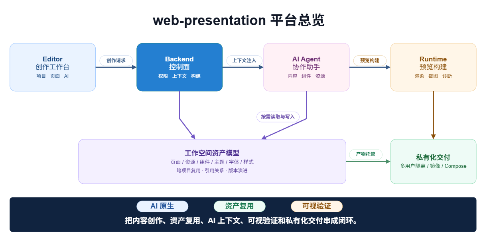
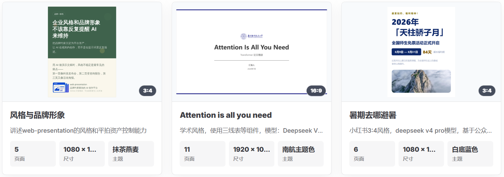

# web-presentation

English | [简体中文](./README.zh-CN.md)

`web-presentation` is an AI-native presentation authoring platform designed for creating slide decks, visual cards, thematic report pages, and data explanation graphics. It represents slide contents as code, consolidates media assets, components, themes, and styles into reusable workspace libraries, and provides immediate feedback through a Vue 3, Vite, and Runtime preview pipeline—empowering AI to excel at structured content generation, iterative layout refinement, styling adaptations, and multi-scenario asset reuse.

[Website](https://wp.llmxpm.com/) · [Showcases](https://wp.llmxpm.com/showcases.html) · [User Docs](https://wp.llmxpm.com/docs/user/)



## Key Features

- **Customizable Brand Styles**: Configure logos, typography, color palettes, aspect ratios, and multi-dimensional design tokens to meet specific organizational and enterprise branding requirements.
- **Consistent Style & Quality**: Enforce visual consistency across slide decks and pages through component reuse and structured design conventions.
- **Accessible Model Requirements**: Support custom models—models comparable to DeepSeek V4 Flash deliver viable drafts, while DeepSeek V4 Pro grade models produce polished, presentation-ready results.
- **Ultra-Low Cost**: Generate a complete 10-slide presentation for under ¥1 (~$0.15 USD).

## Core Capabilities

- **AI-Native Authoring**: Express page content as code and structured configurations; the Content Assistant inspects and mutates business objects across projects within the workspace via dedicated, fixed general-purpose tools.
- **Automated Layout Diagnostic**: Performs DOM-based automated detection for common AI layout defects (e.g. overflow, awkward text wrapping, element overlap) to enable autonomous AI self-healing.
- **Asset Abstraction & Reuse**: Accumulate media, components, themes, styles, and typography in workspace libraries, enabling PPT decks, visual cards, report pages, and display boards to share the same design foundation.
- **Rapid Visual Feedback**: The Runtime loads pages, components, and configuration bundles using Vue 3 and Vite, powering Editor features including live iframe preview, remote screenshot capture, component preview, and production builds.
- **Constrained Visual Editing**: Inspect Vue container hierarchies alongside rendered outputs to modify static text, component props, and controlled Tailwind styles via intuitive form controls.
- **Context Isolation & Injection**: The Backend injects only the essential context (project, page, component, asset specs) into the AI model, allowing it to focus on creative tasks without runtime overhead or implementation leaks.
- **Workspace-Scoped Content Assistant**: Eliminates the need to switch chat sessions across projects; sessions are workspace-bound, and each Run snapshot locks its current focus and project working set with explicit permission checks per target.
- **Isolated Visual Tooling**: Handles visual assets through stateless, single-turn vision analysis and durable background image generation tasks; the language model receives clean asset references while generated images are automatically ingested into workspace storage.
- **Centralized Platform Governance**: Multi-tenant management for users, workspaces, projects, pages, components, assets, themes, styles, AI configurations, and build artifacts.
- **Open Model Integration**: Synchronize chat models via Models.dev or connect custom OpenAI-compatible endpoints; image generation uses dedicated providers, credentials, and capabilities.
- **Self-Hosted & Private Deployment**: Easily deploy via a lightweight all-in-one SQLite container, multi-service Docker images, or Docker Compose templates, keeping your data, keys, and release workflows entirely under your control.

## Product Positioning

页面创建和源码编辑支持在同一次布局诊断中附带截图，保存后可按对应版本的内容 ID 直接下载或供视觉工具读取。附图失败单独表达，页面仍遵循原校验门禁；生成 PNG 不代表已经完成视觉、声音或交互验收。

Existing AI slide generation skills and tools demonstrate that AI excels at structuring content, visual layout generation, and code-based expressions.

| Approach | Typical Output | Key Advantages | Typical Boundaries / Limitations |
| :--- | :--- | :--- | :--- |
| HTML deck skills | Single-file HTML presentations | Consistent style, lightweight delivery, great for talks and cover/image extensions | Oriented toward one-off file generation; lacks team asset management, permissions, versioning, and object reference models |
| Native PPTX skills | Editable `.pptx` files | Preserves PowerPoint native shapes, text, charts, animations, and template replication | Emphasizes final PPTX fidelity; runtime capabilities and cross-project asset reuse are outside scope |
| Frontend slides skills | Zero-dependency HTML / Web slides | In-browser preview, rich styling, responsive design, smooth animations | Centered on local developer workflows; limited project-level context and long-term asset accumulation |
| `web-presentation` | Platformized pages, components, assets, and build artifacts | Workspace asset management, AI context injection, Runtime preview & build engine, multi-tenant isolation, self-hosted deployment | Tailored for ongoing projects and institutional asset reuse rather than a quick one-shot file export |

`web-presentation` occupies a distinct space: it is neither a one-off PPT prompt script nor a simple HTML-to-PPTX conversion utility. It is an **AI-native presentation platform**. It treats media, components, themes, styles, and typography as reusable workspace assets, expresses slide content as code, and enables continuous accumulation and reuse across decks and media types. The AI interacts with clean, isolated project contexts, page states, asset manifests, and component schemas—while the Runtime handles Vue 3 / Vite rendering, asset loading, and live preview, harnessing modern frontend capabilities without leaking runtime complexity to the AI.

## Architecture & Components

| Component | Role | Description |
| :--- | :--- | :--- |
| Editor | Authoring Studio | Web interface for managing workspaces, projects, pages, components, media assets, themes, and styles; includes code editor, form-based visual editor, AI assistant sidebar, and real-time preview |
| Backend | Control Plane | Manages authentication, permissions, workspaces, projects, pages, components, assets, themes, styles, AI agent orchestration, render scheduling, and artifact storage |
| Runtime | Preview & Build Engine | Vue 3 + Vite service rendering pages and components; handles live preview, screenshot host protocols, layout diagnostics, and static production builds |
| Renderer | Headless Browser Worker | Standalone asynchronous Playwright service for capturing high-fidelity screenshots and layout diagnostic scripts |
| Infra | Deployment & Infrastructure | Official Docker images, Docker Compose templates, backup/restore scripts, and runtime environment specifications |
| CLI | Command Line & Agent Skill | Dedicated repository [web-presentation-cli](https://github.com/LLMxPM/web-presentation-cli) provides the official `wp` CLI, dedicated API client, and agent skills |
| MCP | Remote MCP Server | Dedicated repository [web-presentation-mcp](https://github.com/LLMxPM/web-presentation-mcp) provides standard MCP protocol services (Work in progress) |

For detailed architecture, component boundaries, and local development workflows, refer to the [Developer Documentation](https://wp.llmxpm.com/docs/developer/).

## Showcase



Interactive Showcase: [View Live Showcase](https://wp.llmxpm.com/showcases.html)

All showcase presentations were generated using models like DeepSeek V4 Pro and Mimo v2.5 Pro at a total generation cost under ¥1 (~$0.15 USD) each.

## Online Demo

Access URLs, trial credentials, and AI configuration instructions for the public demo are maintained in the [Demo Guide](https://wp.llmxpm.com/docs/user/demo-guide.html).

## Quick Deployment

For individuals and small teams, we recommend the **SQLite Lite** edition: a single container bundling Backend, Editor, Runtime, Renderer (with Chromium), and reverse proxy gateway, using SQLite and in-process runtime storage. Administrator credentials and encryption keys are automatically generated on first launch.

With Docker installed and port `8080` available, run:

```bash
docker run -d \
  --name web-presentation \
  --restart unless-stopped \
  -p 8080:80 \
  -v web-presentation-lite-data:/app/backend/data \
  llmxpm/web-presentation:sqlite-lite

docker logs web-presentation
```

After the container starts, open `http://127.0.0.1:8080` and log in with username `admin` and the generated password from the container logs. The database, uploaded media, screenshots, build artifacts, and encryption keys are stored in the `web-presentation-lite-data` volume. Always retain and back up this volume during upgrades.

局域网或自定义域名部署使用 [Compose 模板](./deploy/compose/compose.sqlite-lite.yml)，配置 `BACKEND_PUBLIC_BASE_URL`、`RUNTIME_PUBLIC_BASE_URL` 和 `CORS_ORIGINS`。预览与私有构建会执行用户代码，`RUNTIME_PUBLIC_BASE_URL` 必须使用独立于工作台和 Backend 的主机名；本机示例为 `preview.localhost`，局域网需配置可解析到同一 Gateway 的预览域名，生产需配置对应 DNS / TLS。业务 Cookie 保持 host-only，业务 CORS 不包含预览域。参见 [生产部署说明](./docs/deployment/production/README.md) 和 [文件鉴权规划](./docs/developer/runtime-integration/file-storage-auth-cache-plan.md)。

## Documentation

| Document | Overview |
| :--- | :--- |
| [User Guide](https://wp.llmxpm.com/docs/user/) | Getting started, AI co-creation, workspace asset management, and export |
| [Deployment Guide](https://wp.llmxpm.com/docs/developer/deployment/) | Architecture options, environment setup, backup/recovery, upgrades, and troubleshooting |
| [Developer Guide](https://wp.llmxpm.com/docs/developer/) | Local development, system architecture, API specifications, and testing |
| [翻页动画与自动放映实施计划](./docs/developer/runtime-integration/slideshow/README.md) | Backend 配置契约、各模块实施计划和分阶段验收；M0–M2 已完成，M3 本地构建产物长稳已完成（未开放产品级远端无人值守） |
| [CLI 字体与主题配置实施规划](./docs/developer/cli-font-theme/implementation-plan.md) | 字体注册/字体族、主题图片与字体配置、跨仓工作包及验收；待实施 |

## Repository Structure

```text
web-presentation/
├── backend/                 # Backend control plane service
├── editor/                  # Editor authoring studio
├── runtime/                 # Presentation/page runtime engine (Vue 3 + Vite)
├── renderer/                # Remote headless Chromium rendering service
├── packages/                # Shared cross-service contract libraries
├── tests/                   # Monorepo contract tests and E2E smoke suites
├── docs/                    # User manuals, developer docs, and visual assets
├── scripts/                 # Development, testing orchestration, and contract linting scripts
└── deploy/                  # Compose templates, Dockerfiles, and backup/restore scripts
```

## License

The top-level code in this repository is licensed under the Apache License 2.0. See [LICENSE](./LICENSE).

`runtime/` contains the presentation runtime service and is licensed under the GNU Affero General Public License v3.0 (AGPLv3) as declared in its directory. See [runtime/LICENSE](./runtime/LICENSE).

External agent integration code is hosted in dedicated sibling repositories: [web-presentation-cli](https://github.com/LLMxPM/web-presentation-cli) (official `wp` CLI, dedicated API client, and agent skills) and [web-presentation-mcp](https://github.com/LLMxPM/web-presentation-mcp) (MCP server, work in progress). The core repository maintains the platform APIs, architecture, and integration contracts.
