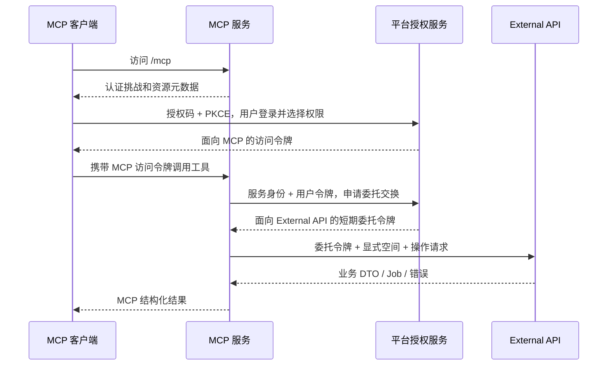

# 远程 MCP 主仓实施计划

规划日期：2026-10-03。状态：实施中（首批 M0 核对、M1 基础解耦、M3 契约发现）。OAuth 与远程 MCP 尚不可用；未标记完成的接口、模型、配置和测试仍为计划。

首批冻结边界、现状缺口及跨仓阻塞见[实施交接记录](./mcp-contract-handoff.md)。M0 按独立边界分项冻结，已冻结的 M1 基础解耦与 M3 可以推进；M2 仍需授权选型最小验证与真实客户端矩阵。

本计划负责 `web-presentation` 平台侧工作；MCP 工具、共享客户端和服务交付由 [agent-kit 实施计划](https://github.com/LLMxPM/web-presentation-agent-kit/blob/main/docs/mcp-implementation-plan.md)负责。平台现行接口仍以[External API v1 契约](./reference/external-agent-api.md)及实际代码为准。

## 1. 目标和交付范围

首期交付一个能远程部署、允许多个用户和客户端连接的 MCP 接入。用户通过平台授权后，外部客户端可以读取规范和资源、创建及编辑页面/组件、查询任务、发布组件、预览、截图和单项归档。

主仓本期只承担三个必要目标：

1. 提供面向远程 MCP 的用户授权与委托访问，使每次 API 调用具有明确的真实用户、授权客户端、空间和 Scope。
2. 让现有 External API 被 MCP 准确消费，补齐实际阻碍创作闭环的契约、鉴权或媒体问题。
3. 提供真实 Gateway、权限隔离和渲染链路的验收证据。

以下不作为首期前置条件：内部助手改走 HTTP、统一内外业务操作层、合并工具注册表、重构 AgentRun/ExternalBatch、二进制上传新通道、Build/Restore/图片生成、MCP Resources 和正式多副本支持。

内部工具的参数、上下文、写围栏和自动续跑保持现有职责。External Principal 的统一只针对 PAT 与外部委托身份，不扩展成内部 Agent 身份重构。

### 1.1 分期

| 阶段 | 平台目标 | 对外状态 |
| --- | --- | --- |
| P0 契约冻结 | 完成 M0；确定授权实现、候选路径、客户端矩阵、Scope 和版本 | 仍不可用，不对外开放 MCP |
| P1 远程只读 | 完成 M1～M3 的只读依赖和 M6 测试环境接入 | 受控联调版，支持授权、读取、撤销 |
| P2 创作闭环 | 完成 M4、M5 中首期必做部分和 M7 发布门禁 | 首期可交付；默认单项归档、文本资源和现有截图 |
| P3 扩展 | 批量确认、受控上传、多副本故障演练、更多客户端 | 按功能逐项验收后声明支持 |

多副本兼容的身份与状态边界从 P1 落实；P2 可以先发布单实例部署。不能把未完成多副本演练写成已支持。

## 2. 已核对的现状

| 已有能力/约束 | 代码入口 | 对实施的含义 |
| --- | --- | --- |
| External 鉴权只支持 PAT，Context 直接持有 PAT ORM 对象 | `backend/app/api/dependencies_external.py` | 先抽象外部访问主体，避免新增一套资源路由 |
| Scope、空间 Header、幂等要求集中注册 | `backend/app/core/external_operations.py` | 延用注册表，不新增 MCP 私有业务 Scope |
| whoami 读取 PAT 名称、到期时间和公共 ID | `backend/app/api/routes/external/system.py` | 新身份接入时兼容旧 PAT 响应，不伪造 PAT 记录 |
| 页面/组件有持久化 Mutation Job | `backend/app/models/api_mutation_job.py`、`backend/app/services/mutation_job_service.py` | 复用任务状态与租约，不增加 MCP Worker 队列 |
| 幂等唯一键为 user/workspace/operation/key | `backend/app/models/api_idempotency_record.py` | 刷新或交换 Token 不应制造新业务写入 |
| 资源、规范、预览、PNG、批量归档已存在 | `backend/app/api/routes/external/` | 优先适配和验证，不按 MCP 工具数量新增接口 |
| 截图 GET 可能等待队列生成最新 PNG | `backend/app/api/routes/external/pages.py` | 必须量测真实耗时，不能认为只是静态下载 |
| 内部工具目录和外部 DTO 不完全一致 | `backend/app/ai/tool_specs.py`、`backend/app/schemas/external_api.py` | MCP 参数以外部 DTO 为准，主仓不导出内部工具清单 |

已有批量归档入口不等于已有远程用户确认协议；已有平台登录也不等于已有 OAuth 授权服务。两者必须分别验收。

## 3. 跨仓职责和依赖

| 接口面 | 主仓负责 | agent-kit 负责 |
| --- | --- | --- |
| 用户授权 | 登录、授权页面、客户端规则、Grant、签发/刷新/撤销 | 受保护资源元数据、挑战响应、逐请求验证和委托交换 |
| External API | PAT/委托凭证校验、Scope、实时成员关系、对象归属 | 请求级凭证、空间 Header、错误与返回值适配 |
| 契约发现 | 实际 OpenAPI、capabilities、standards；必要时补元数据 | OpenAPI 解析、binding、guide、输入验证 |
| 重任务 | 入队、租约、版本复核、状态、取消、重试、幂等 | 返回 Job ID、有界查询、显式取消/重试 |
| 预览/截图 | Backend→Renderer→Runtime、短期 URL、PNG | MCP 文本、结构化结果和图片内容 |
| 部署 | 主仓 Gateway 集成、授权/API 配置、数据库迁移 | MCP 镜像、进程、连接池、HTTP transport、独立部署模板 |
| 确认扩展 | 若实施，提供持久化票据及原子消费 | 可信客户端用户交互、续接、禁止模型伪造确认 |

交接顺序：M0 与 A0 一起冻结契约；M1/M2 与 A1/A2/A3 可按明确契约并行开发；P1 联调通过后接入 A4；M4/M5 与 A5/A6 共同验收创作闭环；M6/M7 与 A8/A9 交付。工作包 ID 仅用于追踪依赖，不能用一仓测试通过代替另一仓验收。

## 4. 授权链路与候选接口契约

本节是 P0 的默认设计，路径、字段和期限均需 M0 核对并冻结后才成为实现契约。若成熟 OAuth 实现要求不同协议路径，以其标准兼容入口为准，两仓同步更新；不得边实现边让客户端猜测。

### 4.1 身份流向



MCP 与 External API 是两个受众。令牌交换是本项目为保留用户身份选择的方案，并非 MCP 协议要求所有实现都必须使用 Token Exchange。授权与资源发现依据 [MCP Authorization](https://modelcontextprotocol.io/specification/2026-07-28/basic/authorization)，交换协议参考 [RFC 8693](https://datatracker.ietf.org/doc/html/rfc8693)。

### 4.2 候选路径和责任

以下均为拟新增；业务管理接口继续使用 `/api/v1`，OAuth 标准协议与 `/.well-known/*` 使用授权实现规定的发现路径，不当作业务 API 前缀的替代品。

| 候选入口 | 调用方与认证 | 输入/输出要点 | 失败语义 |
| --- | --- | --- | --- |
| `GET /.well-known/oauth-authorization-server` | 公开 | issuer、authorize/token/revoke 等端点、支持的资源/PKCE/客户端规则 | 不能返回 SPA HTML 或内部不可达地址 |
| `GET /oauth/authorize` | 浏览器、平台登录 | client_id、精确 redirect_uri、resource、scope、PKCE S256、state；授权后返回 code | 未注册客户端、错误 redirect/resource 不进入正常回调 |
| `POST /oauth/token` | OAuth 客户端或 MCP 服务身份 | 标准表单；授权码兑换、refresh、委托交换三个受控分支 | 标准 OAuth 错误，不能混用平台业务 envelope |
| `POST /oauth/revoke` | 令牌所属客户端 | 撤销令牌/刷新链；幂等效果和关联 Grant 行为在 M0 冻结 | 不暴露其他客户端的令牌存在性 |
| `POST /oauth/introspect` | 仅已登记的 MCP 服务身份 | active、subject、audience、scope、grant/client、期限 | 校验失败/服务不可用时禁止放行业务 |
| JWKS 发现地址（采用 JWT 时） | 公开 | 仅公钥、kid 和固定算法信息 | 未知 kid 刷新有界，不能回退任意算法 |
| `GET /api/v1/account/external-grants` | 平台账户登录 | 当前用户的客户端授权、空间、Scope、创建/撤销信息 | 不能列出其他用户授权 |
| `POST /api/v1/account/external-grants/{grant_id}/revoke` | 平台账户登录 | 撤销指定授权，重复请求仍保持撤销结果 | 用户归属校验；不采用外部业务 Token 管理账户授权 |

登录后的授权页展示客户端身份、目标服务、请求 Scope、所选空间和有效期策略。空间来自实时成员关系；首期默认授权具体空间集合，不默认为未来加入的所有空间。授权提交端点由 OAuth 实现和现有 Editor 登录方式决定，必须具备 CSRF/请求绑定，不能让模型参数代替用户选择。

MCP 侧的资源元数据由 agent-kit 提供，Gateway 按最终资源 URI 路由。授权页面、元数据和 Token 不得从任意 `Host`/转发 Header 拼出 issuer；公网 origin、issuer、MCP resource、API audience 必须显式配置并在启动时校验。

### 4.3 委托交换契约

请求采用 `grant_type=urn:ietf:params:oauth:grant-type:token-exchange`，携带 `subject_token`、对应 `subject_token_type`、目标 resource/audience、请求 scope；MCP 另以登记的服务身份认证。实现只接受本站签发、面向指定 MCP 的用户令牌，且目标只能为配置中的 External API。

交换结果使用标准 `access_token/token_type/expires_in/issued_token_type/scope` 字段；不向 MCP 签发用户刷新令牌，不允许再交换为更大权限或其他服务令牌。MCP 服务身份本身不拥有业务工作空间权限。

External 委托主体至少能够确定：`user_id`、`grant_id`、原授权客户端 ID、执行交换的 MCP 服务 ID、授权空间集合、业务 scopes、issuer/audience、到期时间。JWT claim 名称或 opaque token introspection DTO 在 M0 固定，不能由两个仓库各写一版。

P0 默认建议：授权码 60 秒一次性，MCP 访问令牌 15 分钟，委托令牌最长 60 秒且不得晚于源令牌到期；刷新令牌轮换并检测重复使用。以上为待验证的配置基线，不是现有保证，刷新会话最长时限和清理保留期也必须在 M0 冻结。

### 4.4 撤销与任务边界

- 首期不依赖 Token 自然过期实现撤销：MCP 每请求进行有效授权检查，Backend 每业务请求复核 Grant、用户及实时成员关系。默认不缓存可放行的 Grant 状态；故障时拒绝，后续优化需给出并测试最大延迟。
- 撤销成功后的新请求必须被拒绝；并发请求以实际授权检查/事务边界判断，不能承诺撤销能回滚已经提交的数据。
- 已被 Backend 接受的持久 Job 不因 MCP 断连、Token 到期或撤销自动取消，沿用平台领域队列的权限、取消和写入约束；用户需要时显式取消。P0 核对现状并把这一语义写入授权页说明与任务文档。
- Job 的查询、取消和重试仍按当前请求身份、空间及真实 job_type 鉴权；不得允许新授权读取旧空间任务。授权撤销后的管理处理使用平台已有账户/管理员路径，不能复活委托令牌。

## 5. M0：冻结跨仓契约和发布范围

优先级 P0；依赖无；交付给 agent-kit A0/A3。此工作包结束后才开发依赖尚未存在的接口。

- [ ] 逐条核对 agent-kit binding 需要的真实方法、路径、视图、DTO、Scope、workspace Header、幂等要求与同步/Job 返回。记录现有可用、需补契约、首期排除三种状态。
- [ ] 选定成熟 OAuth 授权实现并完成最小验证：能接平台登录/用户、PKCE、resource audience、预注册客户端、刷新/撤销、服务端交换和多进程存储。依赖许可证、版本、维护状态和适配成本有记录；禁止手写整套授权协议。
- [ ] 与 A0 确定首批真实客户端及版本；至少有一个真实宿主完成验证。SDK 测试客户端只算协议覆盖，不算产品兼容证据。
- [ ] 冻结第 4 节候选契约：协议路径、issuer/resource/audience、客户端注册方式、错误、scope 不扩大、空间选择、期限和撤销边界。
- [x] 冻结 whoami 兼容方式、需要补齐的响应 Schema、OpenAPI 扩展是否必要；结果见实施交接记录，M3 已实现主仓响应和扩展。
- [x] 确认 P2 默认单项归档；批量确认单列扩展，缺少可信交互不阻塞其他创作能力交付。
- [x] 在交接记录中登记双方基线 commit、版本和待实施项，不把本文候选接口提前写成现行 API。

退出条件：两仓可以仅根据同一契约构造请求和正反例；所有未冻结项都有明确阻塞的工作包，不能只有“联调时再看”。

## 6. M1：外部访问主体与 PAT 兼容

优先级 P1；依赖 M0 的主体契约；可与 M2 授权存储并行。

实施落点：`api/dependencies_external.py`、`schemas/external_api.py`、`api/routes/external/system.py`；按职责新增外部身份模型/服务，避免鉴权依赖文件持续膨胀。

- [x] 定义不可混用的认证来源 `pat/delegated`，公共业务属性为用户、空间授权、scopes、有效期及审计来源；PAT 专属字段放到兼容适配中。
- [x] 保持 `require_external_operation`、动态 Mutation 权限和 `ensure_workspace_access` 的统一入口，不复制一套 OAuth 专用资源路由。
- [ ] 明确 Bearer 类型分派规则；PAT 验证失败不能尝试用宽松 JWT 规则再次放行，反之亦然。
- [x] whoami 保留 PAT 已有字段及含义；委托身份使用明确的 credential/grant 信息，不能返回一个看似存在的 PAT ID。新增字段/可空性由 DTO、PAT 回归和已验证主体适配测试确认；真实委托 Token 验收仍依赖 M2。
- [ ] capabilities 的既有 operations 字符串列表保持兼容；主体改变不能隐式增加 read/write Scope，也不能把 all/any 要求错误合并。
- [ ] 日志只记录公共凭证/Grant ID 和主体来源，不记录 Bearer、授权码、刷新令牌。

验收：同一用户同一空间同一 Scope 的 PAT 与委托请求具有一致业务权限；不同空间、退出空间、缺 Scope、伪造来源、错误 audience 均失败；旧 CLI whoami/doctor/资源/Job 流程无回归。

## 7. M2：授权服务、存储和账户页面

优先级 P1；依赖 M0；与 M1 合并后联调 A3。

### 7.1 持久数据职责

以下是领域对象而非要求手写固定 SQL 表；优先沿用选定 OAuth 实现的持久化模型和事务能力。

| 对象 | 至少保存/约束 |
| --- | --- |
| 客户端登记 | client_id、精确回调集合、允许资源、认证方式、状态；public client 不配置假共享 secret |
| 用户 Grant | user、client、空间集合、Scope、授权版本、创建/撤销时间；无原始 Token |
| 授权码 | 摘要、PKCE、redirect/resource/client 绑定、期限、一次性消费状态 |
| 刷新链 | token 摘要、family、上代关联、轮换/撤销状态、有效期；重放时使关联链失效 |
| MCP 服务登记 | 可交换的 source resource、目标 API audience、服务凭据/密钥引用、状态 |
| 审计记录 | 授权、拒绝、撤销、交换失败、刷新重放；关联公共 ID，限定保留期 |

- [ ] 编写数据库迁移、升级/回滚说明和过期记录清理；遵循 UTCDateTime、CAS 和主仓数据库适配边界。
- [ ] 授权码消费、刷新轮换支持并发竞争且只有一个请求成功；跨副本不依赖 Python 字典或进程 Session。
- [ ] 采用 JWT 时复用平台受控签名设施并隔离 audience/用途，明确 kid 轮换、算法白名单和旧钥退出；不能与预览票据混用验证条件。
- [ ] 授权页和账户授权管理页遵循 `DESIGN.md`，显示可理解的权限说明、具体空间、拒绝和撤销入口。
- [ ] 预注册客户端即可启动首期；其他注册发现机制只有在目标客户端确有需要时纳入 M0，不建设开放的任意客户端注册平台。
- [ ] 用户停用、Grant 撤销、客户端停用、退出空间和 Scope 缩减均有明确即时检查点。

验收：真实客户端完成首次授权、拒绝、重复登录、刷新和撤销；错误 PKCE、授权码重放、回调替换、resource 替换、Scope 扩大、跨用户 Grant 管理失败；两个 Backend 实例并发消费测试不得双成功。

## 8. M3：External 契约可发现性

优先级 P1；依赖 M0 的映射清单；不依赖内部助手改造。

- [x] 核对首期依赖的现有 87 个 HTTP 方法/路径组合，补齐源码、草稿、依赖、资源差异、单项归档与 PNG 的实际响应缺口；A1/A4 binding 对拍仍待 agent-kit 实施。
- [x] page.get 的详情/源码/版本、component.get 的详情/草稿/版本等按真实路由验证；operation 主路径不能代替所有视图。
- [x] 采用版本 1 的 `x-wp-operation`，从现有 operation 和真实鉴权依赖派生 Scope、模式及 Header/幂等要求；动态 Job 路由声明按真实 job_type 解析。
- [x] 不建立第二份手工 route→scope 清单，不提供内部 `/guides` 镜像，不复制 `tool_specs.py`。
- [x] 公开 OpenAPI 可跨用户共享；认证后的 External 成功响应使用 private, no-store，规范与 capabilities 保持原有鉴权。
- [x] 源码读取提供完整内容与编辑基线；长源码与草稿版本/hash 对拍测试覆盖，不截断。

验收：从当前 Backend 生成 OpenAPI，agent-kit 所有已启用 binding 的请求、成功响应和引用均可解析；从真实 Gateway 获取的文档同样通过。缺字段时修正 API 契约，不能让 MCP 写本地 DTO 兜底。

## 9. M4：创作任务、幂等和版本语义

优先级 P2；依赖 M1/M2；以现有 Mutation 实现为基础，主要工作是委托身份覆盖与缺口修复。

- [ ] 页面创建/edits、组件创建/edits/重元数据继续入持久队列；轻元数据、发布、单项归档保持现有同步语义。
- [ ] 为目标权限分别验证提交、查询、取消、retry；动态 Job 权限取真实 job_type，不能由调用方指定 resource_type 决定。
- [ ] 记录业务 operation key 与实际幂等存储 operation 命名空间的映射。现有别名路由、批量归档可能复用服务层命名，不能假设与注册表字符串完全相同，更不能无迁移地改名导致重放失效。
- [ ] 保持 user/workspace/operation/key 唯一边界；Token 刷新、换 MCP 副本、响应丢失后的同请求同键返回原结果。同键异载荷返回冲突，不能再入队。
- [ ] 基线冲突后不自动升版本重试；组件 `base_version_no/base_draft_hash` 以 External DTO 为准。
- [ ] 请求断连仅结束请求，已受理 Job 可再次查询；running 取消仍需在业务提交前遵守现有租约和取消检查。
- [ ] 人工 retry 产生新 Job 并关联原任务，保持原基线和可重试限制；仅查询到 failed 不等于查询请求失败。

验收证据应包含：重复请求只产生一个 Job/版本、提交成功但客户端收不到响应后的恢复、Token 刷新后重放、读写 Scope 分离、错误空间 Job 访问、组件草稿冲突、取消与完成竞争、重试新 ID。不要为 MCP 引入内部 ExternalBatch 自动续跑。

## 10. M5：预览、截图和有条件扩展

### 10.1 P2 必做：现有媒体链路

- [ ] 真实调用页面/项目 preview-artifact，确认返回公网可访问的短期地址、到期时间和当前资源权限；不能只验证 Backend 直连 URL。
- [ ] 量测页面 screenshot 的冷/热路径、队列繁忙和并发耗时；记录 PNG 大小、页面版本、API/代理/宿主截止时间。
- [ ] PNG 下载仍走 Backend 鉴权，不向 MCP 暴露 Runtime/Renderer 控制地址或服务器路径。
- [ ] 若现有 screenshot 无法在首批宿主预算内可靠返回，则异步截图契约成为 P2 阻塞项：先冻结提交/查询/下载路径、Scope、状态、幂等与版本语义，再复用既有 render_requests。未量测前不另建队列。

### 10.2 P3：批量归档确认

首期 MCP 只开放单项归档。批量接口本身已存在，可信用户交互、持久确认和原子消费完成后才启用 MCP 批量分支。

- [ ] 冻结确认记录：user/grant/client/workspace、资源类型、规范化目标列表和业务载荷摘要、期限、状态、一次性消费、幂等关联。
- [ ] 明确接受证据来自已认证 MCP 服务转交的受支持客户端用户交互；普通工具 payload 的 `confirmed=true` 不构成证据。更高信任要求时使用平台托管确认页。
- [ ] 准备、确认、执行的候选 API 单独写契约；确认记录不能替代最终权限检查。最终执行应把票据消费、幂等记录和整批归档纳入受控事务。
- [ ] 对委托来源强制检查批量确认，防止跳过 MCP 直接调用 batch API；PAT 兼容策略单独明确，不悄悄改变 CLI 现有行为。
- [ ] 幂等重放返回原执行结果，不因票据已消费误报失败；新键重放已消费票据拒绝。任何一项越权/冲突导致整批失败。

不支持可信确认的客户端不开放批量；不得把批量请求拆成多个单项以规避确认。项目归档继续不级联归档页面、路由或共享资产。

### 10.3 P3：二进制上传

仅在文本资源和资产 ID 不足以支撑真实场景时启动。计划包括：绑定用户/空间的上传会话、大小/MIME/期限约束、传输和完成确认、内容校验、清理与审计；返回平台资产 ID。不得接收服务端本地路径或任意 URL 抓取作为替代。新路径和 DTO 在功能启动前冻结，不预造通用附件体系。

## 11. M6：配置、Gateway、可观测性与回退

优先级 P1～P2；P1 先提供联调入口，P2 完成发布配置。

- [ ] 在现有部署模板中接入 `/mcp` 及准确的资源发现路由；授权端点和 `/openapi.json` 不落到 Editor SPA fallback。
- [ ] TLS、公网 issuer、MCP resource/API audience、回调白名单、MCP 服务认证、限流/请求体/代理超时有明确配置；密钥通过受控 Secret 注入，不写在仓库示例中。
- [ ] 只信任配置的代理转发 Header；Origin/Host 策略由 Gateway 与 MCP 一致实施，CORS 不作为用户认证替代。
- [ ] OAuth 发现和挑战 Header、MCP JSON/流式响应、外部 API request ID/Retry-After 穿透真实 Gateway。
- [ ] 授权/交换/业务调用串联 trace/request ID；记录 grant/client/workspace/operation/job 与结果，不记录 Token、源码全文、图片 Base64 或带签名预览 URL。
- [ ] 数据库迁移先加后用；先部署兼容 PAT 的授权/API，再部署 MCP。主仓旧版缺少必需契约时 MCP 明确拒绝启动/就绪，不静默降级成共享 PAT。
- [ ] 回退顺序为关闭 MCP 入口或撤销 MCP 服务授权，再回退 agent-kit；不删除已提交业务结果和 Job。主仓回退要考虑新表/字段数据与委托令牌存活期，避免破坏 CLI。

P2 单实例发布也需要连接/等待预算、健康检查、令牌轮换和停止接收新调用的说明。正式多副本扩展按主仓专属 Docker 演练环境验证，不使用开发数据。

## 12. M7：测试、交接与发布验收

### 12.1 测试分层

| 层次 | 首期必须覆盖 |
| --- | --- |
| 单测 | 主体归一、Scope all/any、audience、撤销、授权码/刷新并发、幂等边界 |
| API | PAT/委托正反例；两用户两空间；whoami/capabilities/规范隔离；Job 动态权限 |
| 数据库 | 新迁移、原子消费、刷新轮换、既有幂等并发；适用 SQLite/PostgreSQL 配置 |
| 契约 | 当前 OpenAPI 引用、响应类型、Headers、向后兼容；与 agent-kit binding 对拍 |
| Gateway | 真实 Nginx 返回 JSON、认证挑战、OAuth 发现、MCP 转发、PNG 与短期 URL |
| E2E | 真实客户端授权→页面/组件创作→Job→编辑→预览/PNG→撤销 |

复用测试入口：`backend/tests/api/test_access_tokens.py`、`test_external_api_v1.py`、`test_external_contract_gaps.py`，以及 `backend/tests/unit/test_api_access_tokens.py`、`test_idempotency_service.py`、`test_mutation_job_service.py`。新增授权专题测试按职责拆分，不把全部场景塞进一个文件。

### 12.2 实施时命令

以下是未来相应代码变更的验证要求，不代表本次文档编写已执行：

```powershell
# External 身份与业务回归，按实际修改增加授权专题测试文件
uv run --project backend pytest -c backend/pyproject.toml backend/tests/api/test_access_tokens.py backend/tests/api/test_external_api_v1.py backend/tests/api/test_external_contract_gaps.py
uv run --project backend pytest -c backend/pyproject.toml backend/tests/unit/test_api_access_tokens.py backend/tests/unit/test_idempotency_service.py backend/tests/unit/test_mutation_job_service.py
# HTTP DTO 变更
pnpm run codegen:editor-api
pnpm run test:contracts:generated
# 授权页面变更
pnpm run test:editor:gate
# External API/Gateway 与发布门禁
pnpm run test:contracts
pnpm run test:contracts:gateway
pnpm run test:repository
```

预览/截图变更按影响补 integration 与 `pnpm run test:render-e2e`；发布后使用 `scripts/contracts/check-gateway-openapi.py` 从外部 Gateway 验证。OAuth/MCP Gateway 场景需扩展专门断言，现有 OpenAPI Nginx 测试通过不能替代它们。命令参数以当时脚本帮助为准。

### 12.3 交接记录模板

每个可交付批次在 PR/发布记录中填写：

| 字段 | 必填内容 |
| --- | --- |
| 工作包 | M/A 编号、完成项、明确延期项 |
| 版本 | 主仓 commit/镜像、agent-kit commit/版本、MCP SDK/协议、客户端名称及版本 |
| 契约 | 新增/变更路径、DTO、Scope、错误、幂等、最低兼容版本、生成 OpenAPI 摘要 |
| 环境 | Gateway、Backend、Renderer、Runtime 拓扑和脱敏配置；数据隔离方式 |
| 证据 | 测试命令、结果、真实用户隔离和创作流程；PNG/Job/请求关联 ID |
| 发布 | 迁移顺序、健康检查、回退、未支持能力和已知限制 |

### 12.4 完成定义

- [ ] 至少一个真实客户端通过远程授权完成创作闭环，并与另一用户交错调用验证隔离。
- [ ] CLI PAT 兼容；内部助手工具注册、围栏和续跑未被 MCP 接入改造。
- [ ] 各类令牌受众正确，撤销后新请求拒绝，业务 Job 生命周期明确。
- [ ] 真实 Gateway 契约与 Backend→Renderer→Runtime PNG 链路通过。
- [ ] 文档只声明已验收功能；更新主仓 MCP 集成页、External API、部署/发布清单与 README，agent-kit 同步版本和最低主仓要求。

## 13. 工作包总表

| ID | 交付物 | 依赖 | 验收方 | 状态 |
| --- | --- | --- | --- | --- |
| M0 | 冻结契约、授权实现选型、首批客户端矩阵 | 无 | 两仓 | 进行中；M1/M3 边界已冻结，授权最小验证/真实宿主待办 |
| M1 | External Principal、PAT/委托兼容 | M0 | 主仓 API + A3/A4 | 基础解耦完成；真实委托认证/撤销与对等验收待 M2 |
| M2 | OAuth、Grant、账户授权 UI、撤销 | M0；联调依赖 M1 | A3 真实授权 | Authlib 协议/存储及自省撤销交换核心实现；公开授权、账户 UI、PG/真实宿主验收待办 |
| M3 | OpenAPI/响应/自省缺口修复 | M0 | A1/A4 契约对拍 | 主仓首批实现完成；agent-kit binding 与实际 Backend Gateway 对拍待办 |
| M4 | 委托身份的创作、Job、幂等验证 | M1/M2 | A5 | 待实施 |
| M5 | 预览和截图预算/实机验证 | M1/M2 | A6 | 待实施 |
| M6 | Gateway、配置、观测、升级回退 | M0，随 P1/P2推进 | A8/A9 | 待实施 |
| M7 | 跨仓完整验收和发布记录 | M1～M6 与 agent-kit 首期实现；与 A9 联合执行 | 两仓 | 待实施 |
| M5 扩展 | 批量确认、上传、必要的异步截图 | 各自冻结契约 | A7/P3 | 待实施；异步截图按量测可能升级为 P2 阻塞项 |

原规划提交只创建工作清单；当前各批次实现与验证证据见实施交接记录。未验收项目不得提前写成已支持。
