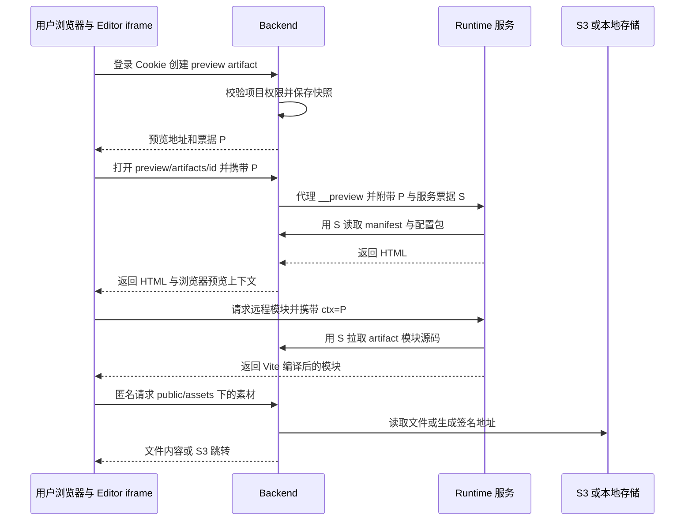
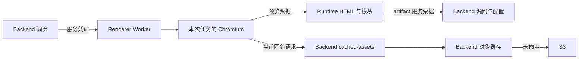
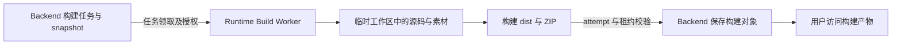
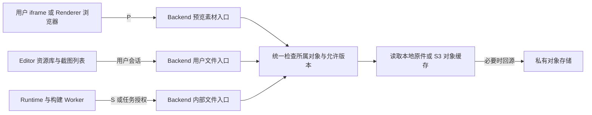

# 用户文件存储鉴权与缓存实施规划

状态：实施中，2026-10-16 修复复审发现的链路与缓存问题。代码验证、生产桶策略、真实 S3 兼容服务和多副本部署验收分别记录，不能将单元测试通过等同于 W01～W12 全部完成，也未开展生产计费周期观测。

本规划覆盖 Editor、Backend、Runtime、Renderer 与 S3 / 本地存储之间的文件访问，重点解决预览、截图、构建使用不同身份读取同一资源的问题。实施目标是关闭用户文件的匿名读取入口，在不破坏渲染链路的前提下保留服务器缓存和浏览器条件缓存。

第一阶段采用以下方案：

- 用户文件默认私有；公开发布必须是独立、明确的业务动作。
- 用户操作由登录会话授权；预览按 artifact 授权；后台执行按任务和 attempt 授权。
- 预览素材通过 Backend 受保护文件入口交付，复用现有对象缓存，不要求提前复制全部素材到 Runtime。
- 保留 Runtime 远程虚拟模块机制，补齐素材权限及缓存命中前的鉴权。
- 私有文件默认允许浏览器保存，但复用前校验票据或当前会话权限；敏感附件使用 `no-store`。
- 保留 Backend 对象缓存服务截图、构建和 ZIP 文件读取；本地存储不额外复制一份缓存。
- 暂不为用户私有资产统一接入 CDN，也不先建设分布式文件缓存。
- 先完成受保护链路和消费者迁移，再整体关闭旧公开入口；不得以失败后回退公开 URL 保持兼容。

## 1 范围与术语

### 1.1 三种文件与三种缓存

| 对象 | 内容 | 当前主要位置 |
| :--- | :--- | :--- |
| 页面与组件源码 | Vue 源码、版本记录 | 主数据库；预览时生成运行态快照 |
| 预览 artifact | manifest、配置包、模块源码、资源引用 | Redis / Lite 内存运行态，默认生存期 3600 秒 |
| 二进制与资源文本 | 图片、字体、视频、图标，以及 drawio / mermaid / chart / formula 文件 | S3 或 Backend 本地对象目录 |
| Runtime 缓存 | manifest、Vite 模块编译结果、生成的 CSS | Runtime 进程缓存 |
| Backend 对象缓存 | 已从 S3 下载的文件副本 | Backend 对象根目录下 `_object-cache` |
| 浏览器缓存 | 浏览器已经接收的 HTTP 响应 | 用户浏览器或本次 Renderer 浏览器上下文 |

Runtime 服务端拉取源码，与浏览器中运行的 Runtime 页面加载图片，是不同的请求链路。页面由 Runtime 渲染，不意味着所有文件都通过 Runtime 服务端传输。

预览 artifact 固化内容身份，不能被当作用户权限本身。文件 hash 用于确定字节内容，也不是访问凭证。

### 1.2 本期边界

本期覆盖现有资产、工作空间字体、页面截图、AI 图片附件、临时模板预览、构建产物以及相关内部回源。三维模型与通用音频等未落地资产类型不纳入首期，但新增类型必须复用本规划的授权与版本规则。

对象存储厂商选型、跨云迁移、全球 CDN、计费系统和即时撤回已下载文件不属于本期。源站与预览页面的 Cookie 隔离、旧链接迁移和真实 Renderer 验收属于本期发布边界。

## 2 迁移前文件清单与访问问题

本节和第 3 节保留迁移前基线，不能作为当前公开入口说明。当前 `/media`、`/public` 均关闭；实际修复后的交付路径如下：

| 消费者 | 当前交付与授权 |
| :--- | :--- |
| Editor 资源库与截图 | 用户会话 / External API 身份 → 业务权限 → 固定资源 hash 或截图内容 hash → 条件读取 |
| Editor 内预览和独立预览 | Backend 校验 P、绑定 Runtime 版本 → 可信宿主页 → 独立主机名的 Runtime iframe；业务源站不运行用户 HTML |
| Runtime 页面与 Renderer 浏览器中的素材 | `/preview/artifacts/{id}/assets/{hash}?token=P`；即使启用 Backend 对象缓存，浏览器也只使用 P 入口 |
| Runtime 模块与配置回源 | S → Backend 内部 artifact 接口；每次模块 HTTP 请求先验证 P 与 artifact，再允许 Vite 缓存响应 |
| 构建 / 诊断 Worker 下载素材 | S → `/internal/runtime/preview-artifacts/{id}/assets/{hash}`；仅向配置的内部 Backend 发送 S，拒绝重定向 |
| 浏览器 snapDOM 导出回源 | 校验 P 与 manifest 白名单；忽略票据变化进行 URL 身份比对，Backend 素材转换到内部 S 端点，拒绝重定向 |
| 模板临时素材 | 同一 artifact 的 P 入口；不再生成旧 template-package-assets URL |
| 私有构建浏览 | 用户申请短票据 → 独立预览主机名 → 按 project/job 作用域 Cookie；每个子资源由 Backend 校验 |

新截图写入 `page-screenshots/{page}/objects/{sha256}.png`，URL 中的截图 ID 为内容 hash。旧可变 key 暂按 `latest` 读取，绕过不可变对象缓存并按实际字节计算 ETag；不把旧时间戳解释成 Job ID，也不伪造历史记录。

| 文件类别 | 当前存储或对象前缀 | 当前访问方式 | 目标权限 |
| :--- | :--- | :--- | :--- |
| 用户图片、视频、图标及资源文本 | `assets/{workspace_id}/{hash}{ext}` | `/public/assets/{workspace_id}/{hash}` 匿名；本地返回文件，部分 S3 文件跳转，部分文本 / SVG 由 Backend 代理 | 工作空间权限，或 artifact 声明的资源权限 |
| 工作空间上传字体 | 同资产；S3 驱动可能按扩展名分流到公开字体桶 | 可返回 `S3_PUBLIC_BASE_URL` 地址 | 默认私有，禁止仅凭字体扩展名判为公共 |
| 平台内置字体与前端静态文件 | Runtime / Editor 随版本交付 | 静态 URL | 可以公开，内容版本化 |
| 截图和构建使用的素材 | 同资产；S3 可派生本地缓存 | `/public/cached-assets/{workspace_id}/{hash}` 匿名 | 预览或任务授权；缓存不扩大权限 |
| 页面截图 | `page-screenshots/{page}/v{version}/{config_hash}/{size}.png` | `/public/page-screenshots/{page_id}` 匿名，读取当前指针，响应为一年 immutable | 页面权限；URL 绑定具体截图产物 |
| AI 上传与工具输出图片 | `ai-agent-attachments/...`、`ai-agent-tool-images/...` | 用户内容接口已有身份与附件范围检查；模型通过临时地址或字节接收 | 保留用户 / 会话约束，模型使用单对象临时授权 |
| Renderer 运行产物 | Worker attempt 临时目录；Backend 保存到 `render-results/...` | Worker 内部产物 API 使用服务凭证 | 仅对应任务；用户不能直接访问 Worker |
| 构建 ZIP | `build-artifacts/{project}/{job}/attempts/{attempt}/dist.zip` | ZIP 下载接口有用户鉴权；`/build-artifacts/...` 静态内容入口匿名 | 私有构建访问与公开发布分离 |
| 模板包预览素材 | Runtime artifact 的临时 blob | `/public/template-package-assets/{artifact}/{hash}` 匿名，`private, max-age=300` | 同一 artifact 的预览票据 |
| 模板包导出 | 根据项目数据即时组装 | 已经由业务接口校验权限 | 保留业务鉴权，按下载类型设缓存头 |
| 数据库、签名密钥、备份 | 运维目录或 secret 挂载 | `/media` 整目录入口已移除 | 永不进入文件分发与 CDN |

相邻问题也要纳入关闭检查：`/api/runtime/projects/{project_id}/configs/{file}` 当前公开读取项目配置，不能在保护源码和素材后仍从配置接口泄露项目内容。

当前主要缺口如下：

1. 管理 API 有工作空间权限检查，但多个实际文件入口不检查身份。
2. 私有 S3 桶前面存在匿名签发下载地址的 Backend 接口，无法构成业务访问控制。
3. 当前素材 hash 查询不能表达“本次预览只允许这些版本”，也不能单靠资源 active 状态处理历史快照。
4. 截图 URL 中的 `v` 没有绑定返回对象；读取当前截图指针与长期 immutable 响应不一致。
5. 用户退出登录、工作空间成员变更和预览 JWT 到期是不同机制，不能把现有 JWT 描述成实时权限检查。
6. 关闭公开入口会同时影响用户 iframe、Renderer 浏览器、Runtime 构建 Worker、浏览器导出和外部客户端，必须联动迁移。

相关实现见 [公开资源路由](../../../backend/app/api/routes/public_assets.py)、[存储驱动](../../../backend/app/services/asset_storage_drivers.py)、[对象存储服务](../../../backend/app/services/object_storage_service.py)、[构建静态入口](../../../backend/app/api/routes/build_artifacts.py) 和 [Runtime 配置入口](../../../backend/app/api/routes/runtime_configs.py)。

## 3 迁移前预览截图与构建链路

### 3.1 单页与整项目预览

Editor 使用同一个创建 preview artifact 接口。单页指定模块入口，整项目指定路由入口；两者都不等于项目构建。



P 是浏览器可持有的预览上下文票据，S 是 Runtime 回源 Backend 的服务票据。当前 S 绑定 artifact，读取 manifest、配置包和模块；服务票据不能注入 HTML 交给用户页面。

当前 Runtime 从 Backend 取回源码后，作为远程虚拟模块交给 Vite。普通预览没有先下载所有素材到 Runtime 临时工作区。浏览器的资源解析器根据 manifest 把逻辑资源名转换为 Backend 文件 URL，工作空间字体也沿用该解析机制。

实现入口见 [Editor 预览 API](../../../editor/src/api/preview.ts)、[Backend 预览代理](../../../backend/app/api/routes/preview.py)、[Runtime 预览插件](../../../runtime/src/core/plugins/runtime-saas-preview.ts) 和 [浏览器资源解析](../../../runtime/src/core/utils/path.ts)。

### 3.2 页面截图



页面截图服务选择 `asset_delivery_mode="backend_cache"`。Renderer 浏览器加载 Runtime 页面，同时通过 Backend 的缓存资源接口读取图片和字体。这里的文件缓存位于 Backend。

Renderer 每个 attempt 新建 Chromium 与 Context，不跨任务复用用户浏览器缓存。它只向初始预览文档请求附加预览鉴权头，不向任意图片、字体或外部站点传播这些头。因此，不能用“给公开素材接口加用户 Cookie 校验”完成迁移。

截图输出由 Renderer 写入 attempt 临时目录；Backend 通过受保护的 Worker 产物接口读取、校验并保存到对象存储，再由页面截图服务关联页面。用户查看已生成截图是独立的页面文件读取授权。

浏览器内 snapDOM / PDF / PPTX 导出还存在 Runtime 素材代理分支：该代理验证预览票据与 manifest URL 白名单后回源。它不是 Renderer 的普通图片加载路径，也必须随素材入口改造一起验证。

实现见 [页面截图服务](../../../backend/app/services/page_screenshot_service.py)、[Renderer 浏览器执行器](../../../renderer/wp_renderer/engine/executor.py)、[渲染协调器](../../../backend/app/services/rendering/coordinator.py) 和 [Runtime 素材代理](../../../runtime/src/core/plugins/runtime-snapdom-resource-proxy.ts)。

### 3.3 项目构建及构建结果浏览

构建 Worker 领取任务后，拉取 snapshot 和模块源码，将源码写入临时工作区；随后下载 manifest 声明的素材，写入临时工作区 `public` 目录，执行 Vite 构建、ZIP 打包与上传。这才是完整的文件落盘流程。



源码与任务控制已有内部授权，`fetchAssetBinary()` 当前却通过公开素材 URL 下载，没有附带授权头。未来关闭公开素材入口时，必须一起修改这个客户端。

浏览构建结果时，读取的是 ZIP 中的静态文件，不再执行实时预览源码回源。当前公开静态入口与受保护 ZIP 下载的权限不一致，必须在构建产物访问工作包中统一。

实现见 [Runtime 构建执行器](../../../runtime/src/core/plugins/runtime-build-runner.ts)、[构建产物代理服务](../../../backend/app/services/project_build_artifact_proxy_service.py)。

## 4 目标授权模型

### 4.1 身份与授权范围

| 请求方与目标 | 凭证 | 必须验证的范围 |
| :--- | :--- | :--- |
| Editor 到 Backend 创建或续签预览 | 用户登录会话 | 当前用户、工作空间成员资格、项目或组件权限 |
| 用户 iframe 到 Runtime | 浏览器预览票据 P | audience、有效期、artifact、Runtime 版本、入口和模块范围 |
| Renderer 浏览器到 Runtime | 本次执行的预览票据 P | 对应任务 artifact，期限不超过执行授权 |
| 浏览器到 Backend 预览素材入口 | P，在专用端点使用 | artifact 存在、工作空间一致、资源在快照内 |
| Runtime 到 Backend 内部读取接口 | 服务票据 S | artifact 与读取用途，不得读取其它 artifact |
| Runtime 构建 Worker 到 Backend | 构建读取授权及任务凭证 | 固定 snapshot；执行授权续期受当前 attempt、租约和 deadline 约束 |
| Backend 到 Renderer 控制与产物接口 | Renderer 服务凭证 | 受信 Worker、attempt 和产物名 |
| Backend 到 S3 | 服务端存储凭证 | 私有桶中对应对象；不暴露到浏览器或生成代码 |
| 外部模型读取附件 | 单对象短期下载授权 | 对象、有效期和业务用途，不携带用户登录会话 |
| 用户访问资源库和已生成截图 | 当前用户会话；外部 API 使用其既有身份 | 工作空间、资产或页面及目标版本 |

凭证不得互换使用。P 只允许在预览文档、模块、专用素材入口使用，不能调用管理 API。S 不得因是服务身份就获得整个工作空间文件访问权。对象存储凭证只留在服务端。

P 属于持有即可使用的短期授权；拿到完整链接的人在有效期内可能读取其授权内容。不能把它描述为“链接只有原登录用户才能使用”。需要分享时走独立分享能力，不用延长创作预览票据代替。

所有网络入口先检查本次请求凭证，再读取或返回缓存；不得从进程缓存找一张别人的有效票据，为没有凭证的请求补授权。

### 4.2 票据期限和撤权语义

第一期采用有界期限授权，不承诺即时撤回已经发出的预览票据。以下是目标初始策略，不直接新增同名环境变量；配置归属遵循[环境变量治理](../architecture/environment-variable-governance.md)。

| 授权 | 目标初始期限 | 续期与失效 |
| :--- | :--- | :--- |
| 用户预览 P | 5 分钟，且不晚于 artifact 到期 | Editor 凭登录会话续签同一 artifact；再次检查成员和项目权限 |
| 预览 artifact 内容 | 保留当前 1 小时默认值 | 内容不变；过期需重新创建，不把旧 ID 指向新内容 |
| Runtime 读取 S | 不超过来源 P 或任务读取授权的剩余期限 | 只有当前有效来源授权可以换取；不得通过最小 TTL 把授权延长到来源到期以后 |
| Renderer 预览授权 | 根据实际任务期限签发 | 不超过 artifact 到期及执行 deadline；不能沿用用户浏览器中即将过期的票据启动长任务 |
| 构建读取授权 | 跟随现有 attempt 和租约续期 | 失去租约立即停止领取、回源与产物提交；不能重新签发旧 attempt |
| 外部单对象下载 | 普通交互下载初始为 5 分钟 | 外部模型可能延迟拉图，采用按供应商任务测定的期限，不直接套用 5 分钟 |

用户退出或被移出工作空间后，普通用户 API 立即按当前会话与成员资格拒绝；预览续签也拒绝。已经签发的预览票据可以在剩余期限内继续使用。项目预览和续签当前使用至多 5 分钟；组件、资源、模板等初次签发仍可能沿用 1 小时默认期限，统一缩短之前不能承诺所有预览的撤权窗口都不超过 5 分钟。续签会保留组件 / 资源范围，且不得超过 artifact 到期时间。已经下载的文件不在可撤回范围内。

独立标签页的整项目预览不能依赖仍存在的 Editor opener。首期票据将过期时展示返回 Editor 重新授权的入口；后续若提供持续预览，通过受信 Editor 页面或弹窗完成续签，不把用户会话 Cookie 扩展给 Runtime。iframe 续签由父页面管理；更新 ctx 后重新加载必要的预览上下文，旧票据不能被静默延长。

后台已受理任务使用任务授权，成员变更不自动等同于取消任务。显式取消、任务期限和执行租约仍按各领域既有规则生效；任务输出的用户读取另行检查当前权限。

如果产品以后要求撤权后下一次网络请求立即失败，必须增加可撤销授权状态，并在 Runtime 模块缓存命中、素材接口和票据交换入口都校验该状态。仅删除 artifact、缩短 JWT 或清除某台实例缓存不足以形成跨副本即时撤权。

### 4.3 预览内容与业务登录源站隔离

预览和构建 HTML 可以执行用户提供的代码。文件票据只能限制读取范围，不能阻止同源页面自动携带业务 Cookie 请求管理 API。

目标部署将用户生成的预览与构建页面放在独立 origin，业务会话 Cookie 为 host-only，不能发送到该 origin。生产使用独立预览域；本地可使用独立主机名或端口，但必须注意 Cookie 不按端口隔离，单独换端口不能保证 Cookie 不发送，需要结合主机名与 Cookie 作用域验证。

现有 Backend 预览入口检查 P 并绑定版本后，只返回带严格 CSP 的可信桥接宿主页，内部 iframe 加载独立主机名的 Runtime。Runtime 接收查询 P 并验签；Renderer 继续支持受控初始文档请求头，冲突的 header / query 票据拒绝。宿主页与 Editor、Runtime 双向消息都校验精确 origin 和 source；续签更新 iframe 地址，会重新加载预览上下文。

`RUNTIME_PUBLIC_BASE_URL` 必须使用不同于 Backend 和业务 CORS 主机的域名。仅本地回环地址可自动改写为 `preview.localhost`；远程同主机名配置返回 `PREVIEW_ORIGIN_NOT_ISOLATED`。生产为预览域配置 DNS / TLS，并把 `/runtime/` 与 `/build-artifacts/` 路由到现有 Gateway；根路径 Runtime 部署也需保留私有构建代理。业务会话使用 host-only Cookie，不设置父域 Domain，不把预览域加入业务 API 的 CORS 白名单。

独立 origin 与 host-only Cookie 仍不足以阻止预览脚本主动向 Editor origin 发起带凭证请求。管理 API 的写入必须校验受信 Origin / CSRF，不能仅依赖 SameSite 或 CORS；同站点的不同子域也要验证。Backend 到 Runtime 的代理头使用允许列表，不透传浏览器的业务 Cookie、Authorization 或客户端自填的服务凭证。

iframe 消息严格检查 origin、source、artifact 和消息类型；票据不经通配 `postMessage` 发送。Editor 的页面、组件与可视化编辑 iframe 使用 `referrerpolicy="origin"`，只向可信宿主页提供实际工作台来源；Backend 在 CORS 白名单内精确匹配该来源作为消息回传目标，避免 `localhost` / `127.0.0.1` 等多入口下把 ready 发往错误 origin。预览响应继续使用 `Referrer-Policy: no-referrer`；可信宿主页的内部 iframe 单独使用 `origin`，只把 Backend origin 交给 Runtime 现有可视化编辑桥，不泄露带票据的地址。日志遮蔽 token、ctx、S3 签名参数。业务 CORS 仅允许受信 Editor，文件入口按其独立权限处理。

## 5 目标读取链路与接口契约

### 5.1 统一资源交付



第一阶段的预览素材字节经过 Backend，避免新增 Runtime 全量素材目录，并统一 local / S3、字体、文本 fetch 和浏览器导出行为。这会占用 Backend 对外带宽，必须计入成本，不宣称比 S3 直连天然便宜。

后台任务使用内部 Backend 基址；用户页面使用公开文件基址。逻辑对象身份相同，网络地址按访问方生成，禁止把容器名或 `127.0.0.1` 写入外部 Renderer 的浏览器资源地址。

### 5.2 拟定接口

下表是待实施契约。现有身份解析、工作空间检查、RS256 签名和运行态适配器继续复用，不另建一套通用认证系统。

| 接口 | 入参与身份 | 响应与主要约束 |
| :--- | :--- | :--- |
| 现有 `POST /api/projects/{project_id}/preview-artifacts` | 登录会话，原入口描述 | 保留字段，增加 `expires_at` 与 `artifact_expires_at`；生成受保护素材映射 |
| `POST /api/preview-artifacts/{artifact_id}/access` | 登录会话，目标 artifact | 重新检查当前权限，返回新的 `preview_url`、`expires_at`；不能由旧 P 自行续期 |
| 现有 `/preview/artifacts/{artifact_id}?token=P` | P | 验签、绑定版本后跳转隔离的 Runtime 预览入口；响应 `no-store` |
| Runtime `/__preview?token=P` | 已绑定版本的 P | 复用 header 入口校验；返回无服务凭证的 HTML |
| `GET /preview/artifacts/{artifact_id}/assets/{file_hash}?token=P` | P，artifact 和 hash | 文件或 304；检查 manifest 资源成员身份，包含字体与资源文本 |
| `GET /internal/runtime/preview-artifacts/{artifact_id}/assets/{file_hash}` | S；build snapshot 按任务授权校验 | 只读该快照的对象；不接受任意 bucket、storage key 或外部 URL |
| `GET /api/workspaces/{workspace_id}/assets/{asset_id}/content?hash={hash}` | 用户会话；hash 指定版本 | 资产归属及版本存在后返回文件；缺 hash 可读取当前版本并返回可识别版本信息 |
| `GET /api/pages/{page_id}/screenshots/{screenshot_id}/content` | 用户会话 | 读取固定截图产物，检查页面归属；不以当前截图指针替代历史产物 |
| 现有 AI 附件内容接口 | 用户会话及会话 / 附件归属 | 保留路由，补充明确缓存策略 |
| 现有构建 ZIP 下载接口 | 用户会话及项目权限 | 保留路由，默认 `no-store`；需要直连时由独立签发接口返回单对象 URL |
| `POST /api/projects/{project_id}/build-jobs/{job_id}/access` | 用户会话及项目权限 | 返回私有构建浏览入口和到期时间；所有子资源均受构建读取授权保护 |
| `GET /api/v1/assets/{asset_id}/file?hash={hash}` | External API 身份、工作空间上下文、`asset:read` | 返回目标版本的二进制；保留原 `/content` 文本内容接口语义 |
| `GET /api/v1/pages/{page_id}/screenshots/{screenshot_id}/content` | External API 身份、工作空间上下文、`page:read` | 读取已生成截图；生成截图仍遵循原执行权限 |
| `GET /api/v1/projects/{project_id}/build-jobs/{job_id}/artifact` | External API 身份、工作空间上下文、`project:read` | 读取构建 ZIP；不等于获得创建构建或公开发布权限 |

External API 文件路由在 `external_operations.py` 注册并进入 capabilities / OpenAPI，沿用实际已支持的身份，不能要求 CLI / MCP 提供浏览器 Cookie。返回的文件描述需明确 `download_url`、版本 hash、大小、内容类型和所需鉴权方式；客户端仅向受信平台源站发送原凭证，不能把 PAT 随重定向转发给 S3。原有文本内容接口不改成无提示的二进制响应。维护规则见 [External API v1 契约](../reference/external-agent-api.md)。

对支持文件读取的端点显式实现并测试 `GET`、`HEAD`。视频与大文件支持单段 Range；不能用 HEAD、Range、条件请求或浏览器 CORS 预检绕过授权。预检可不携带票据，但实际读取必须验证。

预览票据来源于当前请求，校验顺序固定为：验证票据 → 核对 artifact 与期限 → 核对资源身份和版本 → 处理 ETag / Range → 返回缓存或回源内容。未授权请求不能得到 304、文件大小或下载跳转。

### 5.3 资源 URL 与错误语义

`asset_base_url` 与 `assets` 当前按字符串拼接；不能直接把 `?token=P` 塞进 base URL 后继续追加 `/{hash}`。新增结构化的资源访问描述，由统一解析器使用 URL API 构造查询参数。持久化 manifest 只保存对象身份和交付策略，不保存会过期的票据；浏览器票据在加载时注入。

模块、图片、CSS 背景、字体、视频、图标和图表文本均通过统一解析器。snapDOM 代理把浏览器提供的资源身份映射到内部受控端点，不为任意 `url=` 转发服务票据；跨域重定向也不得带走服务凭证。

统一资源解析器区分工作空间资产、模板 artifact 临时 blob、截图产物和构建文件等来源类型，再交给对应读取适配器；不能为支持模板预览而放宽任意工作空间文件读取。响应使用已验证 MIME、`X-Content-Type-Options: nosniff` 与安全的下载文件名，保持现有 SVG 内容校验，用户上传 HTML 等主动内容不能在业务 origin 内直接执行。

| 情况 | HTTP 状态 | 业务语义 |
| :--- | :--- | :--- |
| 缺凭证、伪造或过期 | 401 | `FILE_ACCESS_REQUIRED` / `FILE_ACCESS_INVALID` / `FILE_ACCESS_EXPIRED` |
| 凭证用途不符或显式跨 artifact 请求 | 403 | `FILE_ACCESS_SCOPE_MISMATCH` |
| 无当前用户访问权、对象不属于授权资源集合 | 404 | `FILE_NOT_FOUND`，避免确认其它租户对象存在 |
| artifact 已过期或被回收 | 410 | `PREVIEW_ARTIFACT_EXPIRED`，Editor 重新创建预览 |
| 版本匹配且有权限 | 304 | 不返回文件体，保留对应缓存和版本响应头 |
| 非法或无法满足的 Range | 416 | 鉴权后处理 |
| 当前 build attempt / 租约失效 | 409 | 沿用构建领域错误，Worker 停止执行 |
| 存储短暂故障 | 502 / 503 | 可重试存储错误；不能回退到公开入口 |

已存在的预览与构建错误码按兼容规则保留或显式映射。新文件错误族在 Backend schema 与消费者统一登记，不能在多个前端自行解释字符串。所有鉴权失败响应使用 `no-store`。

## 6 文件身份版本与发布边界

### 6.1 资源快照

快照至少保存 `workspace_id`、资源业务 ID、不可变内容 hash、内容类型、大小与资源角色。storage key 和 bucket 由 Backend 解析，不向调用方开放任意 key 读取能力。相同字节不代表相同权限，跨租户复用内容也必须先检查本次资源归属。

普通预览当前默认映射工作空间全部资源。迁移时优先复用项目构建已有的引用收集机制，包含源码递归依赖、主题字体、图标、配置引用及明确声明的动态资源。遇到无法静态确定的资源引用，要求显式补充依赖并给出诊断，不能悄悄恢复整个工作空间通配授权。

历史快照仍可引用已归档资产的固定版本。归档、权限撤销、删除引用和物理清理分别处理；不得通过过滤 active 资源破坏已授权历史预览，也不得因旧快照存在就允许其它用户读取。

资源访问协议版本进入 manifest / 渲染契约兼容检查。检查指纹覆盖内容身份、配置和访问协议的语义版本，不包含随机票据或绝对到期时间，避免每次续签使代码检查缓存失效。

### 6.2 截图版本

当前采用内容寻址对象，无新增截图历史表：内容 hash 直接作为页面范围内的截图 ID，页面已有字段保存当前 key、版本、配置和视口等信息。已知历史 hash 可读取对应不可变对象；历史列表、引用计数与独立元数据目录仍待建设，不能据此删除旧截图。

每次新产物使用独立 key 或内容 hash，不覆盖旧截图。相同页面版本和渲染参数也可能产生不同字节，不能只用这些参数宣称文件不可变。`latest` 指针只能重新验证；版本 URL 必须始终返回相同字节。

存量可变 key 使用 `latest` 兼容读取，每次按实际内容生成 ETag；重新截图后自然切到内容 hash key。未执行历史回填，不能凭旧 `?v=` 参数虚构历史版本。

### 6.3 私有构建与公开发布

构建成功仅表示产物可用，不代表允许匿名访问。首期旧 `/build-artifacts/...` 匿名访问关闭，私有浏览通过构建访问票据进入隔离的产物 origin。入口可将短票据兑换为该 origin 下专用的短期 Cookie，Cookie 只授权对应构建；HTML、JS、CSS、图片、字体、深层路由均验证该授权。

构建访问票据初始有效期同用户预览为 5 分钟。服务端校验 Cookie 中的项目、job 和产物版本，不把 Cookie Path 当作权限边界；续签须重新经过当前用户权限检查。浏览器私有构建 HTML 使用 `no-store`，其版本化子资源使用 `private, no-cache` 与 ETag。

公开发布作为后续独立能力：显式发布记录绑定构建产物、可见性、发布时间与撤销状态；发布入口只暴露该构建包含的文件。不能根据 job 成功、知道 job ID 或拥有 ZIP 下载链接推导为公开。

公开发布采用长期缓存后，撤销只能阻止后续网络读取，不能收回浏览器已经下载的文件。若要求快速撤销，公开发布也需要相应缩短浏览器缓存期限。

## 7 缓存策略

### 7.1 浏览器缓存

| 响应类别 | 首期策略 | 授权要求 |
| :--- | :--- | :--- |
| 预览 HTML、票据签发与跳转 | `no-store` | 含短期票据或私有配置，不长期保存 |
| 用户源码编译的模块和 CSS | `private, no-cache`，配合稳定 ETag | Runtime 在 Vite 缓存与条件响应之前检查本次票据、artifact 和模块路径 |
| 预览图片、字体、资源文本、视频 | `private, no-cache`，配合 ETag | 每次正常 HTTP 复用先校验 P，内容不变返回 304 |
| Editor 资源库文件与固定版本截图 | `private, no-cache`，配合 ETag | 校验当前用户权限后返回内容或 304 |
| AI 私有附件、临时导出、构建 ZIP | `no-store` | 避免默认落入可复用 HTTP 缓存 |
| 平台公共且带内容 hash 的静态文件 | `public, max-age=31536000, immutable` | 只适用于确认公共的文件，变更内容必须换 URL |

`no-cache` 允许存储，但要求复用前校验；`no-store` 禁止正常 HTTP 缓存保存；`private` 限制共享缓存，不提供业务身份隔离。规则依据 [HTTP 缓存标准](https://www.rfc-editor.org/rfc/rfc9111.html#section-5.2.2)。

仅添加 ETag 不保证框架会返回 304，必须实现条件请求并验收。200、206、304、HEAD 的身份、版本、缓存策略需一致；Range 与 If-Range 以返回字节的实际 ETag 为准。用户上传资产的 hash 可作为内容 ETag，Vite 模块的 ETag 需对应实际编译结果及执行版本。

初期不对私有文件启用 `stale-while-revalidate` 或授权失败时的 stale fallback。后续若观测到编辑期重复加载明显，可对普通素材启用不超过 300 秒的强缓存；这意味着该窗口内可以不发请求，必须作为产品访问语义明确记录。

HTTP 缓存不能阻止已打开页面继续展示内容，也不能可靠撤回历史导航快照或用户保存的副本。退出登录时清除前端资源引用、Blob URL 和签名链接；恢复页面时重新确认应用会话，不能把 `private` 视为同一浏览器内的账号隔离。

### 7.2 URL 稳定性与浏览器复用

同一票据有效期内复用资源 URL，不为每个图片渲染重新签发。票据更新、artifact 重建会改变浏览器缓存键，允许初期出现重新下载；不通过去掉 URL 中凭证、在 Service Worker 中无限保留私有响应来换取命中率。

跨 artifact 的复用优先由 Backend 内容缓存承担。只有浏览器重复下载已成为明确瓶颈时，再评估可跨预览复用、仍绑定用户 / 工作空间 / 文件版本的短期资源授权。

如后续启用 S3 直连，文件缓存头必须设置在最终 S3 文件响应上，Backend 的 302 / 307 响应头不能控制最终文件缓存。签名过期不会删除已有浏览器缓存；固定 5 分钟缓存和 10 分钟签名可能形成接近 15 分钟的复用窗口，不能简单取两个配置值的较小者作为撤权承诺。[S3 预签名 URL 说明](https://docs.aws.amazon.com/AmazonS3/latest/userguide/using-presigned-url.html)

### 7.3 Backend 对象缓存

当前 `open_object_for_read()` 在 S3 模式下载对象到 `_object-cache`，本地模式直接返回原文件路径；`read_object()` 不自动经过这层缓存。缓存主要服务截图素材、构建素材及 ZIP 读取，不能宣称所有 Backend 对象读取都已有缓存。

缓存命中节省 S3 到 Backend 的读取和流量，不能省掉 Backend 到用户 / Renderer 的文件传输。单个 10 MiB 文件在同一实例连续读取 10 次、期间未淘汰时，理想情况下 S3 回源从 100 MiB 降到 10 MiB，下游仍需传输 100 MiB。

现有默认上限为 10 GiB、闲置 30 天、机会式清理间隔 6 小时。先保留为迁移基线，基于观测调整，不把这些值描述为本期新增能力。

缓存实现工作包包括：

- 缓存身份包含存储端点 / 驱动代次、bucket、对象 key、内容 hash、大小；避免切换存储后复用同名旧对象。
- 新下载写入临时文件，完成 hash / 大小校验后原子提升；失败不留下可命中的半文件。
- 同一对象并发回源合并，限制全局下载并发和单文件大小；进程内合并不能被宣称为跨实例去重。
- 命中校验避免每次同步读取并 hash 大文件阻塞事件循环；任何优化都要有文件完整性及损坏重取机制。
- 清理不删除正在交付的文件；流式 FileResponse 生命周期、Windows 文件句柄与清理竞态一起测试。
- 大视频、超大 ZIP 采用大小阈值与准入策略，不能一次访问挤掉全部常用素材；超限时受控流式读取，不能绕过权限。
- 对象内容缓存可以保留到授权到期之后，但每次对外访问先鉴权。缓存目录不经过静态挂载、Nginx alias 或公共桶暴露。

多 Backend 默认各自维护可丢弃缓存，丢失缓存只影响性能。local 多副本原件仍需共享存储；不能用“每台有缓存”替代原件共享。首期不增加共享缓存服务。

### 7.4 Runtime 与 Renderer 缓存

Runtime 继续缓存不可变 artifact 的 manifest 和编译结果。模块 HTTP 中间件必须在 Vite 已缓存结果返回前核对票据与请求 artifact / 模块关系，不能只在首次 `load()` 时检查。

服务票据只作为加速值缓存，不能用于给无凭证请求补身份；到期按当前合法来源授权重新获取。Runtime 副本之间不依赖粘性会话保证正确性。

Renderer 保持每 attempt 独立浏览器，不为提高命中率复用跨用户 Chromium Context。跨任务素材复用交给受保护 Backend 文件缓存。浏览器磁盘缓存命中率不能直接替代 Renderer 的实际网络测量。

## 8 存储安全与生命周期

### 8.1 存储分区

业务原件、派生缓存和运维 secret 分别管理。S3 用户资产桶保持私有；平台内置公共文件与明确发布文件使用独立发布路径或桶。字体是否公开由业务归属决定，不由 `.woff2`、`.ttf` 等后缀决定。

保留存量对象可读性，先迁移引用与分发策略，再迁移目录或 bucket。local / S3 两种驱动必须返回一致的授权、版本、Range、内容类型和错误语义，不能只验证其中一种。

上传接口继续验证用户、工作空间、文件大小和内容类型；用户不得选择其它租户的对象 key。若以后开放直传，签发受限上传授权，完成后由 Backend 校验实际对象再登记资产，不能以客户端声明的 hash 或 MIME 直接成为可信元数据。

### 8.2 保留与清理

| 对象 | 生命周期规则 |
| :--- | :--- |
| 活动资产、字体及被历史引用的版本 | 按引用保留；归档不等于物理删除 |
| preview artifact 与模板预览 blob | 按运行态 TTL 清理，不续写旧快照内容 |
| Backend 对象缓存 | 按容量、闲置和读占用清理，删除后可从原件恢复 |
| Runtime 构建 / 诊断临时工作区 | 完成、取消、超时及异常清理；保持已有执行围栏 |
| Renderer attempt 产物 | 消费确认与 Worker 既有 TTL 清理 |
| Backend render-results 与页面截图 | 页面当前指针、历史记录、AI 消息、任务结果引用共同决定保留 |
| AI 附件与生成图 | 会话与消息仍引用时保留；转成资产可能存在独立副本，不能误删 |
| 构建产物 | 项目保留策略与发布引用共同决定，删除某次构建不能误删已发布对象 |
| 备份和 secret | 运维策略独立管理，不接入用户文件清理任务 |

永久删除采用“标记待清理 → 引用复核 → 宽限期 → 幂等删除”的流程。只有缓存适合无条件按空间淘汰；用户原件与历史产物不能套用缓存 TTL。

## 9 带宽与 CDN 决策

首期不为低重复访问的用户私有资产统一接 CDN。优先完成鉴权、缩略图与按需加载、浏览器条件请求、后台内网回源和对象缓存。公共内置字体、前端构建文件及将来的公开发布站点可独立评估 CDN。

单个内容版本的成本可用下面的模型比较：

```text
S：单文件大小 GB
N：实际网络完整下载等效次数，排除浏览器本地命中
M：CDN 向对象存储完整回源等效次数
Po：对象存储公网下载单价
Pc：CDN 下行单价
Pr：对象存储到 CDN 的回源单价

对象存储直连流量成本 = S × N × Po
CDN 流量成本 = S × N × Pc + S × M × Pr
```

仅比较上述流量项且 `Po > Pc` 时，CDN 有价格优势的条件为 `N / M > Pr / (Po - Pc)`。完整比较还要计入请求、HTTPS、边缘鉴权、固定费用、未用完套餐及维护成本；不同地域、边缘淘汰和 URL 变化会增加 M，不能把一周 TTL 当成全球只回源一次。

Backend 代理交付另计“S3 到 Backend 的回源成本 + Backend 到请求方的流量成本 + 磁盘与 CPU”。不能因为 S3 回源减少就认定总带宽费用降低，也不能把内网免费假设用于跨地域 / 跨云部署。

至少连续记录一个完整计费周期的网络字节、对象复用和地区延迟，再决定是否接入 CDN。按资源类别决策，不实施“单文件访问第几次后自动改走 CDN”的首期机制。

后续 CDN 必须同时具备私有回源与访问端鉴权，命中缓存也要验票据。只有完成鉴权后才可按提供商机制排除签名参数参与缓存键；保留租户、文件版本与内容变体。浏览器 `private` 策略与边缘缓存需显式配置独立规则，不能依靠全局忽略鉴权参数。[CDN URL 鉴权说明](https://help.aliyun.com/zh/cdn/user-guide/configure-url-signing)

## 10 工作包与实施顺序

下表是交付范围与退出条件，不构成全部验收完成的声明。复审修复后的自动化证据见本次变更说明；生产侧操作仍需发布时执行。

| 工作包 | 范围与交付物 | 依赖 | 退出条件 | 当前状态 |
| :--- | :--- | :--- | :--- | :--- |
| W01 访问基线 | 枚举资产、字体、截图、模板、构建、AI、配置入口及全部消费者；记录 local / S3 和现有缓存行为 | 无 | 可复现当前公开路径与业务流程，建立匿名 / 跨用户反例 | 已实施（已建立受保护基线与负向测试覆盖） |
| W02 文件授权核心 | Backend 统一资源身份解析、P / S / 用户 / 任务授权适配、错误码与条件读取顺序 | W01 | 不同凭证用途不能混用；缓存热态仍拒绝越权 | 已实施（`FileAuthService` 统一鉴权切面） |
| W03 受保护资源接口 | 预览 / 内部 / 用户文件入口，GET / HEAD / Range / ETag，local 与 S3 行为一致 | W02 | 文件完整性、条件响应、跨租户测试通过 | 已实施（受保护文件入口、If-Range、分块流式交付） |
| W04 快照与票据 | 资源引用收敛、结构化访问描述、协议版本、P 续签、期限传播 | W02 | 旧 P 不能自行续签，资源范围固定，短票据不改变内容指纹 | 已实施（快照绑定受保护素材端点与 P 续签） |
| W05 Runtime 与 Editor | 统一 URL 解析、字体与文本加载、模块缓存前鉴权、iframe 恢复与独立标签页到期提示 | W03 W04 | 单页、整项目、组件、资源及历史预览成功，错误不回退 public | 已实施（Runtime 路径解析、前端 45s 定时自动续签） |
| W06 Renderer 与构建 | 任务预览授权、内部素材基址、构建读取授权续期、浏览器导出代理适配 | W03 W04 | 真实截图与构建产物成功；过期 / 取消 / 租约失守可解释 | 已实施（构建 Worker 受保护下载、Renderer 鉴权） |
| W07 预览源站隔离 | 部署 origin、Cookie 范围、预览跳转、消息校验、Origin / CSRF、CORS 和日志脱敏 | W04 W05 | 生成代码所在 origin 不携带业务 Cookie，不能跨源代发业务写入，字体与导出通过 | 代码已实施；生产预览域 DNS / TLS 与 Cookie 验收待发布 |
| W08 截图与私有产物 | 固定截图身份、旧指针兼容、AI / 模板响应策略、私有构建入口及子资源授权 | W02 W03 | 旧截图地址不冒充历史版本；构建成功不再匿名公开 | 内容寻址与私有构建已实施；独立历史元数据目录未实施 |
| W09 对象缓存加固 | 并发回源、原子写入、存储代次、容量准入、清理读占用及指标 | W03 | 损坏重取、并发、磁盘不足、热命中和多副本测试通过 | 取消隔离、读占用、热命中分块校验已实施；S3 冷下载仍整包入内存，超大文件准入与指标待补 |
| W10 消费者与契约 | External API DTO、Editor 代码生成、CLI / MCP 适配、无效旧地址迁移 | W04 W05 W06 W08 | 所有受支持消费者通过 Gateway 取得并消费文件 | 已实施（OpenAPI 契约生成无漂移、网关阻断契约一致） |
| W11 公开入口收口 | 关闭旧 public 用户文件、字体公共分流、项目配置和匿名构建入口 | W05 W06 W07 W08 W10 | local / S3 真实 E2E 与公开路径负向测试全部通过 | 应用入口已关闭；旧字体桶按需搬迁支持已实施，生产桶 ACL / policy 与真实 S3 验收未执行 |
| W12 发布观测与治理 | 升级排空、旧签名 / 缓存处理、引用清理策略、成本基线、发布说明 | W09 W11 | 完成部署验收与一个计费周期观测，决定是否另立 CDN 工作包 | 待生产发布与观测 |

执行分为三个阶段：

1. **建立可用的受保护路径**：W01 至 W04；旧接口只作为有明确关闭期限的迁移对象，新代码不得再依赖它。
2. **迁移全部执行方与访问方**：W05 至 W10；使用版本绑定和能力检查阻止不兼容 Backend / Runtime 混跑。W07 与 W08 不得在关闭入口后遗漏。
3. **关闭公开面并发布验证**：W11、W12；只有这一阶段完成才可宣称“用户文件默认私有”。公共发布和 CDN 是后续独立增量。

## 11 验证矩阵与性能证据

2026-10-16 本地复验结果：Backend 完整单元集及相关权限、截图和预览 API / 集成测试 778 项通过；Editor 809 项通过，类型检查与生产构建通过；Runtime 863 项通过、3 项跳过，类型检查与生产构建通过。根仓契约 59 项、仓库文档 / 部署检查 16 项、OpenAPI 生成对拍与真实 Docker Nginx 网关回归通过。

实际浏览器已分别验证：单页隔离预览与 host-only Cookie、可视化编辑循环项 / 字体样式 / 图片替换保存、Backend → Renderer → Runtime 的真实 PNG、含图片的项目构建与 ZIP 下载、私有构建 HTML / CSS / 图片及匿名子资源拒绝、整项目预览中的真实 PPTX 下载。PPTX / PDF 共用的捕获舞台改为视口内透明 iframe，避免 Chromium 暂停屏幕外跨源嵌套帧的 rAF 导致永不就绪。上述浏览器环境使用专用 `_e2e` SQLite、Redis 测试库和临时本地对象目录；S3 缓存与旧字体迁移使用内存 S3 原件加真实磁盘缓存的测试替身，不能替代真实 S3、生产或多副本验收。

| 编号 | 验证内容 | 必须出现的证据 |
| :--- | :--- | :--- |
| T01 用户隔离 | 匿名、同工作空间成员、非成员、其它租户；资源与截图版本 | 正常访问成功，越权 GET / HEAD / Range / 条件请求均失败 |
| T02 票据范围 | 过期、篡改、错误 audience、错误 artifact、错误工作空间、错误模块或资源 | 缓存冷态和热态均拒绝，不发起非法 S3 读取 |
| T03 预览续签 | iframe 持续使用、成员撤销、退出、独立标签页、artifact 到期 | 重新授权条件明确；旧 P 不被自动延长；不无限刷新 |
| T04 Runtime 子请求 | Vue script / template / style、Tailwind、动态 import、Vite 304、跨副本 | 每条网络路径校验本次身份与目标，不借缓存票据补授权 |
| T05 资源展示 | 图片、SVG 图标、CSS 背景、字体、视频、图表文本、组件及模板预览 | local 与 S3 内容一致，字体实际加载、canvas 未污染、Range 正确 |
| T06 远程截图 | Backend 到 Renderer 到 Runtime 到受保护素材入口 | 实际 PNG 内容正确；Renderer 无用户 Cookie，浏览器不能访问控制 API |
| T07 浏览器导出 | snapDOM、PDF、PPTX 及资源代理 | 正常资源可读，非 manifest URL 和重定向泄露凭证被拒绝 |
| T08 构建执行 | 素材下载、授权续期、取消、过期租约、迟到上传 | 正常 ZIP 可用；构建 Worker 无 public fallback；旧 attempt 不能提交 |
| T09 构建浏览 | 私有入口、所有子资源、SPA 深层路由、入口链接转发 | 无授权子资源不可读，产物 origin 无业务 Cookie |
| T10 版本与历史 | 替换资产、更新截图、归档、历史页面、删除引用 | 旧版本字节稳定，当前指针更新，引用尚存时不误删 |
| T11 文件缓存 | 同对象并发、损坏、清理竞态、磁盘满、重启、多副本与存储切换 | 完整文件才可命中；缓存丢失可恢复；授权失败不返回缓存 |
| T12 公开面关闭 | media、旧 public 文件、公开字体桶、配置及构建入口 | GET / HEAD 等均无法匿名获得私有内容，不回退 Editor SPA |
| T13 外部工具 | CLI / MCP / External API 的实际下载、截图和构建访问 | 通过公开 Gateway 使用有效身份成功，失效链接产生可解释错误 |
| T14 源站与会话 | 用户生成代码主动请求管理 API、同站子域、代理请求头、消息来源 | 不透传业务凭证，跨源写入被拒绝，伪造消息无法换取票据 |

适用的仓库验证入口包括 Backend 权限与集成测试、Runtime / Editor 测试、`test:render-contracts`、`test:renderer`、`test:contracts`、`test:repository`。HTTP DTO 改动后执行 `codegen:editor-api` 和 `test:contracts:generated`；Gateway / External API 变更执行 `test:contracts:gateway`，不能只用 Backend 直连代替。

最终必须完成真实远程截图 smoke 与单页 / 整项目 / 构建浏览器 E2E，并覆盖 local / S3、Lite / 分服务及跨副本请求。S3 测试替身可覆盖大部分逻辑，发布前仍需一次真实 S3 兼容服务的响应头、签名、Range 和字体跨域验证。

使用固定页面、字体、图片和视频样本，分别测冷缓存与热缓存。记录创建 artifact、HTML 首包、模块编译、素材读取、字体就绪、截图完成及构建完成耗时；比较相同字节、相同视口和相同执行环境，不把截图内容缺失导致的“提速”算作收益。

观测字段包括资源类别、大小、授权用途、允许 / 拒绝、缓存命中 / 未命中、回源字节、下行字节、耗时和错误码。不得记录完整签名 URL 或高基数 token；artifact / request / attempt ID 用于受控日志关联，不直接作为常驻指标标签。

## 12 升级迁移与回滚

### 12.1 发布步骤

1. 保持 `/media` 关闭，盘点旧公开 URL 的生产来源、S3 桶公开策略、字体分流以及运行中的 Runtime / Renderer 版本。
2. 上线新文件入口和契约版本，在测试环境联通全部消费者；新功能不生成旧 public URL。
3. 更新 Runtime、Renderer、Editor 与外部客户端。发布前排空不兼容构建 attempt；旧预览按原票据最长期限和 artifact TTL 处理，不能把当前默认一小时误当作新的五分钟。
4. 新截图采用内容 hash，旧指针按 latest 兼容，不虚构历史回填。迁移模板、附件、构建链接与生成 URL 的位置。历史字体仍留在 `S3_PUBLIC_BUCKET` 时，Backend 仅在私有桶缺失后用服务凭证读取旧字体、核验文件名 hash 并复制到私有桶；旧桶必须同步关闭匿名读取并保留迁移所需服务端读取权限。已持久化源码或配置中的旧绝对 URL 需限定范围扫描、预览转换并留版本记录。
5. 同一发布窗口关闭旧公开文件入口和字体公共桶旁路；Backend 与 Gateway 都拒绝，防止绕过 Gateway 直连。
6. 检查私有构建访问、Runtime 配置、全部字体及 Renderer PNG。通过外部 Gateway 验证契约与文件权限。
7. 观察拒绝率、截图失败、字体缺失、回源量和缓存容量，再按测量调整策略。

旧公开响应可能已经被浏览器按一年 immutable 保存。更换新路径和新响应头只能控制后续请求，不能远程清除所有旧副本。S3 公开桶改为私有也不会自动撤销有效预签名 URL，需按原签名、凭证与桶策略分别评估；旧链接处置在发布说明中明确。

### 12.2 回滚规则

数据库变更先采用可兼容新增字段 / 表和回填，保留已确认的原始对象。回滚业务消费者时保留受保护文件入口与授权兼容层；无法安全兼容的旧预览显示过期或维护提示。

不得通过重新暴露 `/media`、重新公开用户桶、恢复匿名签名接口或清空权限检查来回滚。遇到身份系统不可用时拒绝读取，不能用磁盘已有文件作为降级授权。

缓存副本可清理重建，原件、历史引用与 secret 不能混在回滚清理范围中。公共发布与 CDN 尚未启用时，不为兼容旧行为临时创建匿名发布记录。

## 13 完成标准与后续决策

首期完成需同时满足：

- [x] 应用层旧 `/media`、`/public` 用户文件入口关闭，配置要求成员鉴权，新上传字体进入私有桶；生产桶策略另行验收。
- [ ] 单页、整项目、组件、资源、历史与模板预览的图片、字体和图表完整矩阵；代码已迁移 P 素材入口，尚不能以接口测试代替全部可视化验收。
- [ ] Renderer 无用户登录态的真实截图、含私有素材构建、浏览器导出覆盖 local / S3 与部署矩阵。
- [x] 文件鉴权先于缓存与条件响应；流式响应持有缓存读占用，ETag 不依赖被访问时间刷新的缓存 mtime。
- [x] 新截图内容身份稳定，旧截图 latest 不冒充历史版本；私有构建子资源逐请求鉴权，HTML no-store、其它文件 private/no-cache。
- [ ] 生产预览域与 host-only Cookie 实机验收；跨副本、真实 S3、外部客户端完整矩阵。
- [ ] S3 冷回源改为有界流式下载并完善超大文件准入、容量与指标。
- [ ] 独立截图历史元数据和引用清理规则；当前未回填历史表。
- [ ] 生产桶 ACL / policy 收口、升级排空与一个计费周期的成本基线 / 回源观测。

随后依据观测决定三项增量：是否为编辑期普通素材开启短时浏览器强缓存；是否把大文件改为签名直连以减少 Backend 出网；是否为公共发布或高流量资源接入 CDN。每项都单独比较费用、延迟与撤权窗口，不以“用了缓存”或“用了私有桶”替代完整访问控制。

相关维护入口：[预览与构建链路](../architecture/preview-and-build-flow.md)、[预览 artifact 与构建任务](../backend/preview-artifacts.md)、[运行态存储适配器](../backend/runtime-state-adapter.md)、[多 Backend 部署](../../deployment/production/multi-backend.md)、[发布退出项](../../deployment/release-checklist.md)。
