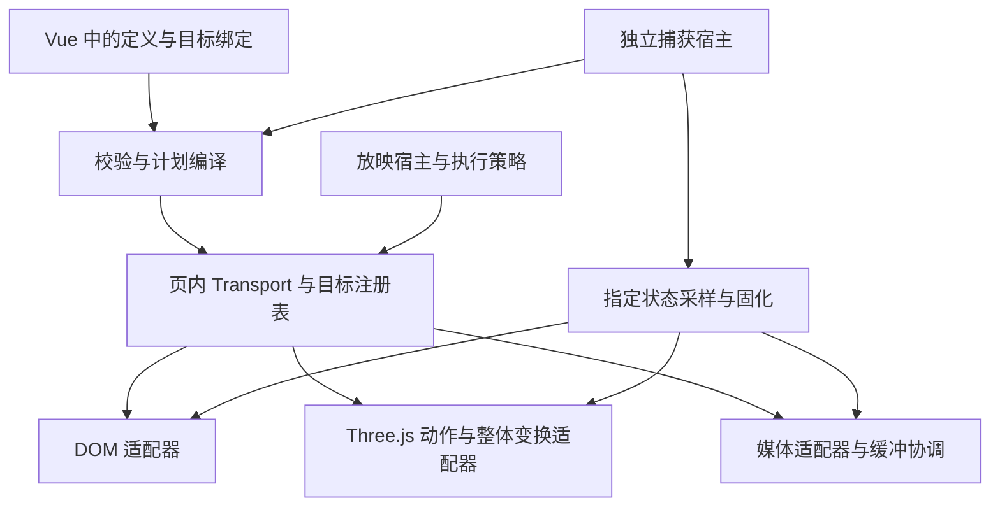

# 页内动画三维动作与媒体编排首期规划

状态：**WP01 完成，G0 功能选型通过**；WP02–WP12 待实施，G1/G2 未关闭。更新：2026-10-21。首期编号 M1。采用 GSAP 与“受控原生视觉＋资源 builder”，见[G0 决定](./g0-decision.md)。固定模板下 Luna 八任务首次提交8/8、纯静态构建8/8通过；真实生产裁剪执行包、媒体交接与卸载通过。用户已确认许可无问题；性能/规模预算仍后置，未开放新 Runtime Kit 能力。

首期交付一条完整流程：模型查询真实资源与动作 → 编写 Vue 页面中的编排定义 → 页面稳定后同步播放标题、旁白、视频与三维动作 → 暂停、定位和重播 → 生成指定状态的 PNG、PDF、PPTX 与独立网页构建。演讲者模式仍只有观众窗口实际播放。

## 首期范围

| 范围 | 首期交付 | 后续能力 |
| :--- | :--- | :--- |
| 编排 | 标签、绝对时间、前后依赖、并行、有限重复、统一毫秒单位 | 点击逐步展开、复杂分支、跨页连续时间轴 |
| DOM 和图片 | 入场预设、透明度与独立包裹层的二维变换；SVG 容器使用同一适配器 | 任意 SVG 形变、任意 CSS 属性、图表内部动画托管 |
| 三维 | 自包含 GLB、每实例单片段播放、片段裁切、有限重复、暂停定位与结束姿态；模型整体变换轨道 | 多片段混合、部件拆解、相机运动、多模型共场景、骨骼重定向和新动作生成 |
| 音视频 | 一个主媒体或单调时钟；旁白、文件视频的裁切、同步、受阻与缓冲处理 | 跨页 BGM、ducking、多轨混音、直播、外部 iframe 和离线视频导出 |
| 字幕与音效 | 有限文本标记轨道；保留现有 cue API 与静音策略 | 自动语音对齐、编排内音效轨道和拖动试听 |
| 控制与放映 | 播放、暂停、继续、重播、异步定位；新增显式 `timeline_end` | 原生 PPT 动画和逐元素可视化时间轴编辑器 |
| 静态交付 | 默认海报状态、指定标签或时间点取帧，静音、无事件副作用 | 任意脚本动画自动接管、跨设备逐像素相同或实时严格帧同步承诺 |

内容音频继续默认手动播放。旁白仍遵守现有能力开关和单页最多一个目标的约束。首期最多一个有声音的同步主媒体，辅助同步视频必须静音；独立媒体不作为同步目标。无限视觉装饰只作为不参与完成判定的派生轨道。

## 设计决定

1. **一份创作定义。** 定义保存在已有页面或组件 Vue SFC 中，不新增平行的时间轴数据库记录，不让 Editor 与模型各维护一份效果。可序列化定义与 Vue ref 绑定分开。
2. **一个播放所有者。** 当前实际页面最多一个时间轴。已注册媒体的控制权交给该会话，现有媒体会话继续负责未注册媒体，不能两个控制器同时调用同一元素。
3. **逻辑时钟统一。** 实时播放尊重媒体时钟，确定取帧按指定时间采样；不在播放期间逐帧设置媒体 currentTime。
4. **GSAP 与受控原生创作。** G0 已选择 GSAP、原生视觉填充函数和有限资源 builder，Runtime 托管初始化、静默采样和生命周期。Three.js 继续负责模型，原生媒体负责音视频，Runtime 负责资源与统一控制；公开版本化入口与正式 Schema 由 WP02/WP10 落实，不重建完整 JSON 视觉 DSL。
5. **明确版本。** 新增版本化 Runtime Kit 入口和资源包装器；保留旧 v1 行为。没有新能力时明确拒绝新调用，不静默改成另一种效果。
6. **捕获独立。** 减少动态效果、媒体静音、是否允许自动播放和取哪一帧是独立维度；静态宿主不能被页面请求放宽。

## 架构

复用现有 [执行策略](../../../../runtime/src/core/execution/execution-policy.ts)、[放映宿主](../../../../runtime/src/runtime-shell/playback/usePlaybackHost.ts)、[页面媒体会话](../../../../runtime/src/core/media/page-media-session.ts)、[模型引擎与实例克隆](../../../../runtime/src/runtime-kit/internal/renderers/model3d/engine.ts) 和 [离屏捕获舞台](../../../../runtime/src/core/services/export/OffscreenPageStage.ts)。新增职责拆入 `core/motion/` 与 `model3d/motion/`，不继续向单个 ModelViewer 或放映宿主堆积逻辑。

## 文档与事实源

| 文档 | 职责 |
| :--- | :--- |
| [G0 决定](./g0-decision.md) | 已定引擎、创作形状、八任务与裁剪交付证据、后续边界 |
| [创作契约](./authoring-contract.md) | 定义、目标绑定、轨道、校验边界与模型写法 |
| [运行与捕获契约](./runtime-contract.md) | 时钟、状态、所有权、放映、媒体、版本、身份和错误 |
| [实施顺序](./implementation-plan.md) | 模块边界、依赖、热点文件与发布策略 |
| [工作包清单](./work-packages/README.md) | 12 个可独立评审的工作包与完成证据 |
| [验收计划](./acceptance.md) | G0/G1/G2、浏览器场景、模型创作基准与支持矩阵 |
| [完整故事研究](./story-authoring-comparison.md) | 真实旁白、视频、骨骼的六组合与创作入口、静默回调比较 |
| [Luna 创作结果](./luna-authoring-results.md) | 独立上下文的首次生成、一次反馈、局部修改、函数复用与故障恢复 |

字段与行为只在两份契约中维护，工作包引用契约。当前产品的用法仍以 [页内动画指南](../../runtime/page-animation-guide.md)、[音频计划](../audio/README.md) 和 [三维资源计划](../threejs-resource-implementation-plan.md) 中的实际实现与验收状态为准。

## 里程碑与开始顺序

| 出口 | 必要输入 | 结果 |
| :--- | :--- | :--- |
| G0 | WP01 | 已通过：执行器、默认创作形状、样本与最小交付路径收口；性能/规模预算后置 |
| G1 | WP02–WP09 | 内部测试可走通 DOM、媒体、模型、放映与取帧；不开放公共能力 |
| G2 | WP10–WP12，并复核全部前置 | Editor、模型、CLI/MCP、独立构建与真实 Renderer 联合验收后开放 |

[WP01](./work-packages/wp01-baseline-engine-spike.md) 已完成，下一步进入 WP02 正式定义契约和规范计划。WP03 完成后推进执行适配器，不用工作包数量推算交付日期。

## 延续与维护

- 当前提示规范只说明已有动画能力。新入口和新效果通过 G2 后，再更新 Runtime Kit manifest、模型默认规范、用户指南和顶层 README，不能只改提示就宣称支持。
- 仓库测试选择、服务复用与 E2E 数据纪律遵循 [dev-start-test](../../../../.agents/skills/dev-start-test/SKILL.md)。
- 每张卡片回填代码版本、实测命令、通过与失败数量、产物位置和未覆盖项。阶段结果以出口验收更新，单个包合入不视为发布。
- 此规划不创建后台任务、排期自动化或新的用户聊天；工作包为仓库内实施卡片。
