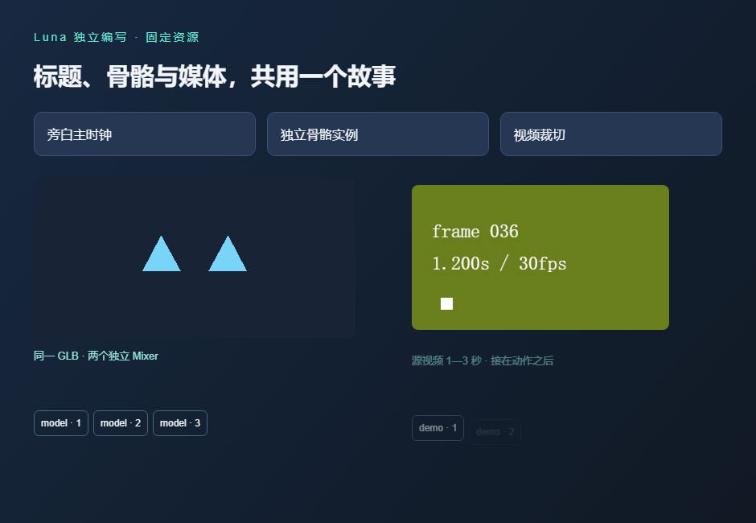

# G0 决定：GSAP 与受控原生视觉编排

日期：2026-10-21。状态：**WP01 完成，G0 功能选型通过；WP02–WP12 待实施，G1/G2 未关闭。** 用户已明确确认许可没有问题，本轮不再设许可确认阻塞。当前尚未开放任何新 Runtime Kit import。

## 选定的主线

| 决定 | 首期选择 |
| :--- | :--- |
| 视觉编排引擎 | GSAP；本轮固定 3.15.0，通过后不再并行实施四套执行器 |
| 创作形状 | Vue SFC 中的原生 GSAP 视觉填充函数＋有限资源 builder |
| 生命周期 | Runtime 创建作用域/暂停时间轴，处理初态、静默定位、固化、撤销与释放 |
| 资源上下文 | 目标与只读摘要、受控句柄；不向作者透出原始媒体、Mixer 或模型 sample/dispose |
| 资源与时间 | 资源、transport、捕获使用毫秒；GSAP 原生参数为秒，经统一转换 helper；资源 id 自动登记视觉标签 |
| 三维与音视频 | Three.js 继续承担 GLB/实例动作；原生媒体与 Runtime transport 承担实际播放/解码/时钟 |
| JSON | 规范资源计划、诊断和机器校验仍可序列化；不要求作者用完整 JSON 重写库的全部视觉语义 |

Anime.js 保留备选研究资料，Motion 保留 Vue 声明式参照，裸 WAAPI 保留底层与历史参照。没有同时安装两套正式编排引擎，也不把选定 GSAP 等同于开放其全部插件和任意脚本回调。

本决定冻结引擎、创作职责和输入形状。公共方法名、`.vN` import、正式 Schema、错误码和支持属性由 WP02/WP10 定义；研究 SDK 的 `useGsapStory` 不是现有平台 API。

## 本次收口验收

用户要求先不比较性能，本次 G0 出口限定为**功能、创作形状和可交付原型**。首轮性能/规模数值继续保留为历史候选，未冻结为生产承诺；后续实现与 WP12 需单独复核。此范围替代早期卡片将所有性能预算纳入 G0 的要求，不以少量功能样例冒充性能达标。

固定适配层先独立自检，再冻结输入。八个全新 `gpt-6-luna`、medium、`fork_turns: none` 上下文，完成如下任务，每类独立两次：

| 任务 | 首次提交结果 |
| :--- | :--- |
| A：从任务包生成完整故事 | 2/2 通过 |
| B：只延后默认模型段落，后继随动 | 2/2 通过 |
| C：同函数复用两组错峰段落 | 2/2 通过 |
| D：依据有界行为反馈修复注入故障 | 2/2 通过 |

预定出口为至少7/8首次通过、8/8在最多一轮反馈后通过。实际 **8/8首次提交通过，没有额外修复轮**。其中只有 A 是从空文件首次生成；B/C/D 是在同一通过种子上的独立任务，不能称为“八个新页面首次生成全部成功”，也不能与前轮四样例直接计算因果提升率。

检查覆盖严格 Vue/TS、透明度/位移中间态、实际视频时间与帧、独立求得的骨骼姿态、双实例作用域、乱序恢复、父子计数回调静默、固化前后 PNG 一致、过期 clip 及释放。原始八份代码和88个评分输入 hash 保持一致；两例 B 仅改默认值，两例 D 精确恢复种子。

A1 仍写了 immediateRender=false，适配层接管 from 初态后也通过，说明关键规则不必依赖模型每次记住。适配层会预置显式 fromTo 的初态；任意插件、初始化副作用、多段同属性覆盖及无限装饰仍需后续契约/验收，不能外推本题结果。

任务包限制读取固定契约及本库资料，但共享文件系统没有 OS 隔离；A1 自报额外读了 api-types 引用的共享 types.ts，已记录为方法边界。没有模型内部版本、seed 或 token 数据，本轮是工程小样，不是普遍成功率证明或正式 G2 基准。

## 交付路径

真实执行 `pnpm --prod` 安装最小研究执行包，确认 vue-tsc 被裁掉；Vite、Vue 插件与所有打包库模块实际从裁剪包内加载，没有偷偷回读工作区执行依赖。

| 验证 | 结果 |
| :--- | :--- |
| 裁剪后直接加载含导入 props 类型的真实 Vue SFC | 通过 |
| 使用裁剪后的构建器和插件生成独立包 | 通过 |
| 只托管 HTML/JS/CSS，重新运行八份候选全部行为检查 | 8/8 通过 |
| 静态包中的旁白正常 ended → 单调时钟交接、视频裁切终帧 | 通过 |
| 静态包播放中卸载、媒体暂停/移除 src、自有 RAF 清零 | 通过 |
| 互联网/源码/node_modules/Vite 回退 | 无；网络限制为静态源站与原创素材源站 |

第一次研究包把 TypeScript 错放开发依赖，裁剪后 Vue compiler-sfc 无法解析导入类型；失败保留，随后按正式 Runtime 已有的生产分类修正并重装成功。**TypeScript 与 Vite/插件都是本场景执行依赖，vue-tsc 是开发检查工具。** 未通过链接回开发依赖规避问题，也没有更改 Luna 输出或评分标准。

固定基线：GSAP 3.15.0、Vue 3.5.34、Three.js 0.186.1、Vite 8.3.0、Vue 插件 6.0.9、TypeScript 5.9.3。正式包与根锁文件本轮未改。

## 证据与边界

[研究入口](../../../../tests/experiments/motion-final/README.md)保留可重跑夹具；八任务与 88 个输入核对、真实裁剪/构建、首次裁剪失败和派发提示的逐次记录均保存在本地研究归档，不随仓库提交。前序研究仍见[四候选调研](./authoring-engine-research.md)、[真实故事六组合](./story-authoring-comparison.md)及[上一轮 Luna 小样](./luna-authoring-results.md)。

这是最小执行依赖原型，**没有验收完整 Runtime 镜像、Backend 真实票据、Editor 预览、Renderer、双窗口、完整 buffering/blocked、跨浏览器、长时间运行、性能或正式 G2 模型基准**。这些事项保留在后续工作包，G0 通过不开放能力，也不宣称全部首期已实现。

下一步进入 WP02：按已定的原生视觉＋资源语义形状正式设计契约和计划编译，明确初态/属性所有权、允许语法、错误和版本；不再按旧 JSON 草案实现第二套完整视觉 DSL。

交付检查：八个 `evaluate.mjs` 首次提交、`production.mjs` 的裁剪加载/独立构建与八例静态检查通过；历史输入的 hash 核对在本地证据归档完成。`pnpm --config.verify-deps-before-run=false run test:repository` 通过，8文件63项；新增 MJS 语法与 `git diff --check` 通过。未运行的产品/性能门禁按上文保留，不计为本轮已通过。
