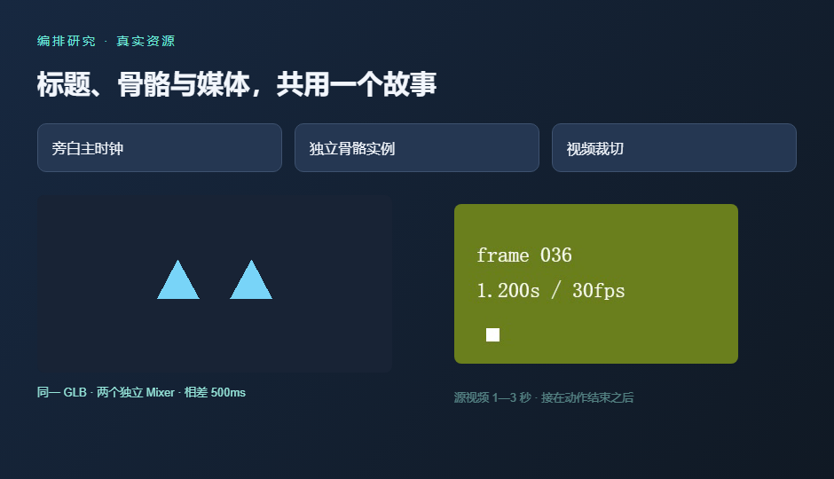

# 完整故事编排与 SFC 创作入口对照

日期：2026-10-21。属于 WP01 的过程证据，本阶段没有关闭 G0；后续固定模板与交付验证已通过，最终结论见[G0 决定](./g0-decision.md)。这里不比较性能、不开放公共能力，将 GSAP 与 Anime.js 放入同一真实故事；样例由研究作者编写并修正，不构成独立模型生成成功率。

## 当前建议

1. **GSAP 优先进入主编排方案验证。** 原生嵌套段落、作用域和统一静默定位在本题中衔接直接。选择依据是编排语义及控制边界，没有使用性能排名。
2. **Anime.js 保留为主要备选。** 六组合功能与 GSAP 一样通过；`sync` 子时间轴的静默回调行为有差异，但用向同一父时间轴追加定义的段落工厂可规避。不能据单个差异判定整个库不可用。
3. **Motion 转为 Vue 声明式/局部交互参照。** 这轮没有新增其媒体与骨骼实验，也没有证明它不适合其他场景；当前优先把两个时间轴候选做深。
4. **裸 WAAPI 退出主编排选型。** 底层动画仍可使用，但不再为整页段落、对象和资源关系自建完整编排引擎。
5. **创作入口优先验证“原生视觉段落＋有限资源 builder”。** 资源关系进入可校验计划，DOM 错峰与复用保留成熟库语义。完整 JSON 保留为机器计划/诊断方向，暂不作为 AI 必须逐项填写的唯一入口。

这是下一步原型优先级；库、公共接口与 Schema 尚未冻结，也没有将两款库同时放进生产依赖。既有 JSON 契约仍是候选草案。

## 同题与边界

代码和复现入口见[夹具说明](../../../../tests/experiments/motion-story/README.md)。版本固定为 GSAP 3.15.0、Anime.js 4.5.0、Vue 3.5.34、Three.js 0.186.1，独立 Chromium 148.0.7778.96。新编排 SFC/TS 严格检查，沿用的媒体/模型 MJS helper 不算新增 TypeScript 检查覆盖。

| 内容 | 同一份故事 |
| :--- | :--- |
| DOM | 标题 400ms 入场；三卡从 600ms 起，时长 300ms、错峰 100ms；动作/视频字幕 |
| 旁白 | 自有中文文案，Windows Huihui 离线生成并补静音至四秒；沿用首轮已记录素材 |
| 模型 | 自包含蒙皮 GLB；真实两秒 `wave` clip；两个克隆实例各有 Mixer，采样相差 500ms |
| 视频 | 六秒、固定 30fps、带帧号；只使用源时间 1000—3000ms |
| 关系 | 动作起于 1200ms，视频在动作结束后 200ms 开始，即 3400ms；故事结束于 5400ms |
| 修改 | 只把动作起点改为 1700ms，视频与字幕顺延到 3900ms，总长 5900ms；旁白仍在 4000ms 结束 |

三种路线共用同一资源与 transport：先查询真实 clip 引用及媒体时长，再构建；旁白实际 currentTime 为主时钟，只有正常 ended 才交接；视频播放期间不逐帧改写 currentTime。静态定位暂停且静音，等待视频帧就绪，再采样骨骼和 DOM。结束时另行定位裁切终帧并等待解码，不能把刚暂停的位置当作已完成捕获。

这部分是 Runtime 集成研究，不是库自带媒体调度能力。夹具尚未实现完整的 buffering/blocked、任意并发命令、生产定位围栏、资源鉴权与放映宿主协议。

## 六组合结果

| 引擎与路线 | 实际画面采样 | 乱序恢复 | 固化后捕获 | 起点修改 | 过期 clip 反馈后修正 |
| :--- | :--- | :--- | :--- | :--- | :--- |
| GSAP 原生桥接 | 通过 | 通过 | PNG 字节相同 | 通过 | 通过 |
| GSAP 资源 builder | 通过 | 通过 | PNG 字节相同 | 通过 | 通过 |
| GSAP JSON tracks | 通过 | 通过 | PNG 字节相同 | 通过 | 通过 |
| Anime.js 原生桥接 | 通过 | 通过 | PNG 字节相同 | 通过 | 通过 |
| Anime.js 资源 builder | 通过 | 通过 | PNG 字节相同 | 通过 | 通过 |
| Anime.js JSON tracks | 通过 | 通过 | PNG 字节相同 | 通过 | 通过 |

采样 0/1500/3600/5000ms，对比实际 opacity、骨骼四元数及解码视频像素；六组合一致。另走终点、回到 200ms，再回到 1500ms，完整规范状态恢复一致。固化实验在同一浏览器先捕获暂停画面，再取消原生动画并使用 `animations: disabled` 捕获，六组合 PNG 字节相同。此结果限于本设备、浏览器、同一字体与本题属性，不能外推跨设备逐像素一致或任意插件可固化。

两款原生路线均实际播放至 5400ms，验证四秒旁白正常结束后续播、视频裁切终帧就绪、媒体暂停、自有 RAF 清零。播放中卸载后，保留的旧 audio/video 元素均暂停且移除 src。没有浏览器脚本错误；没有用仅检查构建成功代替资源执行。

错误探针覆盖目标拼错、循环依赖、视频裁切越界、无动作 GLB、动作目标缺失与过期 clip 引用。错误提供 code 和 fieldPath；改回实际查询的 clipRef 后六组合均重新 ready。同名动作以 index 0 引用仍无歧义，不通过名称猜动作。本轮签名只是动画 JSON 的摘要，**不是包含全部二进制动作语义的正式版本算法**；WP07 仍需定义资源版本与语义签名。



## 影响选型的具体差异：嵌套静默定位

官方文档分别提供 Anime.js 的 [`seek(time, muteCallbacks)`](https://animejs.com/documentation/timeline/timeline-methods/seek/)、[`sync`](https://animejs.com/documentation/timeline/timeline-methods/sync/) 和 GSAP 的 [`seek(position, suppressEvents)`](https://gsap.com/docs/v3/GSAP/Timeline/seek()/)。本题在父、子时间轴的 500ms 各放一个 `.call`，父静默定位到 900ms，得到：

| 路线 | 对象数值 | 触发的回调 |
| :--- | :--- | :--- |
| GSAP 父时间轴 `.add(child)`，`seek(0.9, true)` | 0.9 | 无 |
| Anime.js 父时间轴 `.sync(child)`，`seek(900, true)` | 0.9 | 子时间轴回调 |
| Anime.js 工厂向同一父时间轴追加定义，`seek(900, true)` | 0.9 | 无 |

检查安装的 4.5.0 发布代码可解释该观察：`timeline.js:243` 中 `sync` 动画化子对象的 currentTime；`timer.js:220—224` 的 setter 调用 `.seek(+time)`，没有传递父时间轴的 muteCallbacks。这里记录的是该版本、该 API 路径的实测，不扩展成所有 seek 或全部回调的结论，也没有修改第三方库。

因此首期若采用 Anime.js，可复用“向父时间轴追加定义的函数”，或限定被 sync 的段落只含可采样视觉属性。不能仅凭父 seek 的 mute 参数，就允许 AI 在子段落写任意副作用。GSAP 在这个嵌套路径省去了一条特殊规则，是当前优先级更高的功能依据；它同样不能保证任意初始化代码、插件或异步回调都天然安全。

资源开始/结束始终由 Runtime 计划决定，不写 `.call(() => video.play())`，也不以回调补发跨过的旁白、网络请求或业务操作。该约束对两款库相同。

## 原生、builder 与 JSON：作者承担的概念

| 任务 | 原生库＋显式桥接 | 原生视觉＋资源 builder | 原 JSON tracks 草案 |
| :--- | :--- | :--- | :--- |
| 标题与三卡错峰 | 库原生 stagger | 同左，保留原生段落 | 本例显式展开三条卡片轨道 |
| 复用视觉段落 | GSAP 子时间轴；Anime sync 或段落工厂 | 同左 | 需要数组片段/工厂或再加分组语法 |
| 视频接在动作后 | 作者计算动作起点＋实际时长＋间隔，映射到视觉标签与资源计划 | `after: 'model'`，编译后取视频插入点 | 同样能表达 after 依赖 |
| 资源错用 | 桥接编译器反馈 | builder 使用同一编译器反馈 | JSON 使用同一编译器反馈 |
| 只延后动作 | 本例共享一个起点变量后重建，成立 | 修改一个起点后重建，后继由依赖解析 | 修改 detail 标签后重建，成立 |
| 增加库已有视觉效果 | 沿用原生 API，仍需受控采样验证 | 同左；不用给资源 builder 复制每个属性 | 有限 Schema 需扩展或提供预设 |

Builder 只封装 voice/clip/video 的资源语义及命名依赖，没有复制 timeline.to、所有缓动或任意样式。例子为：

```ts
const plan = storyBuilder(assets).voice('voice')
  .clip('model', clipRef, { atMs: detailStartMs })
  .video('demo', { inMs: 1000, outMs: 3000 }, { after: 'model', offsetMs: 200 })
  .build()
```

这只是研究输入形状，不是已经发布的 import 或接口。GSAP 使用秒，资源定义使用毫秒，边界转换应集中在适配层；Anime.js 使用毫秒，但仍需遵守初始化和段落约束。

不按 SFC 行数排名：builder 样例把视觉代码提取到公共 helper，原生路线也可以这样提取。有效差别是作者是否还要手工维护资源完成关系、错误能否定位，以及库新增视觉能力时平台是否必须再设计一套表达语法。JSON 可以增加宏或用代码生成，不能把本例有限实现泛化成 JSON 无法表达错峰。

## Runtime 下一步该承诺什么

职责组合仍贴近底层工具的实际边界：库管理视觉时间轴，Three.js 的 [AnimationMixer](https://threejs.org/docs/pages/AnimationMixer.html) 管理实例动作，浏览器遵循[媒体异步定位](https://html.spec.whatwg.org/multipage/media.html#seeking)，Runtime 管理跨介质语义与执行策略。没有依据把某一库宣传为覆盖这些职责的通用行业标准。

后续原型应只推荐一个默认创作模板，集中提供：

- 资源查询与类型化句柄：实际 clip 列表、index/签名/时长、视频/旁白就绪与版本；模型不猜动作或私有 URL。
- 受控视觉段落：作用域、时间轴登记、统一时间单位边界、卸载撤销与静态固化；已注册段落不自行启动第二套播放时钟。
- 有限资源 builder：命名依赖、裁切、完成规则与有界错误，不重写成熟库的完整 tween API。
- transport 与捕获：唯一播放所有者、主时钟/正常交接、buffering/blocked、异步定位修订号、海报与指定状态取帧。减少动态效果、静音、autoplay 和静态取帧分别处理。

这是面向本平台的设计建议，仍需落实为 Runtime Kit 版本化入口；本轮直接第三方导入仅存在研发夹具。

## 剩余验证与证据

后续已按同一任务、资源查询和有界反馈完成 [Luna 四上下文创作小样](./luna-authoring-results.md)，保存首次生成、段落移动、复用与故障恢复的原始源码和修正记录，候选全部由 Luna 编写/修复。结果稍支持 GSAP，但不能宣称广泛模型生成成功率更高；需要更多重复样例，并重测固定适配模板。

本阶段提出的固定视觉模板、裁剪依赖与独立构建验证后来已完成，功能 G0 已关闭，旧契约方向已修正。正式 G2 多任务模型基准未运行；完整生产资源、Renderer、双窗口、缓冲/阻塞、跨浏览器、长时间运行及 G1/G2 均未验收。性能继续后置。

功能原始状态、实际资源 hash、24 个输入源码 hash 与版本，以及静默定位的回调观察，均记录在本地研究归档（不随仓库提交）。

已运行 `prepare-assets.mjs`（复用六个原创素材）、`run.mjs`（六组合、两条真实播放及反例全部通过）和 `probe-events.mjs`（差异与规避写法断言通过）；`pnpm --config.verify-deps-before-run=false run test:repository` 通过，8 文件、63 项。实验 MJS 语法、24 个证据源码 hash 与 `git diff --check` 通过。未运行新的性能测试、生产 Runtime/Backend/Renderer 门禁、业务 E2E、独立构建或独立模型创作基准。
