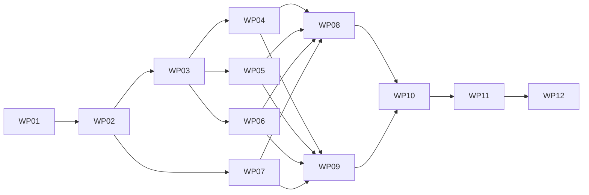

# 首期编排工作包执行清单

状态：**WP01–WP12 已收口（2026-10-23），共 12 个工作包。** G1 已关闭；G2 未通过，遗留项见 [G2 遗留清单](../g2-followups.md)。WP12 作为首期交付单元关闭，不等于 G2 验收通过。页内时间轴与 `timeline_end` 已按用户要求提前默认开放，指定状态截图仍关闭；MCP 暂不提供服务，移出本轮 G2。每包对应一个可独立评审的提交或 PR；领取和完成记录写在本仓卡片，不自动派发智能体或创建新的用户聊天。

字段事实源为 [创作契约](../authoring-contract.md)，执行事实源为 [运行契约](../runtime-contract.md)。测试场景见 [验收计划](../acceptance.md)，实际命令选择遵守 [dev-start-test](../../../../../.agents/skills/dev-start-test/SKILL.md)。

## 工作包与依赖

| 工作包 | 状态 | 主责 | 前置 | 主要交付 |
| :--- | :--- | :--- | :--- | :--- |
| [WP01 基线与执行器验证](./wp01-baseline-engine-spike.md) | 完成 | Runtime / 技术验证 | 无 | GSAP＋受控原生视觉/资源 builder；最终 Luna 与静态构建各8/8 |
| [WP02 契约与计划编译](./wp02-contracts-plan-compiler.md) | 完成 | 跨模块契约 / Runtime | WP01 | Schema、类型、正反例、计划与错误 |
| [WP03 时钟状态与目标所有权](./wp03-transport-targets.md) | 完成 | Runtime core | WP02 | transport、虚拟时钟、注册与定位围栏 |
| [WP04 DOM 动效适配器](./wp04-dom-adapter.md) | 完成（10-23） | Runtime | WP03 | 预设、属性轨道、reduced、采样与固化 |
| [WP05 音视频同步适配器](./wp05-media-adapter.md) | 完成（10-23） | Runtime media | WP03 | 主媒体、缓冲、裁切、异步定位与独占控制 |
| [WP06 三维动作适配器](./wp06-model-adapter.md) | 完成（10-23） | Runtime model3d | WP03 | 单片段、整体变换、多实例与指定姿态；A04 保留堆转 G2-06 |
| [WP07 资产摘要与能力契约](./wp07-asset-capabilities.md) | 完成 | Backend / 契约 | WP02 | 动作元数据、资源版本、能力门禁与生成类型 |
| [WP08 放映宿主与双窗口](./wp08-host-slideshow-sync.md) | 完成（10-23） | Runtime shell / Backend | WP04–WP07 | 生命周期、timeline_end、presenter v4；A11/A16 已验证 |
| [WP09 捕获协议与静态导出](./wp09-capture-export.md) | 完成（10-23） | render-contracts / Renderer / Backend / Runtime | WP04–WP07 | 渲染 v2、状态固化、身份与产物隔离；指定状态截图仍关闭 |
| [WP10 公共入口与预览控制](./wp10-runtime-kit-editor.md) | 完成（10-23） | Runtime Kit / Editor | WP08、WP09 | 一个创作入口、Asset*.v2、预览与表单；生产镜像最终重建转 G2-02 |
| [WP11 模型与外部客户端](./wp11-agents-clients.md) | 完成（10-23） | Backend AI / CLI（MCP 移出） | WP07–WP10 | 同源规范、查询写入取帧、CLI 往返；助手联合验收转 G2-01 |
| [WP12 联合验收与能力开放](./wp12-integration-release.md) | 已关闭（首期收口） | 联调 / 发布 | WP01–WP11 | G1 关闭、G2 遗留登记与移交；G2 未通过 |

## 依赖图

WP04–WP06 可在契约冻结后分别推进，WP07 可与核心实现交错；WP08 与 WP09 消费相同适配器接口。公共句柄的内部形状由 WP02 先定义，WP10 负责公开包装和完整使用体验，避免适配器等待公共 UI 产生依赖环。

## 状态与完成要求

状态使用“待实施 → 实施中 → 待验收 → 完成”。完成卡片至少回填代码版本、实际测试命令、通过/失败数量、证据位置、未覆盖项与后续接手条件。2026-10-23 首期收口时，WP04–WP06、WP08–WP11 的未覆盖项已由 G1 证据覆盖，未完成部分已转入 [G2 遗留清单](../g2-followups.md)，因此不再停留在“待验收”。

单包合入不自动改变能力开关。G0 由 WP01 关闭；G1 由 WP08/WP09 的联合证据在 WP12 复核并关闭（2026-10-23）。WP12 已作为首期交付单元关闭，但 G2 验收不随工作包关闭，剩余项由 [G2 遗留清单](../g2-followups.md) 跟踪；G2 关闭前指定状态截图保持关闭。

## 首期收口结论（2026-10-23）

- WP01–WP12 的实施与首期交付单元关闭；G1 关闭；G2 未通过。
- 已交付能力：页内时间轴、`timeline_end`、Editor 预览控制、CLI 时间轴/截图链路；指定状态截图协议与临时 opt-in 链路已交付但正式开关关闭。
- 后续 G2 工作不在本清单新增工作包，统一在 [G2 遗留清单](../g2-followups.md) 记录；本清单只保留首期实施与验收历史。
