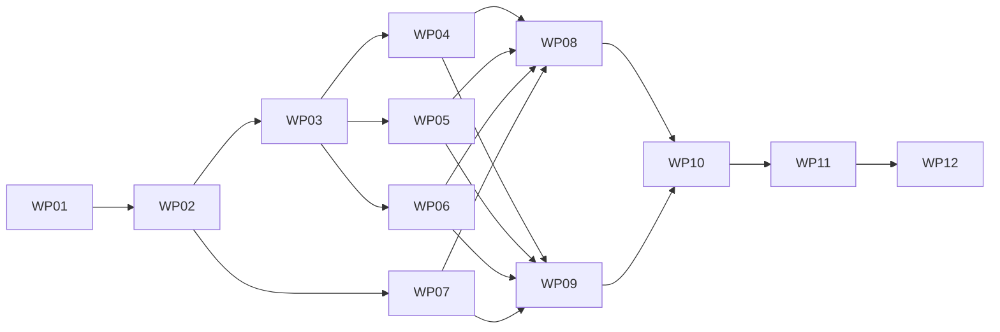

# 首期编排工作包执行清单

状态：WP01–WP03 完成，G0 功能选型通过；WP04–WP12 待实施，共 12 个工作包。每包对应一个可独立评审的提交或 PR；领取和完成记录写在本仓卡片，不自动派发智能体或创建新的用户聊天。

字段事实源为 [创作契约](../authoring-contract.md)，执行事实源为 [运行契约](../runtime-contract.md)。测试场景见 [验收计划](../acceptance.md)，实际命令选择遵守 [dev-start-test](../../../../../.agents/skills/dev-start-test/SKILL.md)。

## 工作包与依赖

| 工作包 | 主责 | 前置 | 主要交付 |
| :--- | :--- | :--- | :--- |
| [WP01 基线与执行器验证](./wp01-baseline-engine-spike.md) | Runtime / 技术验证 | 无 | 完成：GSAP＋受控原生视觉/资源 builder；最终 Luna 与静态构建各8/8 |
| [WP02 契约与计划编译](./wp02-contracts-plan-compiler.md) | 跨模块契约 / Runtime | WP01 | Schema、类型、正反例、计划与错误 |
| [WP03 时钟状态与目标所有权](./wp03-transport-targets.md) | Runtime core | WP02 | transport、虚拟时钟、注册与定位围栏 |
| [WP04 DOM 动效适配器](./wp04-dom-adapter.md) | Runtime | WP03 | 预设、属性轨道、reduced、采样与固化 |
| [WP05 音视频同步适配器](./wp05-media-adapter.md) | Runtime media | WP03 | 主媒体、缓冲、裁切、异步定位与独占控制 |
| [WP06 三维动作适配器](./wp06-model-adapter.md) | Runtime model3d | WP03 | 单片段、整体变换、多实例与指定姿态 |
| [WP07 资产摘要与能力契约](./wp07-asset-capabilities.md) | Backend / 契约 | WP02 | 动作元数据、资源版本、能力门禁与生成类型 |
| [WP08 放映宿主与双窗口](./wp08-host-slideshow-sync.md) | Runtime shell / Backend | WP04–WP07 | 生命周期、timeline_end、presenter v4 |
| [WP09 捕获协议与静态导出](./wp09-capture-export.md) | render-contracts / Renderer / Backend / Runtime | WP04–WP07 | 渲染 v2、状态固化、身份与产物隔离 |
| [WP10 公共入口与预览控制](./wp10-runtime-kit-editor.md) | Runtime Kit / Editor | WP08、WP09 | 一个创作入口、Asset*.v2、预览与表单 |
| [WP11 模型与外部客户端](./wp11-agents-clients.md) | Backend AI / CLI / MCP | WP07–WP10 | 同源规范、查询写入取帧、独立仓往返 |
| [WP12 联合验收与能力开放](./wp12-integration-release.md) | 联调 / 发布 | WP01–WP11 | G1/G2 汇总、模型基准、生产构建与开放 |

## 依赖图

WP04–WP06 可在契约冻结后分别推进，WP07 可与核心实现交错；WP08 与 WP09 消费相同适配器接口。公共句柄的内部形状由 WP02 先定义，WP10 负责公开包装和完整使用体验，避免适配器等待公共 UI 产生依赖环。

## 状态与完成要求

状态使用“待实施 → 实施中 → 待验收 → 完成”。完成卡片至少回填代码版本、实际测试命令、通过/失败数量、证据位置、未覆盖项与后续接手条件。代码完成但未跑真实媒体/WebGL/捕获场景时停在待验收。

单包合入不开放能力。G0 由 WP01 关闭，G1 由 WP08/WP09 的联合证据在 WP12 复核，G2 由 WP12 关闭；WP11 可先验证 closed capability 的准确失败语义。
