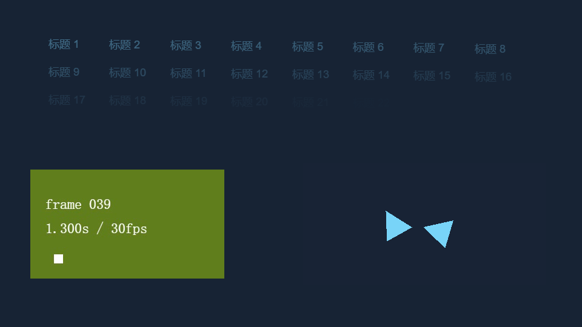

# WP01 第一轮技术验证历史记录

实验日期：2026-10-20。2026-10-21 更新：本页保留首轮实验事实，**撤回当时的 WAAPI 选型和 G0 关闭结论**；后续已选 GSAP、完成默认模板和交付收口，当前状态见[G0 决定](./g0-decision.md)。下述数值不作为当前选型依据或已冻结契约，未发布 Runtime Kit 或新增正式依赖。

## 第一轮判断（已撤回）

第一轮曾认为 WAAPI 足以承担限定的 DOM 属性执行，并由平台维护计划和控制。该实验没有充分比较成熟库的整体编排、Vue 原生写法和创作入口，因此不能据此选定首期后端。以下事实保留，不将旧决定延续到后续工作包。

两个后端使用同一场景、线性曲线、绝对时间与媒体/模型模块；分别构建静态包后由临时 HTTP 服务交付。WAAPI 适配器 gzip 431 字节，GSAP 3.15.0 适配器 gzip 30281 字节；完整场景 gzip 分别 170634 / 200685 字节，后者增加约 30KB。体积包含各适配器代码，完整包还包含 Three.js，不能把完整包当成动画库净体积。

GSAP 的标签、嵌套和控制更丰富，但首期仍须自行提供跨媒体计划、权限、确定采样及异步就绪；它在这组受控能力上没有免除这些职责。[GSAP 当前标准许可](https://gsap.com/community/standard-license/)还区分 AI 生成代码与部分可视化动画构建工具，不能把商业免费理解成所有产品形态均无限制。本次仅隔离实验使用，不对未来可视化编辑产品作许可结论。

WAAPI 对当前有限属性范围足够；更多 SVG、复杂曲线或可视化编辑能力应另作后续选型，不扩大本次承诺。依据：[Web Animations 规范](https://www.w3.org/TR/web-animations-1/)、[GSAP Timeline](https://gsap.com/docs/v3/GSAP/Timeline/)、[Three.js AnimationMixer](https://threejs.org/docs/pages/AnimationMixer)。

## 基线复核

基线提交 `d58aa8367b72db4686986879f8d6a2e2bdd06a`；实验源码未提交部分由证据中的逐文件 SHA-256 标识，根锁文件 hash 同时保存。

| 现有入口 | 复核结果与交接 |
| :--- | :--- |
| execution-policy.ts | interactive-preview 需手势，capture/export 禁播放；新视觉采样不得放宽该上限 |
| page-media-session.ts / usePlaybackHost.ts | 已存在 generation、旁白限制与媒体控制；WP03/WP08 必须交接独占所有权，不能新增并行控制者 |
| model3d/engine.ts / ModelViewer.vue | GLB 已保留 clips，SkeletonUtils 已隔离实例；v1 尚无动作播放接口，WP06 复用解析/缓存并抽离每实例 mixer |
| OffscreenPageStage.ts | 当前会将有限原生动画 finish 到终点；WP09 必须先固化托管目标，再运行旧兜底 |
| Renderer executor.py | 默认 reduce 且截图 animations=disabled；本次证明固化后可保持指定帧，不改用户系统偏好 |
| runtime-version-identity.ts / write-runtime-build-id.mjs | 发布身份来自运行输入与锁文件，不来自实例 ID；后续新增执行代码进入既有身份，不能另立可漂移版本 |

## 场景、素材和方法

参考设备：AMD Ryzen 7 8745H、16 逻辑核、28.8GiB 内存，Windows 10.0.26300，Node 22.16.0，Playwright 1.60.0、Chromium 148.0.7778.96。独立 headless context 的 `document.visibilityState=visible`；960×540、DPR=1。WebGL 使用 ANGLE / SwiftShader 软件渲染，Three.js 0.186.1；不代表用户实际 GPU 或复杂模型的性能。

场景包含 32 个 DOM 包装目标、64 条 DOM 属性轨道，另有两个独立骨骼实例、四秒旁白和裁切视频，压力超过拟公开的 64 总轨道 / 32 总目标。测试绝对位置 325/500/1000/1500ms，夹入 1900/0/900/1800000ms 后回到同一位置，逐项比较 32 个 DOM 状态、骨骼四元数、媒体位置及解码画面 hash。

音频是自有文案“标题与模型，同步播放。”，Windows 离线 Huihui 合成、48kHz 单声道 PCM，补静音至四秒。六秒 VP8 WebM 含逐帧编号和时间，由脚本生成 180 张画面、用 Playwright 随附 ffmpeg 固定为 30fps；不再用实时录制计时推测帧率。GLB 含真实蒙皮和一个关节动作；另生成无动作、缺失目标、两个同名动作反例。所有素材源自本仓生成代码，不下载第三方媒体；样本身份与生成来源见证据清单。非 Windows 的提示音替身不计为中文旁白验证。

素材由另一个临时源站提供，票据校验先于 HEAD/Range，CORS 限定静态页源站；验证无票据 403、HEAD 200、Range 206/100 字节及可读取视频像素。这里是真实跨 origin 夹具，**未验收 Backend 签名票据、独立预览域与 Renderer 的完整产品链路**。

静态包浏览器只允许访问两个本地测试源站，不能访问 Vite、node_modules 或互联网。WAAPI 无新增生产依赖；GSAP 从忽略的实验目录加载并打进比较包。该离线包验证说明客户端产物无开发依赖，不等于已跑生产 Runtime 镜像裁剪与启动；后者保留为 G2 门禁。

## 第一轮候选预算与观察（当前未冻结）

| 项目 | 第一轮记录值 |
| :--- | :--- |
| 编排规模 | 每页 64 总轨道、32 总目标、有限主时长最多 1800000ms；30 分钟只验证乱序取样，长时间播放仍须 G2 soak |
| 暂停响应 | 前台命令到下一可观察帧 p95 ≤100ms |
| 温缓存定位 | 命令到媒体帧、骨骼与 DOM ready p95 ≤1000ms；单次媒体定位/帧等待期限 1000ms，冷准备另计 |
| 稳态同步 | 30fps 视频相对主旁白 p95 ≤80ms、最大 ≤160ms；启动前 250ms 与 seeking 分开统计，保留原始数据 |
| 漂移校正 | 每 100ms 最多检查一次；软阈值 30ms，辅助速率 0.95/1.05；硬阈值 80ms 才有界定位，不每帧写 currentTime |
| 可见帧测量 | rVFC.mediaTime 对齐 expectedDisplayTime 的主时钟投影；记录回调时刻、原始音频位置与预计呈现差，不只比较两个 currentTime |
| 同时刻取样 | 同设备同输入，规范状态完全一致，乱序返回同一视频解码帧；直接与乱序截图逐像素一致 |
| 固化图像 | 单通道差 >8 的像素不超过 0.1%；最终实测为 0，不允许借容差掩盖目标时刻变化 |
| 跨后端数值比较 | CSS opacity 末位舍入差 ≤0.000101、平移差 ≤0.001px；同一后端的乱序状态仍严格相等，两个后端截图也严格相等 |
| 清理稳定性 | 每后端 100 次重建 DOM 执行器/重播，暂停后自有 RAF、原生动画、播放者均为 0；每 20 次 GC 观察 DOM/堆，100 对 20 次保留堆增长 <1MiB、DOM 节点增长 ≤2 |

模型、DOM 和视频始终由绝对位置驱动；Three LoopOnce 到终点后需显式重置 action 再采样，不能依赖历史 finished 状态。模型可见像素和独立 skeleton 均有断言，不能用空 WebGL 画面通过 A04。

WAAPI 必须在**独立包装层**上执行，保持外层居中变换。指定取帧先设置样式和模型姿态，等待 seeked 与 rVFC，再 commitStyles/cancel。捕获期间保留包装层 `will-change: transform, opacity`，截图完成后恢复；否则即使计算样式相同，取消原生动画导致合成层变化，文字抗锯齿也会改变。该约束不要求页面永久保留合成层。

## 运行结果与证据

三轮、两个后端全部通过；每轮各执行 100 次重建/重播，合计 600 次。逐次暂停、seek、解码帧、保留堆/DOM 计数、源文件与样本 hash 记录在本地研究归档（不随仓库提交）。本轮实验源文件 hash 与归档逐项复核，三轮样本 hash 相同。

下表取三轮各自 p95 的最大值或全部观测最大值，单位 ms；样本较短，差异不用于给两个引擎作性能排名。

| 项目 | WAAPI | GSAP |
| :--- | ---: | ---: |
| 暂停 p95 | 16.5 | 16.4 |
| 温定位 ready p95 | 32.6 | 33.2 |
| 稳态漂移 p95 | 44.3 | 70.2 |
| 稳态漂移最大值 | 47.4 | 72.7 |
| 启动阶段漂移最大值（独立统计） | 46.4 | 72.6 |
| 每帧 JS 采样/绘制提交 p95（不代表 GPU 耗时） | 0.5 | 0.7 |

每轮各记录 230 次暂停、27 次带计时定位，稳态解码帧分别约 48–49 个；全部通过原预算。每 20 次强制 GC 的五个窗口中，WAAPI 的最终保留堆相对第一个窗口减少约 19–20KiB，GSAP 增加约 103–104KiB；两者 DOM 节点增长均为 0。计时/回调/媒体对象按实验自身所有权检查归零；不把短样例当成长期内存保证。

另执行 `node tests/experiments/motion-wp01/probes/correction.mjs`：注入 400ms 辅助视频超前，两后端均仅触发一次硬定位，分别约 66 / 65.4ms 观测到校正命令；到逻辑 1500ms，尾部八帧最大偏差为 17.6 / 7.5ms。该异常恢复数据单独保存，未混入正常稳态统计。播放中直接 dispose 后，RAF、视频帧回调、原生动画和播放者归零，继续观察 80ms 逻辑位置不再推进。

图中逻辑位置为 325ms，两个模型实例取样相差 500ms；视频从源 1000ms 处裁切，当前解码帧为 39。直接采样、乱序返回、固化与 animations=disabled 后的 PNG SHA-256 均为 `1841c4c1d67c413f470d3e56747f2a33a7a7495004d8e717fe6f8ed348eff492`。

实际命令：先按实验说明隔离安装 `gsap@3.15.0`，随后设置 `WP01_RUN_LABEL=final-1/final-2/final-3` 分别执行 `node tests/experiments/motion-wp01/run.mjs`；复用视频的轮次显式设置 `WP01_REUSE_VIDEO=1`。每次均重新生成旁白与 GLB、重新构建两个候选并启动新 context；第二轮还重新生成视频。

本页只保留第一轮可行性证据；后续功能 G0 已完成，A03/A04/A06/A09/A13 的完整产品集成验收仍未完成。

早期原型曾出现：只用元素 currentTime 校正却遗漏实际可见帧漂移、材质默认金属导致测试模型黑帧、取消原生动画后文字像素变化。均通过补充真实帧/可见像素/逐像素断言发现并修正，未放宽原定 80/160ms 漂移预算。

## 创作草案与后续边界

八题 B01–B08 完成自编草案审查：错峰、旁白和文字、模型并行、动作后视频、局部延迟、双实例姿态、冲突/过期引用修复、reduce/blocked/buffering/capture 区分。B05 只改模型 start 的一个字段，后继视频由 2200ms 自动变为 2700ms；其余轨道对象逐项未变。B07 的两个有界错误经一次局部修改解除。

这是 API 草案可表达性与修改实验，没有独立模型运行、token 或模型首轮通过率，不计为 G2 的 7/8、8/8 基准。正式 Schema、完整属性冲突和动作签名算法仍由 WP02/WP07 实现；真实 blocked、required buffering、迟到回执围栏由 WP03/WP05 验证。

WP02 不能依据本页直接冻结 WAAPI 或旧 JSON 创作入口，须等待补充选型。实验 scene 的 window 对象、测试票据和私有 Three 对象不得公开为 API。后续仍需固化、媒体时钟、实例动作与资源清理的真实集成。

未运行完整业务 E2E、生产镜像、远程 Renderer、跨页/双窗口、30 分钟播放、Firefox/WebKit、移动端和真实模型创作评测。本轮不改旧 v1 页面行为，不开启新 capability。

验证命令：三轮浏览器原型、一次异常校正/播放中销毁探针均通过；全部实验 MJS 与旁白 PowerShell 解析检查通过。`pnpm --config.verify-deps-before-run=false run test:repository` 通过（8 文件、63 项），`git diff --check` 通过，生产 package.json 与根锁文件无改动。
