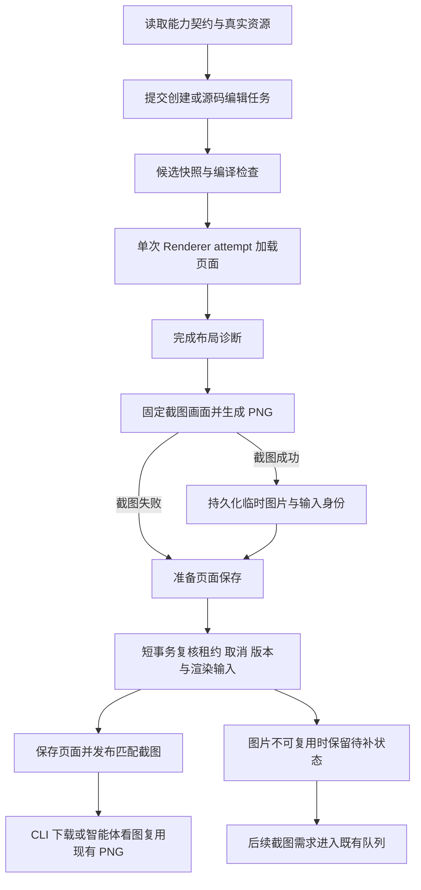

# 页面校验截图复用与智能体引导优化计划

状态：已完成实施（2026-10-19）。本计划合并页面校验与截图重复渲染分析，以及“分析其他智能体异常及引导方式”对话中的资源发现、契约读取和错误恢复分析。WP01～WP07 均已交付并通过跨仓演练与基准实测（见 [实测报告](../../../test-results/validation-screenshots/report.json)）。

目标是形成一条连贯的创作流程：先查清能力与资源，提交源码时自动校验并顺带生成截图，保存后复用对应版本图片，失败时获得适用于当前入口的恢复指引。优先减少错误命令、资源名试探和重复浏览器执行，不降低校验、权限和版本一致性要求。

## 1. 已核实的现状

| 环节 | 当前行为 | 优化切入点 |
| --- | --- | --- |
| 智能体页面写入 | `AiPageMutationExecutor` 在保存前调用 `CodeCheckService`，任务保持在既有 external batch/task 链路内 | 共用校验服务增加截图产出，不再创建第二个 AI 外部任务 |
| CLI 页面写入 | External API Mutation 经 `PageMutationPlanner` 预检，再由 `MutationJobService` 复核版本和租约后保存 | 与智能体共用渲染产物和发布逻辑，保留两套领域队列的现有职责 |
| 页面校验 | 编译通过且未命中校验缓存时，远程 Renderer 启动 Chromium、加载页面、等待视觉资源并分析布局；编译失败不进入浏览器 | 在同一 attempt 中生成布局结果和 PNG |
| 页面截图 | 单独创建预览 artifact 并执行 `page.capture`，页面版本、配置和视口匹配时才复用现有图片 | 保存时发布校验附带图片，后续读取直接命中 |
| 静态处理 | 诊断与截图都核对 capture 上下文；目前只有截图执行额外的捕获层及视频静态帧处理 | 保留诊断语义，在截图前执行额外处理 |
| 图标发现 | `Icon.v1` 介绍渲染方法，可用名称实际来自当前工作空间图标资源；示例中的 `home` 不保证存在 | 明确区分组件契约与资源目录 |
| 校验引导 | `build_validation_text` 提示调用内部 `validate_entity`；External Mutation 也复用此文本 | 区分内部工具和外部 API 的恢复入口 |
| CLI 校验 | 正确命令为 `wp page validate`、`wp component validate`，没有顶层 `wp validate` | CLI 根据真实命令树补充可执行提示 |
| 契约读取 | 参考对话中的智能体把 JSON 截为前 400 个字符，漏读 `usage` 和 `constraints` 后继续推测 | 按关键字段读取，保留分页和省略标记 |

参考对话能够证明存在上述绕路和误导风险，但缺少完整前文，不能认定当次错误命令一定由 Backend 提示触发。

主要源码依据：[校验服务](../../../backend/app/services/code_check_service.py)、[AI 页面执行器](../../../backend/app/ai/page_mutation_executor.py)、[External 页面规划器](../../../backend/app/services/mutation_planners/page_mutation_planner.py)、[Mutation 提交](../../../backend/app/services/mutation_job_service.py)、[Renderer](../../../renderer/wp_renderer/engine/executor.py)、[截图服务](../../../backend/app/services/page_screenshot_service.py)、[校验文本](../../../backend/app/ai/validation_result_formatter.py)、[图标解析](../../../backend/app/services/runtime_icon_service.py)、[Runtime Kit manifest](../../../runtime/src/runtime-kit/manifest/runtime-kit.manifest.json)。

## 2. 实施决策与边界

1. 智能体和 External API 的页面创建、源码编辑默认请求附带截图。轻量元数据更新、复制、恢复历史版本等入口保持现有行为，后续按实际需求扩展。
2. 独立 `validate` 首期保持只读校验，不默认产图，不发布候选截图到正式页面。组件维持当前契约及编译检查，不扩大为浏览器截图任务。
3. 沿用 `page.diagnose` 和现有 `operation_options`，增加可选 `capture_screenshot`；不新建浏览器池，不跨 attempt 复用浏览器，不把 Playwright 引入 Backend 或 CLI。
4. 页面编译或布局诊断未完成、失败或不可用时，沿用现有写入门禁。只有诊断已经完成后的附带截图失败，才允许页面保存成功并单独返回截图状态。现有显式跳过视觉校验路径保持审计要求，不能声称已截图。
5. 复用既有截图队列补齐缺失、过期、不同尺寸和不兼容产物。附带截图失败不自动立即重开浏览器；后续真实截图需求再触发队列，避免无条件重试抵消收益。
6. 外部 API 保持客户端无关的错误语义；CLI 在客户端补充真实命令，MCP 按自己的已注册工具适配，不向通用 API 文本硬编码一种客户端的操作方式。
7. 只在图片确实可读、快照一致且已发布时返回 `ready`。生成截图不等于模型已经看图，也不等于声音、交互或动画已经验收。

## 3. 目标流程

布局诊断应先完成并保存结果，再执行可能改变 DOM 或视频状态的截图准备。两者仍处于同一硬期限内；图片阶段预留有界预算，不能为附带截图延长原请求总期限。截图前后需要保持画布、页面和资源身份一致。

## 4. 工作包与实施顺序

### WP01 修正校验结果的恢复入口

优先级：P0。依赖：无。

- 将公共校验事实与入口专属提示分离。可沿用 `build_validation_text` 的 `include_next_step`，或增加明确的渲染受众参数；结构化错误码、简短摘要和问题列表只保留一份生成逻辑。
- 平台 AI 工具保留 `validate_entity` 引导；External Mutation 的成功警告、失败详情和可恢复错误都不能继续泄漏内部工具调用方式。
- External API 使用中性的“按相同目标和候选模式查看详细诊断”；CLI 在输出层映射到 `page validate` 或 `component validate`，提示保留原 `content` / `edits` 候选输入和 `--detail`。不能默认改为检查当前已保存源码。
- 新建失败尚无页面 ID 时，不输出带假 ID 的校验命令；提示修正原创建候选后重新提交。只有明确可重试的基础设施故障才提示有界重试。
- 如调整 AI 工具说明，先更新 `tool_specs.py` 再检查派生目录和防漂移用例。MCP 的提示以它自己的真实工具为准，不创建 `wp validate` 兼容别名掩盖来源问题。

交付出口：内部工具、External API 和 CLI 同一诊断得到各自正确的恢复方式；成功警告和失败路径都有覆盖。

### WP02 补齐图标发现与契约读取路径

优先级：P0。依赖：无，可与 WP01 分别交付。

- 在 manifest 的 `Icon.v1` 说明中明确：这是渲染组件；平台内容的名称来自当前工作空间 active 图标资源；示例名称不是内置资产保证。保留独立 Runtime 配置使用方式的准确说明。
- 在 CLI Skill 的资源与设计系统参考中集中给出“查图标 → 读 Icon 契约 → 使用真实 name”的短流程，主 Skill 和页面生成流程链接该位置，避免重复维护多份清单。
- 查询示例采用已有命令：`wp --json asset list --type icon`，必要时使用 `--keyword`、`--page`、`--page-size`。保留 `total` 和分页信息，不能把第一页为空或未找到目标等同于工作空间没有资源。
- 无合适图标时，按当前任务授权创建 SVG 图标资源，使用返回的真实名称；不要用整页渲染逐个试探图标名。
- 契约阅读必须保留 `import_path`、`usage`、`constraints`、`preview_schema.props`；按字段投影替代 `json.dumps(... )[:N]`。投影缺字段或存在省略标记时再补读。
- 核对 CLI 现有 Runtime Kit 输出投影是否保留这些字段；只有确认输出层实际丢失时才修改实现。平台内部智能体通过已有资源查询和能力查询工具执行同一原则，不注入 CLI 命令。

交付出口：用真实资源完成一次图标选择；没有图标时明确进入资源创建流程；文档和契约示例不再诱导试错渲染。

### WP03 定义联合结果与截图失败语义

优先级：P1。依赖：WP01 的提示边界；先于执行器改动。

- 请求：`page.diagnose` 支持 `operation_options.capture_screenshot`，缺省为 false。
- 结果：复用 `ExecutionResult.layout`、`diagnostics` 和 `artifacts` 承载布局与 `page.png`；新增可选的截图阶段结果，表达 `available` / `failed` / `skipped`、错误码及可重试性。字段最终名称在本工作包冻结，不用图片有无推测失败原因。
- 保持诊断终态和截图阶段终态分离。Renderer 中 PNG 编码、大小超限、图片阶段超时，以及 Backend 协调器下载/校验/存储 PNG 失败，都不能吞掉已经确认成功的布局诊断；绝不能把失败的图片标为可用。
- 诊断本身失败、浏览器在诊断完成前丢失、结果身份不可信等情况，仍按原规则失败或不可用。无论哪个阶段失败都要完成浏览器关闭、槽位回收和临时文件处理。
- Python DTO 与 JSON Schema 同步变更并做往返测试。新增选项和截图策略版本必须参与输入摘要；混版池通过现有版本/profile 约束或明确能力协商识别支持情况，不能把旧 Worker 忽略新选项当作功能成功。

交付出口：旧调用不请求截图时保持原行为；联合结果能表达“校验通过但截图失败”，且各消费方明确识别。

### WP04 实现单次渲染与临时产物传递

优先级：P1。依赖：WP03。

- Renderer 同一 attempt 只启动一次 Chromium、导航一次。先执行 `_diagnose_page`，再按选项执行现有静态捕获准备与 PNG 捕获；视频 poster／首帧、动画处理、字体与资源等待规则继续有效。
- 提取捕获和结果组装的小模块，避免继续堆叠 `executor.py` 职责。代码文件包含功能说明，新增函数补充中文职责与关键约束注释。
- `RenderDomainFacade.diagnose_page_preview` 不能继续丢弃图片引用；由协调器完成产物大小、hash 和 attempt 身份验证后，返回内部不可变引用。
- `CodeCheckService` 向写入编排返回诊断、候选渲染身份和临时图片引用；不返回图片字节/base64，不把内部 storage key、票据或长期签名 URL 传给模型与外部客户端。
- 输入预览 artifact 可以在浏览器终止后清理；输出图片独立保存并获得明确的过期时间及持有者，不能随输入清理一起消失。

交付出口：一次请求同时得到布局事实与可读 PNG；取消、超时和 Worker 故障后槽位恢复 idle，无悬挂浏览器和资源持有。

### WP05 保存后安全发布与候选身份对齐

优先级：P1。依赖：WP04。此工作包是默认开启创建截图的前置门槛。

- 抽出公共的“临时截图转正式产物并发布”服务，供 `AiPageMutationExecutor` 与 `MutationJobService` 调用；不得复制两套版本、指纹和鉴权判断。
- 指纹覆盖规范化源码、递归依赖、资源实时身份、主题、字体、样式、画布/视口/DPR、Runtime 构建身份、Renderer profile、捕获策略及会影响画面的页面元数据/路由上下文。路由上下文按**可达性门控 + 页码目录投影**处理：只有闭包引用了 `vue-router` 或 `useCurrentPage`/`useRouteCatalog`/`usePageNavigation` 时才纳入投影，且只取 path/title/order/pageNumber/parentPath/hidden；`transition`/`advance`/`playback`/`component`/`speakerNotes` 与模块入口不渲染的 `app` 展示字段一律不入身份。现有校验与截图指纹不能直接视作等价。
- 新页面校验当前使用 `__ai_page_draft__` 与“未保存页面草稿”，正式编码在保存时生成。必须把正式标题等已知元数据带入候选，并解决候选入口、正式编码及路由目录差异。优先在 Job 规划阶段持久化候选编码和目标路由上下文，保存时使用同一身份并校验唯一性；冲突时重新规划，不能换编码后继续发布旧图。
- 不为拿到页面 ID 提前提交业务页面。目标 ID 只能保存时分配；如页面可观察的身份仍无法对齐，明确标记截图不可复用，交给后续需求补生成。默认创建复用的发布验收必须包含读取标题、页码或路由目录的实际页面。
- 修改页面复核基线版本与最终规范化源码；新引用的资源必须按候选依赖计算，不能沿用旧版本资源索引冒充新快照。资源替换或配置变化也会使候选图失效。
- 在短事务外完成慢存储操作；短事务内校验页面版本、Job 租约/generation、取消标记和 AI 写围栏，再原子提交页面版本、截图指针及任务结果。复用现有数据库适配与重试边界，写冲突重试只重做提交，不重开浏览器。
- 正式图片沿用页面范围内按内容 hash 寻址的受保护读取方式。临时对象提升/复制必须幂等；崩溃发生于图片保存与数据库提交之间时有可验证的清理和对账路径。
- 新增候选编码或其他持久字段时补 SQLite/PG 迁移及回滚验证。保持 AI external task 写穿、自动续跑一次和结果消费清理语义。

交付出口：创建和修改成功后截图对应确切新版本；取消、租约失效、配置漂移、并发编辑与迟到 attempt 都不能发布旧图。

### WP06 缓存复用与客户端闭环

优先级：P1。依赖：WP05。

- 区分“诊断结论可复用”和“图片仍可用”。校验缓存命中不代表一定有图，图片对象不存在时不能返回 `ready`；无需为了取图强制重复编译诊断。
- `capture_screenshot`、捕获策略和新增渲染上下文纳入缓存身份；in-flight 合并明确有图/无图请求的兼容关系，不能让无图结果满足需要附带图的请求。缓存只记录引用，不持有图片字节。
- 已保存页面的同版本图片优先直接复用；临时候选图片跨请求共享时逐次校验工作空间权限、输入身份和有效期，不能跨租户共享。
- 写入结果新增有界截图描述，建议字段：`status`、`version_no`、`screenshot_id`、`width`、`height`、`reason_code`。`status` 使用 `ready` / `pending` / `skipped`；`pending` 表示待后续按需生成，不暗示已经入队。正式字段和 DTO 在实施时冻结。
- CLI `page screenshot --screenshot-id` 沿用现有只下载内容路径；读取 latest 时校验当前版本和配置。平台 `analyze_visuals` 优先复用已发布截图，再走原队列；生成图片不自动注入模型，不重复登记 external task。
- CLI 的 Mutation 输出投影保留截图描述；MCP 消费方兼容增量字段；Editor 现有页面/项目查询刷新后应显示新缩略图。无 UI 改动需求时不新增界面。
- 截图缺失、过期或尺寸不同继续使用现有截图队列，保留请求合并、取消和旧快照不发布规则。

交付出口：创建或修改成功后立即下载/看图不产生第二个渲染 attempt；旧客户端仍能完成写入与后续截图。

### WP07 更新创作流程并量化收益

优先级：P2。依赖：WP01、WP02、WP06。

- Skill 与平台 AI 工具说明统一为：查询真实能力/资源 → 提交带自动校验的写入 → 等待成功并读最新版本 → 下载或读取已有截图 → 按需要视觉复核。成功写入后不例行再调用一次相同候选校验。
- 独立校验用于保存前试验或诊断问题；只有需要明细时才带同一候选输入调用。图标缺失先资源查询，基础设施不可用按可重试语义恢复，截图缺失只补截图。
- 记录 Job、render request/attempt、输入摘要、缓存来源、截图来源与阶段耗时，沿用现有结构化日志和指标，避免引入新的全局观测系统。
- 使用固定页面集比较关闭/开启附带截图后的结果，覆盖文本、图标/图片、图表、视频、三维模型，以及读页面标题/路由的页面。覆盖连续编辑、无截图需求和缓存命中三个负载场景。
- 记录每次成功写入及随后取图的浏览器启动次数、导航次数、排队/占槽时间、总耗时、PNG 编码/存储成本、临时对象清理结果。资源节省以实测为准，不预设降低百分比。

交付出口：形成可复查的性能记录和一条从真实资源发现到截图视觉复核的完整操作证据。

## 5. 分阶段交付

| 阶段 | 工作包 | 完成标准 |
| --- | --- | --- |
| M0 减少错误试探 | WP01、WP02 | 外部响应无内部工具调用指引；Icon 名称来源和查询路径明确；候选模式不被恢复提示丢失 |
| M1 联合渲染与可靠发布 | WP03 → WP04 → WP05 | 同次产出布局与 PNG；创建上下文一致；版本、取消、租约与失败隔离均通过 |
| M2 复用闭环与默认启用 | WP06 → WP07 | AI/CLI 写入后下载或看图直接复用；性能证据通过后默认启用 |

每阶段单独可评审、可回退。M1 的联合渲染先通过内部显式选项联调，完成 M2 发布门槛后才在两类写入入口默认请求截图。停用附带截图后，继续执行原有校验，截图读取走既有队列，已发布图片继续按原鉴权方式可读。

## 6. 验收矩阵

测试命令、服务复用与 E2E 数据纪律以 [dev-start-test 技能](../../../.agents/skills/dev-start-test/SKILL.md)及[测试矩阵](../../../.agents/skills/dev-start-test/references/testing-matrix.md)为准。以下只列本计划需要覆盖的行为，实施各工作包时选最小充分测试集；不能把 Mock 的一次调用当作真实浏览器复用证据。

| 范围 | 必验行为 | 优先复用入口 |
| --- | --- | --- |
| 引导与结果 | 内部/外部提示隔离；页/组件；警告/失败；current/content/edits；新页面无 ID；重试分类 | `backend/tests/unit/test_validation_result_formatter.py`、`test_mutation_job_service.py`；External API 测试；CLI 命令和候选输入测试 |
| 图标与 Skill | 真实 name；active 与跨空间边界；示例不保证存在；分页/关键字；关键契约字段完整 | `backend/tests/contracts/test_runtime_kit_components.py`、`test_cli_skill_examples.py`；CLI Skill 分发和输出测试 |
| 联合协议 | layout 与 artifacts 同时往返；截图缺省关闭；图片阶段失败；旧 Worker 兼容 | `packages/render-contracts/tests`、`renderer/tests/test_static_capture.py`，补联合执行专项用例 |
| 保存与发布 | 创建正式上下文；修改基线；资源替换；配置漂移；租约失效；取消；迟到结果；事务失败与孤儿清理 | AI 页面任务、Mutation、截图耐久性及截图 Job 测试；必要的 SQLite/PG 迁移/写冲突用例 |
| 缓存 | 有图/无图；过期/丢失；并发合并；跨空间鉴权；依赖与策略失效 | `test_code_check_result_cache.py`、`test_code_check_fingerprint_builder.py`、截图指纹测试 |
| 客户端 | 新字段投影；旧响应兼容；按 ID 仅下载；latest 过期补生成；模型按需读取 | CLI `test_screenshot_command.py` 及 API Client 测试；MCP 消费适配测试；AI visual 工具用例 |
| 真实渲染 | 同次写入及随后取图一共一个成功浏览器 attempt；PNG 可解码且内容正确；视频静态帧；浏览器和槽位释放 | 现有页面截图 smoke 扩展；按技能准备并复用 E2E 服务 |

跨模块 HTTP DTO 变化后运行 Editor API codegen 与 generated 契约检查；渲染 DTO 同步 JSON Schema 往返检查。CLI Skill 示例需在明确的主仓/CLI 版本组合上验收；相邻仓缺失导致 skip 不能算通过。对有路由/元数据依赖、随机内容或实时数据的页面，不能仅凭源码 hash 宣称截图匹配，需明确捕获快照语义及失效策略。

发布硬门槛：

- [x] AI 与 CLI 的创建、修改四条路径都能保存并复用对应版本 PNG。（实测见 `test-results/validation-screenshots/report.json` 中 `paths` 数组，4 条路径均成功且截图状态 `ready`）
- [x] 正常无重试场景只发生一次浏览器启动与导航；之后的截图下载、视觉读取不新增 attempt。（实测 `attempts == launches == navigations == 1`，下载与视觉读取无新增 attempt）
- [x] 编译/诊断失败仍阻止写入；诊断成功后的图片阶段失败单独表达，不误报页面代码有错。（见 `packages/render-contracts` 契约及 `test_joint_capture.py`、`test_mutation_screenshot_dto.py`）
- [x] 创建标题、编码和路由相关内容没有沿用草稿画面；并发和配置变更不会发布旧图。（见 `test_validation_screenshot_publisher.py` 及基准实测 `context_parity`：“候选与正式截图 PNG 字节一致”）
- [x] 取消、超时、崩溃与写冲突后的浏览器、槽位、资源持有和临时对象均能收敛。（见 `validation_screenshot_cleanup.py`、`test_validation_screenshot_publisher.py` 及槽位生命周期用例）
- [x] External API 不提示内部工具，CLI 提示真实命令并保留候选模式；图标选择无需用整页渲染试名。（见 `test_external_validation_guidance.py`、`test_icon_discovery_guidance.py`、CLI Skill 及 `test_validation_inputs.py`）
- [x] 有截图需求的固定页面集减少重复执行；无截图需求的额外成本有实测记录且符合交付预算。（见实测报告 6 类页面对比，开启附图从 2 次启动降为 1 次，图片阶段单次仅额外耗时 ~200ms）
- [x] 旧 CLI/MCP、旧 Worker 的兼容或明确降级路径有测试证据；可关闭附带截图而不关闭页面校验。（见 `test_validation_screenshot_results.py`、`test_screenshot_command.py` 及兼容用例）

## 7. 仓库分工与文档更新

| 仓库/模块 | 落点 |
| --- | --- |
| 主仓 Backend | 校验事实与提示边界、联合渲染门面、候选快照、公共截图发布服务、两类写入任务、缓存、HTTP DTO 与测试 |
| 主仓 Runtime | `Icon.v1` manifest 说明；候选页与正式页的运行上下文对拍；必要时内部 capture 配合 |
| 主仓 Renderer / render-contracts | 联合执行、图片阶段失败隔离、产物契约、deadline/取消/释放和混版兼容 |
| `web-presentation-cli` | 输出提示、Mutation 截图字段投影、Skill 的图标/校验/截图流程、API Client 与分发测试 |
| `web-presentation-mcp` | External 结果增量兼容、自身工具恢复提示；不复用内部工具名或 CLI 命令作为 MCP 调用方式 |

后续实现同步维护 [External API 契约](../reference/external-agent-api.md)、[重资源队列](../backend/resource-queues.md)、[预览 artifact](../backend/preview-artifacts.md)、[Runtime Kit 契约](./runtime-kit-contract.md)和 [CLI 智能体工作流](../../user/workflows/cli-agent.md)。涉及 AI 工具说明时维护 `tool_specs.py`；实际改变用户流程后再更新顶层 README 和用户文档，不把待实施方案写成现有能力。

当前相邻 CLI 仓与主仓存在其他未提交改动。执行工作包前重新检查工作树，只修改本工作包相关内容，保留已有改动；用最终 API/代码版本复核本文中的字段草案和文件落点。
