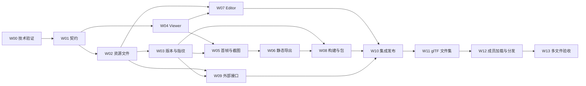

# 三维资源复用与渲染实施计划

计划日期：2026-10-16；实施状态更新：2026-10-17。W01–W09 已实现并合入 `feature/threejs-model3d`，W10 主体验证完成；包级状态、T01–T12 证据与 G1 退出项见「实施状态与证据」。

方向依据：[三维资源复用与 Three.js 渲染接入分析](./threejs-rendering-and-management-analysis.md)。本计划细化交付顺序、接口、数据增量、测试和发布门槛；后续实施状态与实际证据在本计划中维护。

## 实施状态与证据（2026-10-17）

各工作包复选项保留为范围清单，完成状态以本节为准。

| 包 | 状态 | 证据摘要 |
| :--- | :--- | :--- |
| W00 | 并入后续包执行 | 格式矩阵、接受预算与引擎策略已固定进 Backend 策略对象、Runtime 引擎与支持矩阵；未单独留存首帧时间/峰值内存实测记录（见退出项） |
| W01 | 已完成 | model3d 契约、展示参数 JSON Schema、共享正反例、统一错误码、Runtime Kit manifest 能力位与用后披露；`codegen:editor-api` / `codegen:preview-types` 无漂移 |
| W02 | 已完成 | GLB 容器/JSON/bufferView/扩展校验与预算、模型上限、按 ID 替换与提交前基线复核、匿名入口关闭；`backend/tests/unit/test_model3d_glb_service.py`、`backend/tests/api/test_workspace_model3d_assets.py` |
| W03 | 已完成 | 资源绑定/持有表与迁移、页面/组件版本冻结与动态名 409 拒绝、历史预览冻结映射、截图/检查/渲染指纹纳入资源与引擎身份、持有释放与 TTL 对账；`test_asset_binding_service.py`、`test_model3d_reference_collector.py`、`test_model3d_version_bindings.py` |
| W04 | 已完成 | `AssetModel.v1` Viewer、多实例隔离、缓存引用计数、错误/零尺寸/销毁处理；`runtime` gate 与 `ModelViewer.test.ts`、`model3d/*.test.ts` |
| W05 | 已完成 | 模型首帧探针汇入 render-ready.v1、Renderer 无登录态鉴权读取、真实截图；`test:renderer`、`test:render-e2e`（含三维真实像素） |
| W06 | 已完成 | 静态帧准备/整块导出/清理、`data-runtime-kit-media-kind=model3d` 媒体词汇；`model-static-frames.test.ts`、`PPTXRuntimeKitExportDom.test.ts` |
| W07 | 已完成 | Editor 三维上传、详情摘要、按 ID 替换（expected hash）、真实预览与 AssetPicker；`test:editor:gate` |
| W08 | 已完成 | 构建冻结与物化、资源包/组件包/样式包/模板包含三维文件往返、离线产物；`test_project_build.py`、`test_model3d_asset_package.py`、`test_project_template_package_model3d.py` |
| W09 | Backend 外部件已完成；CLI/MCP 未对接 | External `asset.file.replace`、AI 三维摘要与披露、OpenAPI/参考文档；`test_external_asset_replace.py`；CLI/MCP 见退出项 |
| W10 | 本次收尾 | 全量 E2E（auth/smoke/visual-edit/ai/runtime-heavy 共 18 例）、Docker 架构演练（专属 PG/Redis/卷/回环端口）、迁移对拍、兼容矩阵与文档更新 |

集成门禁（2026-10-16/17，分支 `feature/threejs-model3d`）：Backend 全量 1430 通过（14 skip）、Editor gate、Runtime gate、根仓 contracts 59、repository 16、真实 Nginx Gateway 契约、CLI Skill 契约、`pg-claim` 9（专用库）、Renderer 27、`render-e2e` 2/2、`codegen` 无漂移、E2E 全量 18 例（17 通过，1 例跨项目并发 flake 隔离重跑 4/4 通过）、Docker 架构演练 `wp-arch-drill-ab16336a` 与故障注入演练 `wp-arch-drill-d1e9b1a2` 全部阶段通过（证据在 `test-results/docker-architecture/`）：setup/seed/pipeline（经 Gateway 的真实 PNG+ZIP）/jobs/browser-same（双副本 58 条响应、单一版本身份）/browser-cross（三条 `PREVIEW_VERSION_SKEW` 409）/browser-build/credentials/owner/owner-pause/owner-hostname/legacy（旧 schema 前滚）/render-cancel/render-cancel-result/render-timeout/render-kill/render-late/cleanup；三个交付镜像（lite/runtime/renderer）均由本分支代码构建。

### 已知不稳定用例（非本分支引入）

- `[visual-edit] AssetImage 专用检查器…`：全量并发下偶发失败，隔离重跑 3/3 通过。
- `[ai] 内容助手在资源库页面…上传参考图`：全量并发下偶发按钮禁用（会话/路由作用域竞态），`--project=ai` 隔离重跑 4/4 通过。

### G1 退出项（未关闭）

- 独立 `web-presentation-cli` 与 `web-presentation-mcp` 尚未对接 model3d（上传、按 ID 替换、查询、原始文件获取）；M1 发布面限制为平台内与 External API 契约，不能标注「完整外部 Agent 支持」。
- Docker 架构演练已完成主体阶段（见集成门禁）；依赖 N-1 旧镜像的 `m05-*` 组合矩阵属于 M05 里程碑自身门禁，本轮未构建旧镜像、未执行。
- W00 首帧时间/峰值内存实测记录未单独留存；T08 真实 PDF/PPTX 双视角目检与 T10「50 次切换无持续增长」测量未执行。
- 渲染诊断导航回归（`page.diagnose` 曾以桥接宿主页为导航目标导致空等硬期限）已修复，演练探测脚本同步适配桥接宿主页（`test(drill)` 提交），两项均随 W10 验证。

## 交付目标与范围

第一批可发布能力以一条完整流程验收：上传标准 GLB → 在资源库预览 → 两张页面及同一页面的多个实例引用同一资源 → 分别设置视角 → 替换资源并刷新当前引用 → 还原历史视图 → 生成 PNG、PDF、PPTX 与独立网页构建。

资源类型采用 `model3d`，公开组件采用 `AssetModel.v1`。GLB 原始字节保留，Three.js 仅作为 Runtime 内部引擎。资源展示参数不定义物体和材质，不增加场景 DSL。GLB 不进入文本内容工具；程序化效果继续使用工作空间组件。

| 里程碑 | 交付范围 | 发布条件 |
| :--- | :--- | :--- |
| M0 技术与契约验证 | 标准样本、真实 Renderer 镜像、多个实例、静态帧、构建可行性、支持矩阵 | 确认可实施边界与预算，再进入公开能力开发 |
| M1 单文件 GLB | 文件管理、标准格式校验、资源复用、实例视角、版本保护、截图导出、构建与外部 API | W01 至 W10 全部完成并达到 G1 门槛 |
| M2 多文件 glTF | glTF/bin/纹理文件集、原子版本、成员访问、完整导入导出与构建 | W11 至 W13 完成并达到 G2 门槛 |
| M3 按需求扩展 | 动画播放、Draco/KTX2/Meshopt、持久化缩略图、更多格式 | 每项独立声明契约、预算与验收，不计入 M1/M2 默认承诺 |

M1 不依赖完整建模器、对象树编辑器、时间轴和 GPU 硬件集群。资源列表允许先使用类型图标，资源详情提供真实 WebGL 预览；持久化缩略图单独交付，避免为列表预览引入新的重任务前置条件。

## 代码现状与实施前提

| 已有基础或缺口 | 代码依据 | 计划处理 |
| :--- | :--- | :--- |
| 资源上传、覆盖和按 ID 替换均可复用；通用上传当前会全量读取文件 | [AssetService](../../../backend/app/services/asset_service.py)、[资源路由](../../../backend/app/api/routes/assets.py) | 增加三维类型和有界读入；替换加入版本基线 |
| 页版本资源索引保存组件名与资源名，没有固定文件身份 | [PageVersionComponentResource](../../../backend/app/models/page_component_resource.py)、[PageVersionService](../../../backend/app/services/page_version_service.py) | W03 增加三维引用的不可变绑定与文件保留 |
| 发布组件保存源码、previewSchema 和资源名索引 | [组件版本](../../../backend/app/models/workspace_component_version.py)、[组件资源索引](../../../backend/app/services/component_resource_index_service.py) | 递归收集组件资源，按宿主预览模式选择实时或冻结映射 |
| 构建 Release 保存 name→hash manifest，不能单凭映射保证文件未被清理 | [ProjectBuildService](../../../backend/app/services/project_build_service.py)、[Release](../../../backend/app/models/release.py) | W03/W08 增加版本持有，物化后产物独立可用 |
| 截图配置指纹覆盖画布、主题等展示配置，资源更新需要另补身份 | [截图指纹](../../../backend/app/services/page_screenshot_fingerprint_service.py)、[截图任务](../../../backend/app/services/page_screenshot_job_service.py) | W03 纳入三维引用摘要，并在当前截图指针提升时复核 |
| 检查指纹已有资源名与 hash 处理 | [CodeCheckFingerprintBuilder](../../../backend/app/services/code_check_fingerprint.py) | 复用解析服务，补三维规则、执行引擎与版本模式 |
| asset_host、Runtime Kit、visual-assets 和 render-ready 已存在 | [AssetPreviewService](../../../backend/app/services/asset_preview_service.py)、[就绪协议](../../../runtime/src/core/utils/render-ready.ts) | W04/W05 接入模型 Viewer 和首帧状态 |
| External 上传支持 overwrite，但按原文件名或资源名匹配，尚无按 ID 的文件替换路由 | [External assets](../../../backend/app/api/routes/external/assets.py)、[operation 目录](../../../backend/app/core/external_operations.py) | W09 新增明确的二进制替换契约 |
| 文件读取已按用户、预览 artifact 和内部任务分为受保护入口 | [工作空间资产文件入口](../../../backend/app/api/routes/assets.py)、[预览素材入口](../../../backend/app/api/routes/preview.py)、[Runtime 内部素材入口](../../../backend/app/api/routes/internal_runtime.py)、[FileAuthService](../../../backend/app/services/file_auth_service.py) | 按下方 C05 接入；不复用未挂载的旧 `public_assets.py`，不新建匿名 GLB/纹理读取路径 |

所有改动遵循仓库分层和 [DESIGN.md](../../../DESIGN.md)。数据库锁、重试与时间处理复用现有适配层；浏览器仅在 Renderer 执行。文中拟新增的模块名和字段名是实施默认方案，实际命名可随现有边界调整，行为与门槛保持一致。

## 实施契约

### C01 标准文件和元数据

M1 接受 glTF 2.0 二进制 GLB、自包含 buffer/图片、核心 PBR 材质与静态姿态。`KHR_materials_unlit`、`KHR_lights_punctual` 作为首批候选扩展，须在 M0 验证后列入明确白名单。未知必需扩展拒绝；未知可选扩展按规范允许的降级返回 warning。首期不安装压缩解码器，不从 CDN 下载解码脚本。

保留所有原始相机和动画数据，M1 只提供静态姿态，不选择动画片段、不运行 AnimationMixer。多场景选择和相机索引使用源文件中的索引，显示名仅作辅助，避免重名造成不确定选择。格式参考 [glTF 规范](https://registry.khronos.org/glTF/specs/2.0/glTF-2.0.html) 与 [GLTFLoader](https://threejs.org/docs/pages/GLTFLoader.html)。

新增 `AssetAnalysisMetadata` 的 `kind=model3d` 分支，兼容现有 icon 分支与无分析结果资源；不新增第二份手写 Editor DTO。候选摘要字段为：

| 字段 | 语义 |
| :--- | :--- |
| `schema_version`、`kind` | 摘要结构版本与三维类型 |
| `model3d.format`、`gltf_version` | glb/gltf 与文件声明版本 |
| `model3d.scene_count`、`default_scene_index` | 场景数量和默认入口 |
| `model3d.cameras`、`animations` | 原始索引、可选名称及可用信息，不能以名称作为唯一身份 |
| `model3d.extensions_used`、`extensions_required` | 格式扩展信息 |
| `model3d.validation_profile`、`warnings` | 本次接受策略版本与有界提示 |

静态可确定的数据由 Backend 提取；实际 bounds、GPU 内存与实测绘制开销不伪装为已知。Viewer 可在预览时计算 bounds，M1 不额外引入持久化分析任务。

M0 使用以下候选上限做压力验证，W01 在开工前固定最终值：文件 32 MiB、JSON chunk 2 MiB、节点 2048、三角形 30 万、单纹理最长边 4096、纹理解码总像素 32 MP。它们是待校准的接受策略，不是已测性能结论；实际上传上限取平台既有入口上限与三维上限的较小值。所有场景和未选中的潜在加载内容也计入预算。

上限与支持矩阵由 Backend 同一策略对象提供，摘要带策略版本，Editor 展示当前约束，Runtime 执行相同必要防护。固定执行规则先进入代码契约，不随意增加 ENV；需要管理员可调时按现有配置治理规则处理。

### C02 实例展示参数

公开路径为 `@runtime-kit/public/components/assets/AssetModel.v1.vue`。M1 默认 props 如下，JSON Schema 仅描述查看参数，可放在 `backend/app/core/model_view_options.v1.json` 并生成共享类型与正反例：

| 参数 | 默认与约束 |
| :--- | :--- |
| `name` | 必填、稳定资源名；M1 不开放任意 URL 和内联 GLB/base64 |
| `sceneIndex` | 未指定时取 glTF 默认场景，仍缺省时取第一个有效场景；空或越界报错 |
| `cameraIndex` | 可选源文件相机索引，须属于选中场景；与显式 position/target 互斥 |
| `cameraPosition`、`cameraTarget` | 必须成对提供，有限三元数组，坐标使用源资源单位且两点不重合 |
| `cameraFov` | 仅显式透视相机配置可用，默认 45 度，范围大于 0 且小于 180 |
| `background` | 默认透明；接受约定颜色格式，不接受 CSS/URL 表达式 |
| `lighting` | `auto` 或 `source`；auto 仅在选中场景无可用光照时添加查看器默认光照 |
| `interactive` | 默认 false，演示或资源详情可显式开启；首期无自动旋转 |
| `fallback`、容器 class | 失败文案与明确尺寸，不影响资源本体 |

相机优先级固定为显式位置 → 显式 cameraIndex → 选中场景中按源索引排序的首个有效相机 → 自动取景。显式无效选择报错；只在真正缺省时自动取景。资源相机保持透视或正交投影类型，适配容器长宽比。实例不修改几何尺寸，不改写文件材质。

每个 Viewer 的节点、相机、骨骼和控制器独立；可共享不可变下载/解析缓存，geometry/material/texture 的所有权与引用计数由内部模块管理。页面编辑态的临时旋转不直接写入资源或源码；“将视角保存到当前引用”的可视化操作列为 M3，M1 通过页面源码或组件属性保存参数。

### C03 文件替换接口

内部已有 `POST /api/workspaces/{workspace_id}/assets/{asset_id}/replace`。M1 增加 multipart `expected_file_hash`，对 model3d 替换必填；其他类型暂保持旧调用兼容。缺参按请求校验返回 422，基线不匹配返回 409 `ASSET_VERSION_CONFLICT`，不能按客户端旧视图覆盖新文件。

External 新增 `POST /api/v1/assets/{asset_id}/replace`，operation 为 `asset.file.replace`，scope 为现有 `asset:write`。请求包含 `X-Workspace-ID`、必填 `Idempotency-Key`，multipart file 与 `expected_file_hash`；不允许借文件替换改变 asset_type、id 和 name。成功返回 200 AssetResponse；同幂等键同输入回放结果，不同输入冲突，重放不生成第二份历史。

内部和 External 路由调用同一领域服务，领域服务在提交前复核 expected hash，并以条件更新或已有事务互斥保证只成功一次。上传原始文件、旧内容历史、摘要、当前引用失效身份与幂等记录一起协调；校验或冲突失败时不改变当前记录。写文件先于数据库提交的孤立 blob 可按现有存储规则清理，绝不能删除仍被其他资源或快照引用的同 hash 文件。

M1 暂不让通用 overwrite 承担并发安全的模型替换。对已有 model3d 名称的覆盖请求返回明确冲突并指向按 ID 替换；其他资源保留既有行为。这样避免原文件名优先匹配选中另一条资源。

### C04 当前引用与历史绑定

| 使用位置 | 资源解析规则 |
| :--- | :--- |
| 当前页面、组件草稿、当前资源详情 | 按 name 读取当前资源版本，替换后刷新 artifact 才切换文件 |
| 当前页面中的已发布组件 | `/v/N` 固定组件代码；三维资源由宿主页的当前映射解析，多实例仍复用当前资源 |
| 页面版本历史、组件版本独立历史预览 | 使用版本保存时固定的资源映射，包含递归组件依赖 |
| 正在截图的请求、正在构建的 Release | 创建请求时冻结输入；执行期间替换不修改该次输入 |
| 已发布网页产物 | 使用已物化的文件，与 Backend 当前资源脱离 |

这一策略避免首期引入“不同组件模块对同名资源分别解析不同版本”的作用域系统。若未来要求发布组件在所有宿主中始终固定资源，需要增加模块级资源作用域并单独评估；不能静默改变当前实例的解析语义。

历史保存的最小增量方案为复用 WorkspaceAsset 的归档历史副本：保存版本时按 name→hash 建立不可写快照记录，文件内容可复用同一 blob；新增统一的资源绑定/持有表记录 `workspace_id`、`owner_kind`、`owner_key`、`resource_name`、`snapshot_asset_id`、`file_hash` 和可选 `expires_at`。owner 支持 page_version、component_version、release、render_request 和 preview_artifact，避免另造资源文件版本体系。

`snapshot_asset_id` 必须有真实 FK 和删除保护；owner 的关联与生命周期由统一服务校验。永久版本持有不设置过期时间；临时 artifact/request 持有按实际 TTL 或任务终态释放，并与清理器对账。时间列使用 UTCDateTime。新增 `history_kind=reference_snapshot` 时，写保护、历史展示与历史文件读取需明确覆盖该种类。

相同源文件快照复用必须避免并发重复持有或错误删除。版本绑定、根资源读取和替换复核由同一适配层事务协调，禁止只在业务代码里先读 hash 再无条件提交。删除根资源时现有“连带删除历史副本”路径须先检查所有持有者。

首次上线只为新三维引用建立绑定，不扫描重构所有旧资源历史。旧版本若缺绑定则标记无法精确还原，不用当前文件冒充历史版本。首次引入 model3d 前的数据库无需伪造三维历史。

页面源码未变而资源版本改变时，保存逻辑还应比较绑定摘要；摘要变化可以创建注明“资源版本更新”的新版本，不能被当前 PageVersionService 的源码无变化短路忽略。历史预览始终使用冻结绑定。执行页面版本恢复时，恢复源码和展示参数，新保存版本按当前资源重新绑定并明确显示差异；需要把旧模型恢复为当前资源时，应通过资源库的明确文件替换操作完成，因为该操作会影响所有实时引用，页面恢复不自动回滚工作空间资源。

静态 name、可解析的有限数组、previewSchema 与组件资源索引作为首期可精确冻结的引用来源。无法解析的动态模型名不得默认为已覆盖：项目构建可沿用现有额外资源清单；版本冻结须能取得完整有限集合，否则返回 `MODEL3D_REFERENCE_UNRESOLVED` 并提示补充声明或使用静态资源名。AI 默认生成静态引用。

### C05 文件读取与鉴权

三维文件复用平台现有受保护文件链路，授权用途不能互换：

| 读取方 | 入口与凭证 | 实施要求 |
| :--- | :--- | :--- |
| Editor 用户 | `GET /api/workspaces/{workspace_id}/assets/{asset_id}/file?hash={hash}`，用户会话 | 检查当前工作空间权限及当前文件版本；历史版本通过冻结快照读取，资源响应中的下载 URL 不能视为匿名公开链接 |
| Runtime 预览 / Renderer 浏览器 | `GET /preview/artifacts/{artifact_id}/assets/{file_hash}?token=P`，短期预览票据 | P 只读该 artifact manifest 中的资源；Runtime 按 `asset_base_url_auth=preview_token` 显式附加，不向浏览器交付 S 或业务 Cookie |
| Runtime / Build Worker | `GET /internal/runtime/preview-artifacts/{artifact_id}/assets/{file_hash}`，服务票据 S 或任务授权 | 仅允许配置的 Backend 内部源站；校验 artifact 和 manifest 成员，不跟随重定向、不向外站发送凭证 |
| 已生成网页 | 构建工作区内物化的静态文件 | 发布文件不包含 P、S 或 Backend 文件 URL；加载时不依赖在线授权服务 |

旧 `public_assets.py` 文件虽仍在源码树中，但没有挂入当前 Backend API Router；Gateway 同时阻断 `/public`。W02/W04 不得把 `/public/assets` 重新作为 GLB 或纹理路径。三维资源加入预览 manifest 时绑定确定的文件 hash 和引用闭包；不得扩大成新的工作空间通配授权。若上游 artifact manifest 仍包含超出三维引用所需的资源，应与[文件存储鉴权与缓存规划](./file-storage-auth-cache-plan.md)的 manifest 范围收敛工作一起验收后再开放模型能力。

所有入口先完成本次请求授权和版本/manifest 成员检查，再处理缓存、ETag、HEAD、Range 或回源。P 到期由已登录 Editor 重新检查权限并续签同一 artifact；artifact 到期则重建。M2 每个 glTF 相对依赖都必须映射到同一 revision 的校验成员，不允许外部 URL、预签名对象存储地址或路径拼接绕过 manifest。

## 工作包与依赖顺序

所有复选项保留为工作范围清单，完成状态与证据统一维护在「实施状态与证据」。工作包按合并顺序组织，不要求一次性提交所有模块；公开入口只能在相应门槛满足后启用。



### W00 真实环境技术验证

前置：无。负责范围：Runtime、Renderer、构建与测试。完成后关闭 M0。

- [ ] 准备自制或许可明确的小型 GLB：PBR 与纹理、透明材质、正交/透视相机、多场景、骨骼静态姿态、无相机模型；另备损坏、外链和压缩扩展反例。每份记录 hash、来源、许可和预期。
- [ ] 原型验证 GLTFLoader、自动取景、双实例隔离、真实容器 WebGL 2 与 PNG；检查 PDF/PPTX 的帧采集和离线构建路径，原型不登记为正式公开组件。
- [ ] 在 lite 与分服务交付环境记录首帧时间、峰值内存、单次截图时长、软件渲染身份；以 C01 候选预算跑边界样本。
- [ ] 固定 three 版本与对应类型版本，保留根锁文件；不使用浮动 CDN。将 [Khronos glTF-Validator](https://github.com/KhronosGroup/glTF-Validator) 用作样本/CI 的独立校验基准，不因采用它就让 Backend 增加浏览器或隐式 Node 执行依赖。
- [ ] 产出最终格式矩阵、资源预算、默认灯光与色彩策略、测试样本清单和 G0 记录。若容器无法生成正确帧，先修复执行环境，不开放上传入口宣称支持。

验收：至少两份含纹理样本在真实 Renderer 生成非空图，双实例视角独立，标准文件可下载，四种输出路径有可检查产物。G0 只能由实际运行证据关闭。

### W01 契约和共享样例

前置：W00。负责范围：Backend、Runtime、Editor 契约。

- [ ] 固定 C01/C02 的 v1 行为，新增 model3d 枚举和分析摘要分支；保持 icon/null 的序列化兼容。
- [ ] 建立展示参数 JSON Schema、生成类型和共享正反例；明确 cameraIndex 与显式相机的互斥、颜色规则和无效索引行为。
- [ ] 在 Runtime Kit manifest 增加候选 AssetModel.v1 的字段、示例、约束、能力标签与 previewSchema；实现可用前保持能力不披露。
- [ ] 确定统一错误码：格式非法、必需扩展不支持、外部 URI、预算超限、版本冲突、引用无法冻结、相机选择失效。
- [ ] 运行 DTO 与 previewSchema 生成和对拍；将正式 API 契约写入 External 参考文档，实例 props 写入 Runtime Kit 使用文档。

验收：三端对同一正反例一致；旧资源 DTO 兼容；清单中不存在可披露但尚无执行实现的能力。

### W02 Backend 文件管理和边界校验

前置：W01。重点入口：AssetService、schemas/asset、asset_storage_drivers、FileAuthService 与受保护文件路由；新增格式解析与预算模块按职责拆分。

- [ ] 支持 GLB 扩展名与 MIME；应用通用上传上限与 model3d 上限，读入前/过程中有界检查，不只依赖客户端 Content-Length。
- [ ] 解析容器、JSON、bufferView/accessor/image 引用范围与扩展；检查有限数值、引用索引、树结构和预算，拒绝全量解码前即可确定的非法输入。
- [ ] 接入 create、replace、overwrite 拦截、包导入等所有落库入口，同一校验服务防止导入绕过；GLB 内容读写接口返回不支持。
- [ ] 完成 C03 内部按 ID 替换与提交前版本复核；保留 id/name/类型与原始下载字节，失败保持旧记录和引用不变。
- [ ] 将 model3d 纳入受保护的工作空间文件与 artifact manifest 读取流程；不接入匿名 `/public/assets`。本地与 S3 路径验证正确 MIME、缓存、跨域和完整内容，避免在全量响应中额外复制大型文件。
- [ ] 扩展资源筛选、派生字段、归档/恢复/引用保护和摘要。格式通过只表示结构接受，不伪造“已通过浏览器视觉检查”。

测试：扩展 [test_workspace_assets.py](../../../backend/tests/api/test_workspace_assets.py)、[test_workspace_asset_delivery.py](../../../backend/tests/integration/test_workspace_asset_delivery.py) 和受保护素材路由测试，新增 model3d parser 单测；覆盖畸形字节、越界、跨用户、P/S 用途或 artifact 不匹配、manifest 外 hash、上传与包导入、同 hash 替换和并发两个不同文件替换。

验收：所有写入入口校验一致；同一 expected hash 的两个并发替换只成功一个；历史和原始下载正确，存储失败或事务回滚不破坏旧文件。

### W03 版本绑定 文件保留与缓存身份

前置：W02。重点入口：PageVersionService、PageComponentIndexService、ComponentResourceIndexService、PreviewService、ProjectArtifactBuilder、RenderSnapshotService、截图和检查指纹。

- [ ] 按 C04 实施资源绑定/持有表与仓储，复用历史副本和 blob；补充迁移、唯一约束、到期时间及 SQLite/PostgreSQL 事务验证。
- [ ] 在页面保存、组件发布与历史预览中收集递归三维资源，并绑定 name、hash 和不可写快照；对无变化源码但绑定变化的保存新增测试。
- [ ] 当前预览使用实时映射，历史预览使用绑定覆盖；相同资源名在宿主范围只解析成一个版本，并验证组件封装与嵌套引用。
- [ ] 预览 artifact、render request、Release 创建时建立持有，按 owner 生命周期释放；清理器仅删除无任何有效持有且符合原历史保留规则的内容。
- [ ] 检查指纹、截图 config hash 和渲染 input digest 纳入资源绑定摘要、展示参数所在源码/previewSchema、三维校验规则与引擎配置身份。
- [ ] 截图最终提升当前指针、构建物化与历史删除前重新复核输入；旧任务可完成自己的冻结产物，但不得把旧截图提升为当前页面结果。
- [ ] 资源删除、根记录历史级联删除、复制、跨空间导入与版本恢复同步绑定规则。失败时错误明确，不能悄悄读取最新模型替代旧模型。

测试：新增版本绑定与生命周期单测/集成测试，扩展现有资源引用解析、检查指纹、截图指纹和迁移测试。

验收：A→B 替换期间，当前页面使用 B；历史页面与已入队截图使用 A；删除 A 的根资源受持有保护；持有释放后可按规则清理；任务完成前再次替换不能污染当前结果。

### W04 Runtime 标准 Viewer 与多实例

前置：W01；正式联调等待 W02。重点目录：runtime-kit/public/components/assets、内部 model3d 渲染模块、asset-preview、core/shared/runtime-preview。

- [ ] 新增 AssetModel.v1.vue；内部按 loader、实例、相机、释放、静态帧职责拆分模块，用根 pnpm workspace 增加 three 生产依赖。
- [ ] 按资源 metadata 验证 model3d，解析 name→hash→manifest 声明的 URL；预览票据只按 `asset_base_url_auth` 声明添加，独立 LoadingManager 拒绝非受控依赖；加载和引擎代码按需导入。
- [ ] 实现多场景、源相机、显式相机与自动取景，固定灯光、色彩空间、曝光和容器尺寸策略；不缩放改写源几何。
- [ ] 实现请求序号/取消与异步晚到处理；共享下载和解析的缓存须按 workspace/hash/策略版本分区，相机、骨骼和节点状态各实例独立。
- [ ] 明确 geometry/material/texture/ImageBitmap/Blob 的所有权；Observer、事件、控制器、循环和 GPU 资源按实例释放与缓存引用计数回收。
- [ ] 接入 asset_host，处理错误、零尺寸恢复、Resize、context lost、离屏暂停和交互开关。

测试：Vue/jsdom 负责状态、契约、相机计算和释放计数；真实浏览器负责纹理、材质、骨骼与多实例像素，不能用 jsdom 假 WebGL 替代视觉测试。

验收：同资源两实例视角不同；卸载其中一个后另一个正常；连续 50 次切换不留下失控循环、监听或持续线性增长的资源；首次页面加载不使用三维时不额外加载引擎。

### W05 首帧与远程截图

前置：W04，版本输入依赖 W03。重点入口：visual-assets、render-ready、Renderer executor 和相关错误投影。

- [ ] 增加 model3d 加载、ready、error 探针，汇总所有实例；ready 以必需纹理、解码、实例配置与实际绘制完成为依据。
- [ ] 截图模式禁用查看交互与动效，固定静态姿态；场景初始化错误进入现有失败链路并返回有界诊断。
- [ ] 保留 artifactId/inputDigest 双向核对，不用固定 sleep 或 networkidle 替代模型就绪。
- [ ] 用无用户登录态的 Renderer 浏览器验证 P 读取 manifest 内 GLB/纹理、越权 hash 与过期 P 被拒绝；续签只经 Editor 当前会话，不把 S 传给页面。
- [ ] 复用 render-ready.v1 的现有结构；确需增加远程字段或错误协议时同步 render-contracts、Backend、Renderer，而非只改 Viewer。
- [ ] 将模型资源摘要和策略身份纳入渲染日志；已有请求取消、期限与 attempt 围栏传播保持一致。

验收：慢纹理时不提前截图；纹理或 WebGL 失败时任务不成功；旧 artifact 和错 digest 被拒绝；真实交付镜像中的多实例 PNG 有预期内容。

### W06 PDF 与 PPTX 静态帧

前置：W05。重点入口：PageCaptureService、PDFExportService、PPTXDomConverterMedia、PPTXRuntimeKitExportDom、导出报告。

- [ ] 增加通用的模型静态帧准备与清理流程：冻结保存视角、重绘后立即读回 PNG，或通过专用 render target 读取。
- [ ] 页面采集期间使用静态图替换映射，成功或异常均恢复交互状态；多个实例分别采集，不以资源 hash 直接共用图片。
- [ ] 增加 `data-runtime-kit-media-kind=model3d` 及媒体词汇、转换分支与报告，整块导出，避免 canvas 被普通布局递归拆分。
- [ ] 静态图缓存包含资源与实例身份、视口和 DPR；透明背景和深浅背景分别验收，不依赖全局 preserveDrawingBuffer 设置掩盖时序问题。

验收：实际打开 PNG/PDF/PPTX 检查模型、纹理、视角、透明度、位置和清晰度；源资源相同但视角不同的两个实例导出不同图，失败有报告且不残留替换 DOM。

### W07 Editor 管理和引用流程

前置：W02/W04。重点入口：AssetsView、资源详情、asset-manager、AssetPicker、项目与建议参考资源面板。

- [ ] 增加三维类型、文件选择、格式范围和支持提示；上传后可打开 Runtime 真实预览，列表先用类型图标。
- [ ] 详情展示场景/相机/动画摘要、warning、原始下载、按 ID 替换、历史副本、引用关系、复制和归档。
- [ ] 替换提交 expected_file_hash，冲突提示重新读取，不能静默重试覆盖；替换后当前预览按新 hash 生成 artifact，已存在 artifact 不原地改写。
- [ ] 页面通过 AssetModel 静态资源名和 props 引用，AssetPicker 与 previewSchema 能选择同一模型；不同页面无须复制资源。
- [ ] 复用现有组件属性表单；未纳入现有可视化回写能力的相机参数先通过源码配置，不趁本次扩展任意复杂 SFC 编辑器。
- [ ] 遵循 DESIGN.md 的弹窗、滚动、尺寸与响应式规则，处理加载、空态、错误和多次切换。

验收：同资源跨两页、同页两处复用；替换和历史查看流程清楚；交互不抢占页面编辑；GLB 不出现文本内容编辑入口。

### W08 独立构建与标准资源包

前置：W03/W06。重点入口：ProjectArtifactBuilder、ProjectBuildService、runtime-build-worker、资源/组件/样式/项目模板包服务。

- [ ] 静态引用、组件递归与项目额外资源规则收集 model3d，构建 Release 使用已经冻结的 hash 和文件持有。
- [ ] Build Worker 通过 S/任务授权从 artifact-scoped 内部入口读取冻结文件并物化到工作区；三维引擎和 GLTFLoader 在生产裁剪后可用，构建与最终产物不依赖预览 token、Backend 地址或外部 CDN。
- [ ] 资源包、组件包、样式包、项目模板包导出包含所有实际三维文件与对应历史身份；导入后保持标准字节并重新绑定工作空间资源名。
- [ ] 包导入复用 W02 校验，名称冲突、同 hash 复用、整个事务失败和部分文件清理遵循现有包语义并补测。
- [ ] 构建期间替换资源，验证新文件不混进旧 Release；attempt 过期或迟到上传不得提升旧产物。

验收：构建后关闭 Backend 与外网仍能渲染；下载 GLB hash 与源文件一致；包跨工作空间导入后多实例仍正常；无 token 或开发路径泄漏到产物。

### W09 External API AI 与独立消费者

前置：W02/W03，集成依赖 W07/W08。

- [ ] 在 external_operations 注册 asset.file.replace、路径、scope、幂等和返回示例；路由只调用统一领域服务。
- [ ] API/OpenAPI/Editor 生成类型及参考文档同步，Gateway 路径可达且错误语义一致。
- [ ] AI 资源查询返回三维摘要，提示优先复用现有资源；更新 tool_specs 后派生目录与披露，不给 GLB 增加 EditableAssetType。
- [ ] 在独立 web-presentation-cli 仓对接 model3d 上传、按 ID 替换、查询、原始文件获取及使用说明；在独立 MCP 仓对接相应异步客户端和工具 Schema。（未完成，G1 退出项；两仓当前无 model3d 命令与工具）
- [ ] 做真实外部流程：查找资源→上传→多页面引用→替换→旧基线冲突→历史/构建验证；区分 Backend 契约通过和两个消费者各自验收通过。

验收：同幂等键回放不重复生成历史；无 scope、跨工作空间、并发基线均按契约拒绝；真实 Nginx 契约回归和外部消费者各有证据。

### W10 M1 集成 发布与退出条件

前置：W01 至 W09；关闭 G1 后交付 M1。

- [x] 补齐本计划测试矩阵中的自动化与人工产物检查；保留 fixture、渲染配置和结果摘要。（自动化证据见「实施状态与证据」；T08/T10 人工产物检查列入 G1 退出项）
- [x] 在专属数据库、Redis、卷和回环端口执行 lite/分服务镜像演练，遵循 [本地 Docker 架构演练](../testing/docker-architecture-drill.md)，不复用开发数据。（`wp-arch-drill-ab16336a` 与 `wp-arch-drill-d1e9b1a2` 全部阶段通过，证据在 `test-results/docker-architecture/`；三个交付镜像均由本分支代码构建；依赖 N-1 旧镜像的 `m05-*` 见 G1 退出项）
- [x] 验证新增迁移、升级顺序、旧 Runtime 不承接新组件、任务取消/超时、清理和恢复。（`pg-claim` 双库迁移对拍；旧 Runtime 由 manifest 能力位拒绝；取消/超时/清理由 Renderer 与检查持有释放测试覆盖）
- [x] 更新 Runtime 构建身份及兼容矩阵；只有代码、协议、资源服务与交付镜像均就绪后才开放 manifest 能力与 Editor 入口。（`model3d_engine` 清单块与三端指纹；兼容矩阵声明拒绝语义）
- [x] 更新用户资源管理、Runtime Kit、页面资源引用、PPTX DOM、部署与 External/CLI 文档；产品正式支持时更新顶层 README。（`resources.md`、`asset-reuse.md`、`runtime-kit-capabilities.md`、`pptx-export-dom-contract.md`、`external-agent-api.md`、`troubleshooting.md`、`compatibility-matrix.md`；CLI/MCP 文档随消费者对接补齐）

验收：G1 无未关闭的阻断项；若 CLI 或 MCP 尚未完成，明确限制发布面并记录退出项，不能标注“完整外部 Agent 支持”。

### W11 glTF 文件集存储与原子导入

前置：M1。负责范围：Backend、存储与迁移。

- [ ] 定义模型资源集 revision：入口路径、规范化成员路径、hash、大小、MIME、完整成员摘要和源目录信息；绑定到现有逻辑 WorkspaceAsset。
- [ ] 建立成员记录与资源集版本关联，既能保留原始 glTF 目录又能按 hash 去重。对外资源身份仍是 model3d，不把每张内部纹理创建成独立图片资源。
- [ ] 制定 `POST /api/v1/assets/model3d/import` 与按 ID 文件集替换的正式契约；输入 ZIP 作为运输容器并显式指定入口，scope、幂等和 expected revision digest 沿用 C03 原则，路由实现前完成 Gateway 契约声明。
- [ ] 静态解析全部 URI 并校验依赖闭包：相对路径解码与规范化、大小写歧义、重复路径、ZIP 路径穿越、压缩炸弹、外部 URI 和缺失文件；大包有单文件与总解压预算。
- [ ] 整套文件集校验后一次提交当前 revision、历史与持有，失败不能留下可访问的半套资源。

验收：完整 glTF/bin/多纹理导入与替换成功；任一成员缺失或冲突导致整套失败；M1 GLB 的旧接口和快照保持兼容。

### W12 成员加载 构建与导出

前置：W11。负责范围：Runtime、Backend manifest 与包服务、外部消费者。

- [ ] 为 manifest 增加版本化的 model3d 文件集描述：逻辑入口、成员映射、内容摘要；不改变旧 GLB 的 name→hash 入口兼容。
- [ ] 为成员提供版本绑定的受保护读取映射；所有成员必须属于 artifact manifest 中冻结的 workspace+resource revision，不能将后端 hash URL 的目录直接当成模型相对目录，也不能把预签名地址写入 Runtime 页面。
- [ ] 使用 LoadingManager 将标准相对 URI 解析到验证过的成员；创建的 Blob URL、缓存和实例释放遵循 W04 的所有权规则。
- [ ] 构建物化保留目录并使用稳定 base；原始资源下载和各类包导出提供完整标准文件集，外部工具无须平台 SDK 即可读取。
- [ ] 将文件集完整摘要接入历史绑定、截图/检查指纹、替换 CAS、存储清理及 CLI/MCP。

验收：资源预览、历史、Renderer、独立网页和跨空间包迁移使用同一 revision；没有请求包外文件，没有新旧纹理混用。

### W13 M2 回归与发布

前置：W12；关闭 G2 后交付 M2。

- [ ] 执行标准多文件样本、恶意/缺失路径、原子替换、历史与清理矩阵，并重新跑全部 M1 主流程。
- [ ] 使用独立 glTF 消费工具验证导出文件集，记录工具版本与标准校验结果。
- [ ] lite/分服务、SQLite/PostgreSQL、本地/S3 关键路径均有验收；迁移升级不影响旧 GLB 产物。
- [ ] 更新支持矩阵和下载/导入说明，仅宣布已验证的文件形式和扩展。

## 测试矩阵与证据要求

| 编号 | 场景 | 必须观察的结果 | 主要工作包 |
| :--- | :--- | :--- | :--- |
| T01 | 合法 GLB 与原始下载 | 成功渲染；上传与下载 hash 相同 | W02/W04 |
| T02 | 非法容器、引用和预算 | 每个写入口拒绝，旧数据不变 | W02 |
| T03 | 同文件多实例与骨骼静态姿态 | 相机/节点独立，卸载一个不影响另一个 | W04 |
| T04 | A→B 并发替换 | 仅一个基线更新成功，幂等重放无重复历史 | W02/W09 |
| T05 | 当前、历史、截图、Release 混合替换 | 当前刷新后 B；冻结输入仍 A；旧任务不覆盖当前指针 | W03/W05/W08 |
| T06 | 静态名、有限数组、组件与 previewSchema | 收集闭包完整；无法冻结的动态名有明确处理 | W03/W08 |
| T07 | 慢纹理、WebGL 失败和零尺寸恢复 | 不提前 ready；失败可诊断；恢复后正确渲染 | W04/W05 |
| T08 | 相同模型不同视角 PDF/PPTX | 实际产物中视角不同，无空白或缺纹理 | W06 |
| T09 | 离线构建与跨空间导入 | 无 Backend/CDN 依赖，资源重新绑定正确 | W08 |
| T10 | 资源清理与生命周期 | 有持有不可删除；到期/删除 owner 后按规则回收；50 次切换无持续增长 | W03/W04 |
| T11 | 受保护素材鉴权 | 用户会话、P、S/任务授权各自只读其范围；artifact 外 hash、错用途和过期票据拒绝；鉴权先于热缓存、304、HEAD、Range；`/public` 无回退；令牌不进入产物 | W02/W04/W05/W08 |
| T12 | 镜像、任务超时、取消和 attempt | 实际 PNG 正确；无浏览器孤儿、临时产物或槽位泄漏 | W05/W10 |
| T13 | glTF 多文件正常/反例与原子替换 | 完整闭包或整批拒绝，新旧成员不混用 | W11/W12 |
| T14 | 标准文件集再利用 | 独立工具可读取下载/导出文件，不需平台解析器 | W12/W13 |

自动化证据写入现有 `test-results/e2e/` 等对应测试输出目录；仅将小型结论与稳定 fixture 索引写入文档，不提交生成的大型媒体、依赖或缓存。大于 10 MiB 的二进制 fixture 先判断是否需要入库并按仓库 LFS 规则处理，边界压力样本优先测试时生成。

### M1 矩阵证据映射（2026-10-17）

| 编号 | 自动化证据 | 遗留 |
| :--- | :--- | :--- |
| T01 | `backend/tests/api/test_workspace_model3d_assets.py`（上传/下载同 hash）；E2E smoke「三维模型页面截图应包含真实模型像素」真实渲染 | — |
| T02 | `backend/tests/unit/test_model3d_glb_service.py` 与 api 反例（非法容器/引用/预算/外部 URI 拒绝且旧记录不变） | — |
| T03 | `runtime/src/runtime-kit/internal/renderers/ModelViewer.test.ts`、`model3d/model-cache.test.ts`（实例独立、共享缓存引用计数、卸载隔离） | — |
| T04 | W02 并发替换测试与 `backend/tests/integration/test_external_asset_replace.py`（仅一个基线成功、重放无重复历史） | — |
| T05 | `backend/tests/integration/test_model3d_version_bindings.py`（历史冻结仍 A、当前刷新 B）；截图过期复核 `test_page_screenshot.py`；构建快照 `test_project_build.py` | — |
| T06 | `test_model3d_reference_collector.py`（组件闭包递归）；动态名保存即 409 拒绝（integration 与构建测试） | — |
| T07 | Viewer 状态机与相机/零尺寸边界（`ModelViewer.test.ts`、`camera-fit.test.ts`）；首帧探针汇入 render-ready | — |
| T08 | `model-static-frames.test.ts`（实例视角分区不共用帧）、`PPTXRuntimeKitExportDom.test.ts`（整块导出与回退报告） | 真实 PDF/PPTX 双视角目检未执行 |
| T09 | `test_model3d_asset_package.py`、`test_project_template_package_model3d.py`（往返字节保持与重新绑定）；离线物化由构建测试覆盖 | — |
| T10 | `backend/tests/unit/test_asset_binding_service.py`（持有保护/释放/对账） | 「50 次切换无持续增长」人工测量未执行 |
| T11 | `test_private_asset_chains.py`、file_auth 单测、真实 Nginx Gateway 契约回归 | — |
| T12 | Renderer 单测（槽位与清理）与 `test:render-e2e` 真实 PNG；E2E 截图 smoke；Docker 演练 pipeline（真实 PNG+ZIP）、browser-same/cross、render-cancel/timeout/kill/late 全部阶段通过 | `m05-*` 组合矩阵依赖 N-1 旧镜像，本轮未构建、未执行 |

### 门槛与执行命令

| 门槛 | 关闭条件 |
| :--- | :--- |
| G0 | 真实镜像技术验证、样本与预算固定、无未解决的 WebGL/导出阻断 |
| G1 | W01–W10 完成；T01–T12 通过；迁移、外部契约与部署证据齐全；M1 支持矩阵对应实际行为。（当前：W01–W09 完成、W10 主体完成；退出项未关闭，见「实施状态与证据」） |
| G2 | W11–W13 完成；T13/T14 与全部 M1 回归通过；文件集下载保持标准可用 |

开发阶段先跑受影响的最小测试，工作包集成后再运行对应完整门禁。M1 发布前的执行集合为：

```powershell
pnpm run codegen:editor-api
pnpm run codegen:preview-types
pnpm run test:contracts:generated
pnpm run test:backend:unit
pnpm run test:backend:api
pnpm run test:backend:integration
pnpm run test:backend:pg-claim
pnpm run test:editor:gate
pnpm run test:runtime:gate
pnpm run test:renderer
pnpm run test:contracts
pnpm run test:contracts:gateway
pnpm run test:contracts:cli-skill
pnpm run test:repository
pnpm run test:render-e2e
pnpm run test:e2e:regression
```

`test:backend:pg-claim` 中的迁移对拍需要真实 PostgreSQL 配置；缺少 PostgreSQL 不能记为双库验收通过。变更远程 DTO 时补跑 test:render-contracts；变更交付镜像和生产依赖时补跑 test:contracts:docker-context、test:python-workspace，以及实际镜像构建和启动。render-e2e 需在现有截图用例中增加模型主流程；复杂多实例与包回归放 runtime-heavy，不能仅新增未被脚本选中的 spec。

## 合并安排与工作量

建议按工作包形成可审阅的小批次；C01/C02 固定后，格式服务和 Runtime Viewer 可分别推进，但版本、导出、构建与发布门槛按依赖顺序收敛。估算按人日累计，不把不同模块同时推进的工作量直接相减，也不作为交付日期承诺。

| 工作包 | 人日估算 | 首要依赖 |
| :--- | :--- | :--- |
| W00 | 2–3 | 真实 Renderer 与交付环境可用 |
| W01 | 1–2 | W00 |
| W02 | 2–3 | W01 |
| W03 | 3–5 | W02 |
| W04 | 3–4 | W01/W02 |
| W05 | 1–2 | W03/W04 |
| W06 | 2–3 | W05 |
| W07 | 2–3 | W02/W04 |
| W08 | 2–3 | W03/W06 |
| W09 | 2–3 | W02/W03 与独立消费者 |
| W10 | 2–3 | W01–W09 |
| W11 | 3–4 | M1 |
| W12 | 3–5 | W11 |
| W13 | 2–3 | W12 |

详细拆分后，M0+M1 约 22–34 人日，M2 追加 8–12 人日，总计 30–46 人日。相较分析阶段的粗估，本计划显式纳入资源持有与历史还原、相同源码的资源版本保存、并发替换、两个外部消费者和真实镜像验收；后续排期以本计划为准。若缩减发布面，必须在 G1 中明确移除的承诺与退出项，不以跳过验证压缩估算。

上述估算假设 C05 复用已落地的用户文件入口、artifact-scoped P、内部 S/任务授权和统一文件响应，不另建鉴权系统；本次链路调整本身不增加新的鉴权子系统工期。若实现前发现三维资源所需的 manifest 引用范围收敛尚未满足，或必须改造通用 artifact 授权范围，则先复核 W02/W03 依赖和人日，再承诺排期。

主要工期变量是 W03 的历史保留与清理接入、W00 的容器渲染能力，以及两个独立消费者的接口适配。遇到预算或兼容问题，先缩减格式扩展、自动缩略图和交互能力；资源身份、并发正确性、首帧与静态导出属于已承诺核心能力。

## 升级 回退与状态维护

升级先应用向后兼容的数据增量与服务能力，再发布 Renderer/Runtime 和 Backend 消费链，最后开放 Editor 与 Agent 能力。真实顺序应结合当前兼容矩阵验证；新旧 Runtime 混跑时，旧副本不得承接 AssetModel.v1 artifact。旧客户端可以继续使用原有资源，未知 model3d 类型的消费者需在其发布前保持入口受控。

关闭新上传入口后仍需能读取已有三维资源和历史。回退不能直接移除新增持有数据或删除 blob；降回不认识 model3d 的 Backend/Runtime 前，要明确数据与已有页面兼容方案。迁移采用增量与保留数据策略，不能把删除新类型数据作为回退步骤。

每个工作包关闭时，补充实际修改范围、运行命令、测试结果、产物位置和未关闭问题。更新本计划的状态与 checkbox，再同步分析文档和用户文档；未获得真实环境证据的项目保持待验收。
